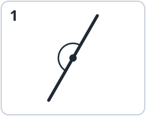
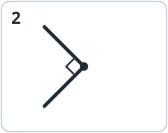
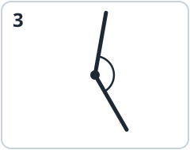
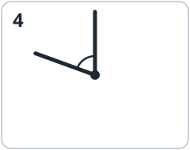

::: {.page-about name="Homework: practice and a home hunt" uses="homework after a lesson; practice that brings the family in; a preview of the next lesson" pieces="picture-answers, true-false, blank, side-by-side, work-space, recall"}
:::

Today you learned two new angles: the  and the . Show a family member your turning angle and teach them the names!

## 1. Sort the angles

Write **acute**, **right**, **obtuse** or **straight** under each angle.

::: {.picture-answers cols="4" height="30mm"}
-  1 | straight
-  2 | right
-  3 | obtuse
-  4 | acute
:::

## 2. True or false?

Write **T** (true) or **F** (false).

::: true-false
- A straight angle is just a line. It is not an angle. | F
- Longer sides make an angle bigger. | F
- An obtuse angle is smaller than a straight angle. | T
- 1 full angle = 4 right angles. | T
- At 6:00, the clock hands make a straight angle. | T
:::

## 3. How far does it turn?

The  starts at 12. What angle has it turned?

**a.** after 15 minutes:   **b.** after 30 minutes: 

**c.** after 60 minutes: 



## 4. Angle hunt at home

Find **two** straight angles and **one** full angle at home. Draw or write what you found.

::: side-by-side
::: {.work-space height="50mm" style="dots" label="Straight angle 1"}
:::
::: {.work-space height="50mm" style="dots" label="Straight angle 2"}
:::
::: {.work-space height="50mm" style="dots" label="Full angle"}
:::
:::

## 5. Challenge

**a.** How many right angles make 3 straight angles? 

**b.** Turn one side of a right angle until it makes a straight angle. How many more right angles did it turn? 

::: recall
- Tom says: "At 12:00 the clock hands make no angle." Lily says: "From 12:00 to 1:00, the minute hand turns a full angle." Who is right? Explain. | Both: at 12:00 the hands are together; in one hour the minute hand turns all the way round.
:::

## 6. Get ready for the next lesson

Next time we measure angles with a , in  (°). A right angle is **90°**. Can you guess?

**a.** A straight angle = 2 right angles =  °  **b.** A full angle = 4 right angles =  °
