::: {.page-about name="Worksheet: name, compare, draw" uses="a math lesson's main practice; naming shapes or angles from pictures; reading clocks" pieces="panel, picture-answers, blank, work-space, side-by-side"}
:::

Use the slides *Turning and Angles* and your turning angle to help you.

::: {.panel title="Word bank · 词库"}
**Parts:**  · 
**Kinds of angles:**  ·  ·  ·  · 
:::

## 1. Name the angle

Write the name of each angle. Find the vertex and the two sides first.

::: {.picture-answers cols="3" height="30mm"}
- 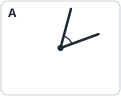 A | acute
- 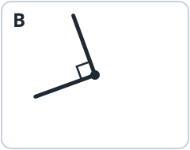 B | right
- 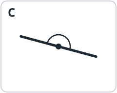 C | straight
- 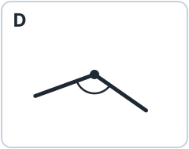 D | obtuse
- 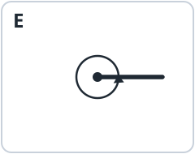 E | full
- 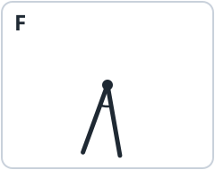 F | acute
:::

## 2. Fill in the blanks

**a.** 1 straight angle =  right angles.

**b.** 1 full angle =  straight angles =  right angles.

**c.** Write **<**, **>** or **=**: acute angle  right angle · obtuse angle  straight angle · 2 right angles  1 straight angle

## 3. Angles on a clock

What angle do the  and the  make? Write **acute**, **right**, **obtuse** or **straight**.

::: {.picture-answers cols="6" height="22mm"}
- 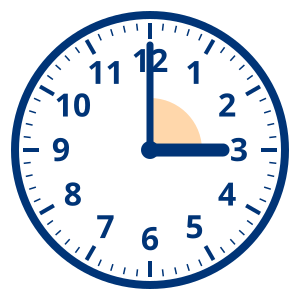 3:00 | right
- 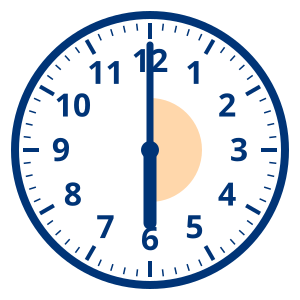 6:00 | straight
- 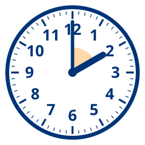 2:00 | acute
- 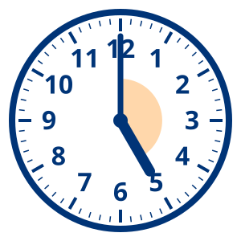 5:00 | obtuse
- 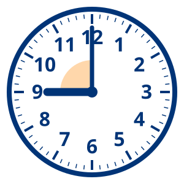 9:00 | right
- 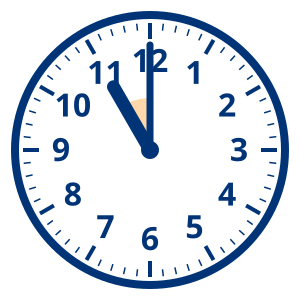 11:00 | acute
:::



## 4. Draw it

Draw each angle. Mark the  with a dot.

::: side-by-side
::: {.work-space height="42mm" style="dots" label="a. an acute angle"}
:::
::: {.work-space height="42mm" style="dots" label="b. a right angle"}
:::
:::

::: side-by-side
::: {.work-space height="42mm" style="dots" label="c. an obtuse angle"}
:::
::: {.work-space height="42mm" style="dots" label="d. a straight angle"}
:::
:::

## 5. In daily life

::: recall
- I see a straight angle when … | a book is opened flat; the clock shows 6:00.
- I see a full angle when … | the minute hand goes round once in an hour.
:::

::: {.content-visible when-profile="teacher"}
::: {.panel title="Look for"}
Students who call C "a line" or E "no angle": ask them to find the vertex and the two sides. In 4d, the dot must be *on* the line, with a side going each way.
:::
:::
