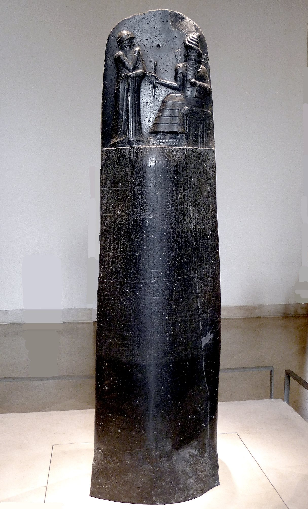
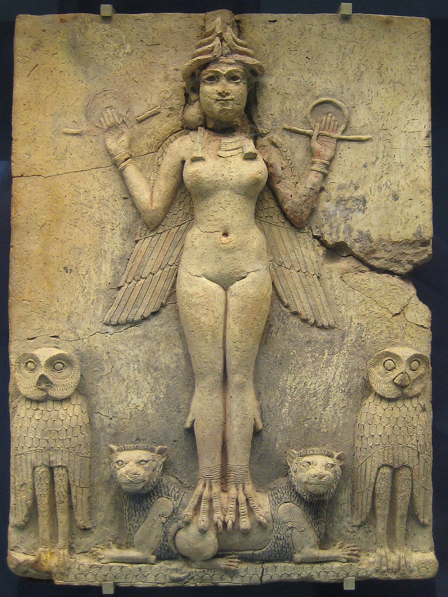

::: {.page-about name="Source dossier card" uses="one primary source per page: an artifact, painting, map, photo or document; museum and gallery studies; science specimens with labelled features" pieces="source-card"}
:::

::: {.subunit number="C.1" title="Sources"}
:::

::: spread
:::

::: {.source-card number="1" region="Babylon · 巴比伦" title="The Code of Hammurabi" title-zh="《汉谟拉比法典》石碑：太阳与正义之神沙马什" size="1215x2000" crop="400,30,850,590" markers="1: 760,175; 2: 612,330; 3: 545,150; 4: 650,505" whole="330,20,900,1960"}
{fig-alt="The Code of Hammurabi stele: the carving at the top"}

The top of the stele: King Hammurabi (left) stands before Shamash, the sun god (right).

::: glance
- What | a stele (stone slab)
- When | about 1754 BCE
- Made of | basalt
- Size | 2.25 m tall
- Found | Susa, Iran, 1901
- Now | Louvre, Paris
:::

::: look-closely
- Horned crown | 牛角冠 | Rows of horns show that a figure is a god. Shamash wears four. | 层层牛角代表神明身份。
- Rod and ring | 权杖与绳环 | Measuring tools: a builder's rod and rope. They stand for order, fairness and the right to rule. | 测量工具，象征秩序、公正与统治权。
- Hand to the mouth | 以手掩口 | Hammurabi's gesture shows respect and prayer, standing before a god. | 表示敬意与祈祷。
- Mountain pattern | 山形纹样 | The rows under Shamash's feet are mountains: the sun rises over them. | 脚下的纹样代表山峦，太阳从中升起。
:::

::: source-context
Hammurabi was king of Babylon. Near the end of his reign he had 282 laws carved on this stone and set up in public. Most people could not read cuneiform, the writing on the stone. But everyone could see the picture at the top. It shows the king getting the right to rule from Shamash, the god of the sun and of justice. The message was clear. The laws did not come from one man's opinion; they came from the gods.

汉谟拉比是巴比伦国王。他把282条法律刻在这块石碑上，立在公共场所。大多数人不识楔形文字，却都能看懂顶部的浮雕：国王从太阳与正义之神沙马什手中接受统治权。法律不是一个人的意见，而是来自神明。
:::

::: {.source-quote title="FROM THE PROLOGUE · 法典序言选段"}
… to bring about the rule of righteousness in the land, to destroy the wicked and the evil-doers; so that the strong should not harm the weak.

……使正义之治行于大地，消灭恶人与作恶者，使强者不欺凌弱者。
:::

::: source-cite
*Stele of the Code of Hammurabi.* c. 1754 BCE, basalt, 225 cm. Musée du Louvre, Paris, Sb 8.

Mbzt, CC BY 3.0, via Wikimedia Commons. Translation: L. W. King, 1910.
:::
:::



::: {.source-card number="2" region="Southern Mesopotamia · 美索不达米亚南部" title="The Burney Relief (Queen of the Night)" title-zh="伯尼浮雕（夜之女王）" size="1280x1703" crop="230,0,1050,440 / 0,1020,1280,1703" markers="1: 470,70; 2: 960,120 / 3: 620,1460; 4: 900,1330; 5: 1130,1150"}
{fig-alt="The Burney Relief: a winged goddess standing on two lions, with two owls"}

Two details of the : look up (the crown and hands), then look down (the feet, the lions and the owls).

::: glance
- What | a clay plaque
- When | about 1750 BCE
- Made of | fired clay
- Size | 50 × 37 cm
- Found | southern Iraq
- Now | British Museum
:::

::: look-closely
- Horned crown | 牛角冠 | Four rows of horns: she is a goddess, and a powerful one. | 四层牛角：一位强大的女神。
- Rod and ring | 权杖与绳环 | The same symbol Shamash holds on Source 1. What could it mean here? | 与史料一中沙马什手持的相同。
- Bird's talons | 鸟爪 | Her feet are a bird's claws, and she has wings: part human, part bird of prey. | 鸟爪与双翼：半人半猛禽。
- Lions | 雄狮 | She stands on two lions, the strongest animals people knew. | 脚踏两头雄狮。
- Owls | 猫头鹰 | Owls hunt at night. Many think this links her to night or the underworld. | 猫头鹰夜间捕猎，或与夜晚、冥界有关。
:::

::: source-context
This plaque was made of clay and baked hard, and it was once painted: traces of red and black paint survive. Nobody knows exactly where it was found, and there is no writing on it, so historians have to read the picture itself. The wings, talons, owls and lions all point to great power, perhaps over the night or the world of the dead.

这块浮雕由黏土烧制而成，原本涂有颜色，至今仍可见红色和黑色的痕迹。它的出土地点不明，上面也没有文字，所以历史学家只能“读”图像本身。
:::

::: {.panel title="Historians disagree · 史学家的分歧"}
Who is she? Three ideas: **Ishtar** (Inanna), goddess of love and war; **Ereshkigal**, queen of the underworld; or **Lilitu**, a demon of the night. Which markers support each idea?
:::

::: source-cite
*The Queen of the Night (Burney Relief).* c. 1750 BCE, fired clay, 49.5 × 37 cm. British Museum, London, 2003,0718.1.

British Museum, CC0, via Wikimedia Commons.
:::
:::
