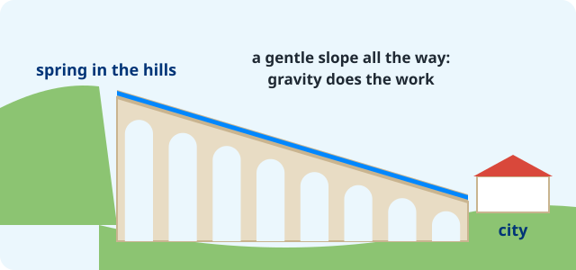

::: {.page-about name="Design challenge" uses="engineering and design tasks; a checklist, then a big sketch, then explain; science investigations" pieces="panel, work-space, recall"}
:::

A town is 10 km from a spring in the hills. Design an  that brings the water to the town, **with no pumps**: only gravity.

::: side-by-side
{fig-alt="An aqueduct bridge carrying water on a gentle downhill slope"}

::: {.panel title="Your design must have"}
☐ a channel that goes **downhill the whole way**, gently
☐ **arches** where the land dips (a valley)
☐ a **tunnel** where a hill is in the way
☐ a **cover**, to keep the water clean
:::
:::

## Sketch your aqueduct

Draw the spring, the town, and your aqueduct between them. Label: **spring**, **channel**, **arches**, **town**, and the **slope**.

::: {.work-space height="fill" style="grid" label="Side view: the spring on the left, the town on the right"}
:::



## Explain

::: {.recall lines="3"}
- Why must the channel slope down *gently*, not steeply? | Too steep and the water rushes, wears the channel away and can overflow.
- Why did Romans build arches, not a solid wall, across a valley? Think: stone, weight, rain. | Arches use less stone, are lighter, and let rivers, rain and people pass under.
- Name one thing a Roman city used aqueduct water for. | Public baths, fountains, toilets, homes, farms or mills.
:::

::: {.work-space height="fill" style="lines" label="Improve it: what would you change in your design, and why?"}
:::
