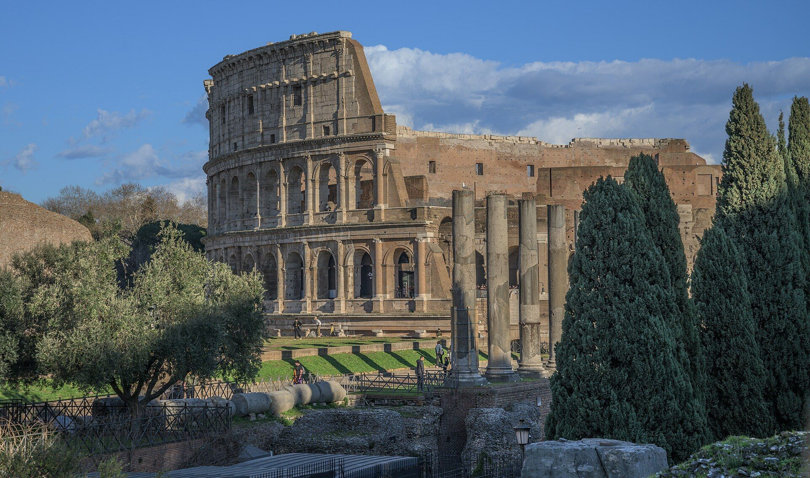

::: {.page-about name="KWL, then a reading with a questions box" uses="before and after a reading; a one-page reading with comprehension questions; a news article; a case study" pieces="subunit, kwl, reading-page"}
:::

::: {.subunit number="B.3" title="Buildings"}
:::

::: {.kwl title="Before you read: KWL" topic="The Colosseum" k-example="It is in Rome." w-example="How many people could sit inside?" l-example="Up to 50,000 people."}
:::



## The Colosseum

Read the text. Then answer the questions in the box.

::: {.reading-page numbered="true"}
In the middle of Rome stands a giant stone oval. It is the Colosseum, the largest arena the Romans ever built. Work began in AD 72 under the emperor Vespasian, and it opened eight years later, in AD 80. Up to 50,000 people could sit inside, more than in many football stadiums today.

The Colosseum is built from stone, brick and concrete. Concrete was one of the Romans' great inventions: a mix of lime, volcanic ash, water and small stones that set as hard as rock. It let builders make thick walls and curved shapes quickly. The outside wall has four levels. The first three have rows of arches, and each row uses a different style of column.

Getting 50,000 people in and out was a puzzle. The builders solved it with 80 entrances, each with a number painted above it. A ticket showed your entrance, your section and your row. Wide stairs and corridors led to every seat, so the arena could empty in a few minutes.

On hot days, sailors pulled a huge cloth roof, the *velarium*, over the seats to make shade. Under the floor was a world of tunnels, rooms and lifts, where animals and fighters waited before they appeared in the arena.

The arena floor was made of wood covered with sand. The Latin word for sand is *harena*, and that is where our word "arena" comes from. Trapdoors in the floor let animals and scenery appear as if by magic, lifted up from the rooms below by ropes and wooden lifts.

The shows were often cruel: gladiators fought, and wild animals were hunted. Today we study the Colosseum for what it tells us about Roman life and Roman engineering. Earthquakes and stone robbers took away almost half of it, but what is left still shows how well it was planned.

::: beside
{width="100%" height="62mm"}

::: {.panel title="Words"}
**arena** a space for shows · **concrete** a mix that sets as hard as rock · **velarium** a cloth roof
:::
:::

- When did the Colosseum open?
- What is concrete made of?
- How did people find their seats?
- Why do you think the Romans needed so many entrances?
:::
