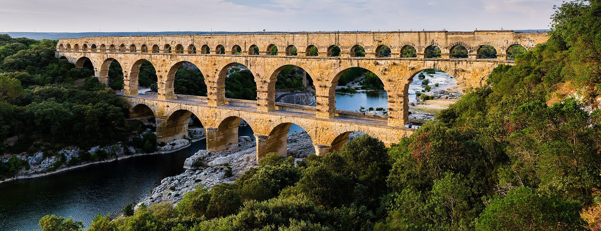
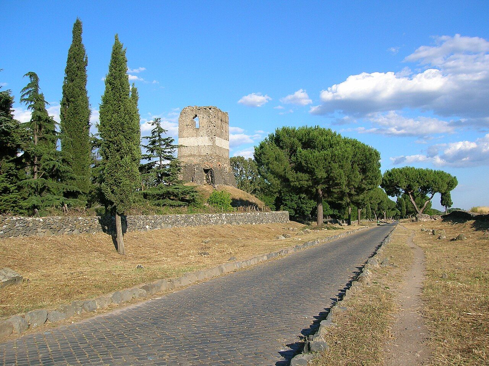
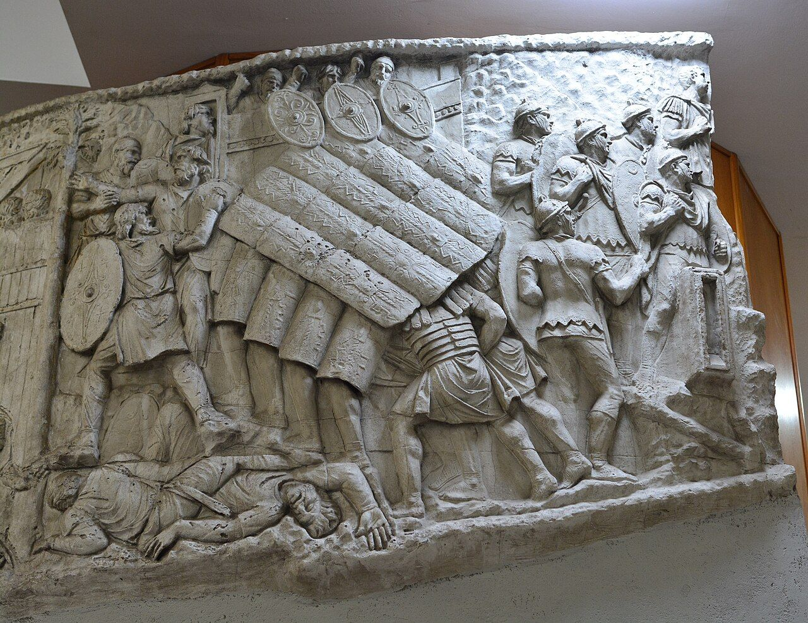

::: {.page-about name="Magazine feature spread" uses="an exciting opener for a topic; a long reading with photos; a reading with reflection questions across the spread; an article in the style of a magazine" pieces="feature-spread, lead-in, col-picture, pull-quote, reflect"}
:::

::: {.feature-spread title="Water for a city" kicker="Feature · Roman engineering" badge="?"}
{fig-alt="The Pont du Gard, a Roman aqueduct bridge with three rows of arches, over a river"}

::: standfirst
How did a million people in ancient Rome get clean water every day, with no pumps and no electricity? The answer is still standing in the hills of Europe.
:::

::: credit
Photos: Pont du Gard, Benh LIEU SONG, CC BY-SA 3.0; Via Appia and Trajan's Column, public domain; all Wikimedia Commons.
:::

::: {.reflect side="left" title="Reflect · 想一想"}
- What surprised you most about the aqueducts?
- Why did the builders need to know about gravity?
:::

::: {.reflect side="right"}
- What does your city do to bring you clean water today?
- If you were a Roman engineer, what problem would you want to solve next?
:::

[Imagine a city]{.lead-in} with no taps, no pipes under the street and no water trucks. Every drop for drinking, cooking and washing has to be carried from a river or a well. That was life in many towns two thousand years ago. Rome was different. By the first century AD, about a million people lived there. Water flowed into the city day and night. It filled fountains on the street corners, public baths and the houses of the rich.

The water came through . The first one, the Aqua Appia, was built in 312 BC by Appius Claudius. He also built the famous road, the Via Appia. Over the next five hundred years, Rome built ten more. Together they brought in more water for each person than many cities use today.

{.col-picture height="42mm"}

An aqueduct is simple in one way: it is a channel that carries water downhill. But making the water flow the right way for fifty or even ninety kilometres was very hard. The channel could not go uphill, not even a little, or the water would stop. If it went down too steeply, the water would rush and wear the stone away. So the engineers planned a slope so gentle that you could not see it with your eyes. Over one kilometre, the channel might drop by only the height of a hand.

::: pull-quote
No pumps, no motors: just stone, a careful slope and gravity.
:::

To measure such a tiny slope, Roman surveyors used a tool called the *chorobates*. It was a long wooden table with a groove of water on top. When the water lay flat in the groove, the table was level. From there they could mark how far each next section should drop. They walked the whole route from the spring to the city, measuring and marking, before anyone started to dig.

Most of an aqueduct was not a bridge at all. It ran under the ground, in a covered channel that kept the water clean and cool and safe from enemies. Workers could climb down through holes along the way to clean out the mud. Only where the land dropped away, across a valley or a river, did the channel rise up onto arches.

{.col-picture height="46mm"}

The most famous of these bridges is the Pont du Gard in the south of France. It is almost fifty metres high, with three rows of arches, one on top of another. The stones on the outside were cut so well that the builders did not need mortar to hold them together. Each arch carries the weight sideways and down into the pillars, and the pillars carry it into the ground.

When the water reached the city, it went into a big tank called a *castellum*. From there, pipes carried it to three places. First it went to the public fountains, then to the baths, and last to private homes, which paid for it. In a dry summer, the homes were the first to lose their water, and the fountains the last. Everyone, rich or poor, could fill a jar at a fountain.

Keeping all this working took a small army of people. In AD 97 a man named Frontinus was put in charge of Rome's water. He found leaks, illegal pipes and channels full of stones and roots, and he wrote a book about how to fix them. It is one of the first books ever written about running a city.

Some Roman aqueducts still carry water today. Others stand empty in fields and valleys, and visitors walk under their arches and look up. They remind us of something. The most important thing a city builds is sometimes the thing nobody sees: the water that arrives every day.
:::
