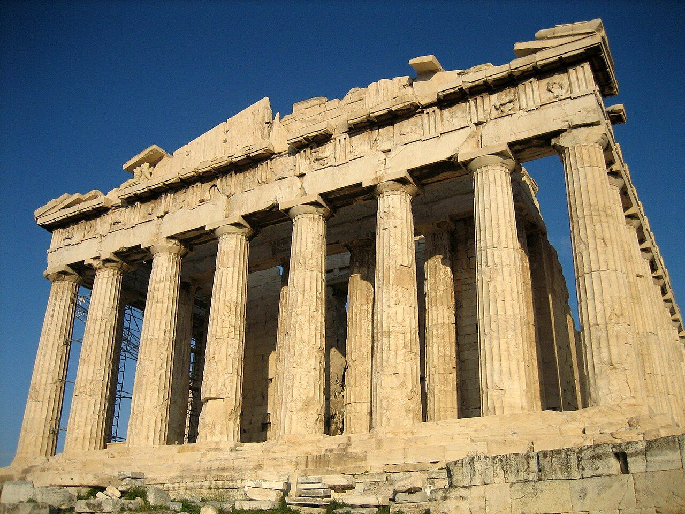
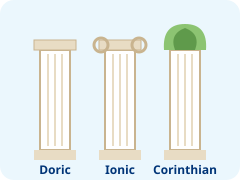
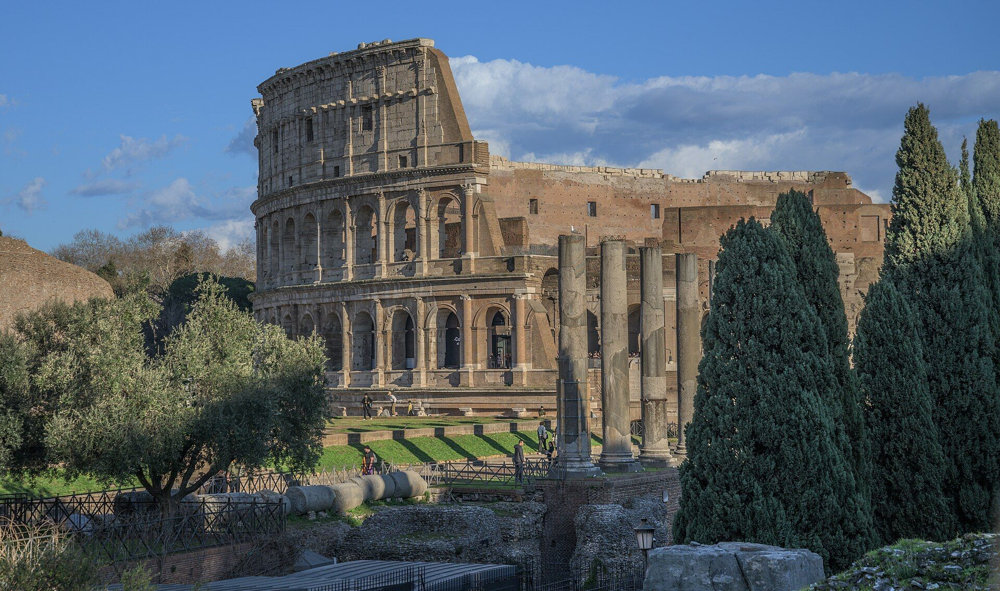

::: {.page-about name="Picture column" uses="a reading with pictures to look at: buildings, people, objects; a short article with photos down the side; a source page: the pictures, then the text about them" pieces="picture-column, recall"}
:::

The Romans learned a lot from the Greeks. Look at the pictures while you read.

::: {.picture-column title="What Rome took from Greece" height="40mm"}

The Greeks built beautiful stone buildings. The most famous is the Parthenon, a  for the goddess Athena. Its roof stands on tall stone posts. Each post is a .

The Romans liked Greek buildings. They copied the columns for their own temples, houses and public buildings.

But the Romans also had new ideas. They used **arches** and **concrete**. Arches can hold up a lot of weight, and concrete is strong and cheap. So Roman buildings could be much bigger.

The  shows both ideas. Its walls are made of arches, one row on top of another. Between the arches, there are Greek columns.

- **From Greece:** columns, temples, theatres
- **New in Rome:** arches, concrete, huge buildings
:::

## Think about it

::: {.recall lines="2"}
- What did the Romans copy from the Greeks? | Columns (and temples and theatres).
- Why could Roman buildings be bigger? | They used arches and concrete, which are strong.
:::
