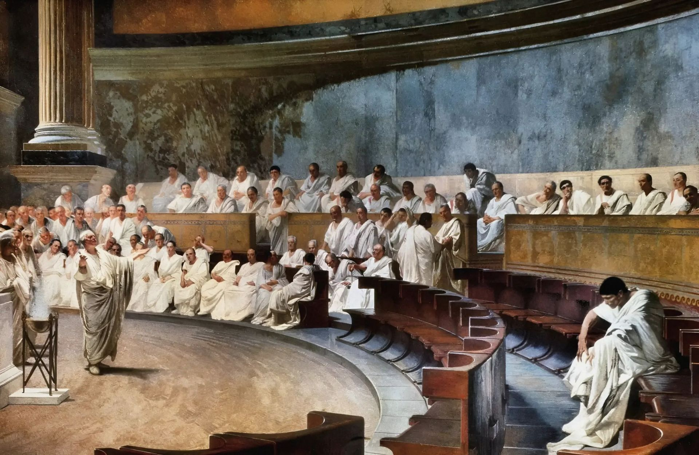
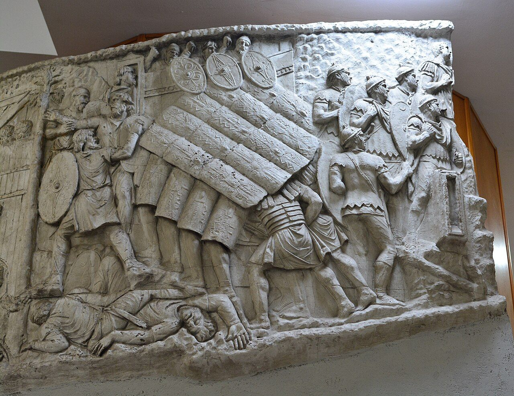
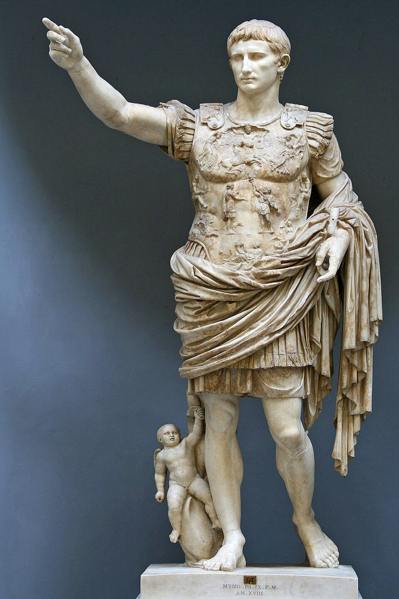

::: {.page-about name="Picture steps" uses="a sequence in history: how something grew or changed, one step at a time; a process: how something works, a picture for each step; instructions: how to make something" pieces="picture-steps, recall"}
:::

Rome started as one small city. Here is how it grew into an , step by step.

::: {.picture-steps height="31mm"}
-  | A republic (509 BC) | The Romans sent away their last king. Now citizens chose their leaders. The  gave advice.
-  | Roads across Italy (312 BC) | Rome built long, straight roads like the Via Appia. Soldiers and traders could move fast.
-  | An army that won | The legions won land all around the Mediterranean Sea. Each new land paid taxes to Rome.
-  | Water for the cities | Cities grew big. Aqueducts like the Pont du Gard brought them clean water from the hills.
-  | The first emperor (27 BC) | Augustus became the first . Now one man ruled the whole empire.
:::

::: {.recall lines="2"}
- Which step do you think helped Rome most? Why? | The roads, because soldiers and food could move quickly.
:::
