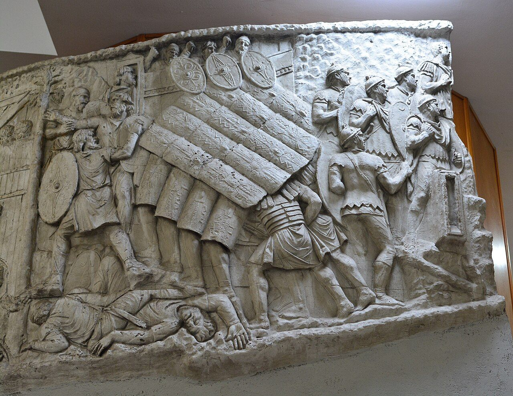

::: {.page-about name="Mixed page: text, pictures and tables" uses="an information handout: short sections, each with a picture or a table; facts and numbers to keep, in tables; a topic introduced with photos, then questions" pieces="side-by-side (widths), pictures in a row (layout-ncol), Markdown tables, panel, recall, work-space"}
:::

Rome's army was the best in the ancient world. It won the land for the , and then it built the roads to hold it together.

## Who were the soldiers?

::: {.side-by-side widths="3, 2"}
::: {}
The army was made of big groups. Each group was a , about 5,000 soldiers.

- Soldiers were Roman citizens.
- They joined for 25 years.
- They trained every day: marching, swimming and fighting.
- At the end, they got land or money.
:::

{width="100%" height="48mm"}
:::

## How the army was organised

| Group | How many soldiers | Led by |
|---|---|---|
| a tent group | 8 | the oldest soldier |
| a century | 80 | a centurion |
| a cohort | 480 | the senior centurion |
| a legion | about 5,000 | a legate |

## What a soldier carried

| Thing | What it was for |
|---|---|
| a helmet and armour | to protect his head and body |
| a big shield | to make a wall with other shields |
| two spears and a short sword | to fight |
| a pot, food and a spade | to cook, and to dig a camp every night |

::: {.panel title="Did you know?"}
Soldiers carried about 30 kilograms on their backs. People called them "Marius's mules".
:::

## Soldiers who built

When there was no war, soldiers built roads, bridges and aqueducts.

::: {layout-ncol=2}
{width="100%" height="42mm"}

{width="100%" height="42mm"}
:::

## Check

::: {.recall lines="2"}
- How many soldiers were in a century? | 80 soldiers.
- Why did soldiers carry a spade? | To dig a camp every night (and to build roads).
:::

## Draw it

Draw a Roman soldier with the things he carried. Label three of them.

::: {.work-space height="fill" style="blank" label="A Roman soldier"}
:::
