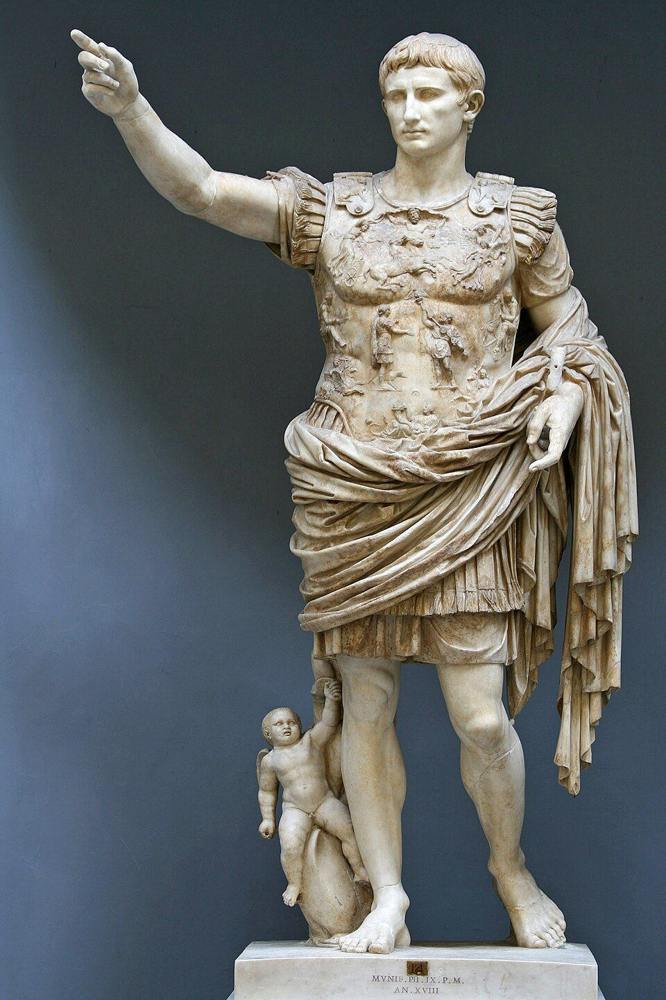
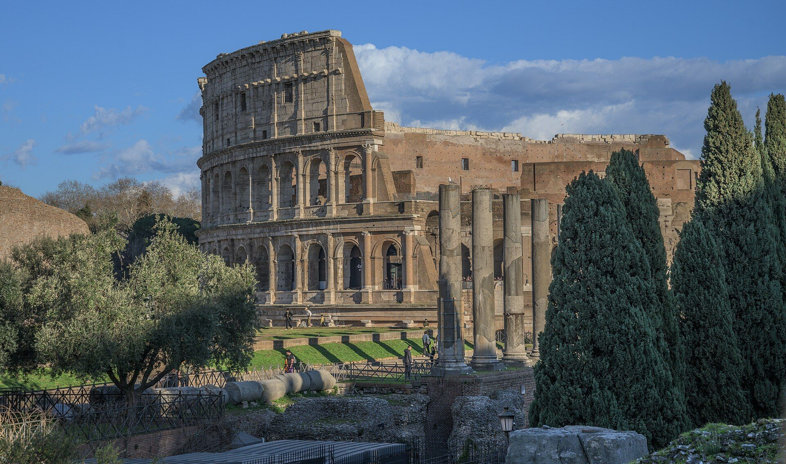

::: {.page-about name="Timeline across a spread" uses="placing events on a long timeline; a person's life; geological or historical eras; a number line" pieces="spread, event-cards, timeline, recall, work-space"}
:::

::: spread
:::

Write each event's letter above the right place on the line. The line runs across both pages.

::: {.event-cards cols="3" height="96mm"}
- A | Rome is founded (the story says by Romulus).
- B | Rome becomes a . No more kings.
- C | The Via Appia, the first great Roman road, is built. | 
- D | Julius Caesar is killed in the Senate.
- E | Augustus becomes the first . | 
- F | The Colosseum opens. | 
:::

::: {.timeline from="-800" to="-150" first="true" height="110mm"}
:::



## Use the timeline

The dates you need: 753 BC, 509 BC, 312 BC, 44 BC, 27 BC, AD 80.

::: {.recall lines="1"}
- How many years passed between A and B? | 244 years (753 − 509).
- Which came first, the Via Appia or Augustus? How do you know? | The Via Appia: 312 BC is before 27 BC.
- How old was the Via Appia when the Colosseum opened? | 391 years (312 + 80 − 1).
:::

::: {.work-space height="45mm" style="grid" label="Work it out"}
:::

::: {.timeline from="-150" to="500" first="false" height="110mm"}
:::
