# [How this deck works | 这套幻灯片怎么用]{.bi} {#how data-menu-title="How this deck works"}

:::: {.columns}
::: {.column width="55%" style="font-size: 0.62em"}
::: {.box .plain}
[Across → | 横向 →]{.kicker}

[The seven phases of a lesson, in their usual order. The top row is a complete lesson. | 一节课的七个环节，按常见顺序排列。最上面一行就是一节完整的课。]{.bi}
:::

::: {.box .plain}
[Down ↓ | 纵向 ↓]{.kicker}

[Other ways to run each phase. The speaker notes (**S**) say when to choose each one. | 每个环节的其他做法。演讲者备注（按 **S**）说明什么时候选用。]{.bi}
:::

::: {.box .plain}
[Your choice | 由你决定]{.kicker}

[Repeat, mix or skip phases. A work day or a review day can look very different. | 环节可以重复、组合或省略。练习课和复习课的结构可以完全不同。]{.bi}
:::
:::
::: {.column width="45%"}
::: {.tiles style="--cols: 1; --gap: 0.2em; font-size: 0.5em"}
::: {.box .plain}
::: row
[1]{.num}

[Lesson intro | 课堂导入]{.bi}
:::
:::

::: {.box .plain}
::: row
[2]{.num}

[Building background | 背景知识]{.bi}
:::
:::

::: {.box .plain}
::: row
[3]{.num}

[Input | 新知输入]{.bi}
:::
:::

::: {.box .plain}
::: row
[4]{.num}

[Strategies | 学习策略]{.bi}
:::
:::

::: {.box .plain}
::: row
[5]{.num}

[Interaction | 互动交流]{.bi}
:::
:::

::: {.box .plain}
::: row
[6]{.num}

[Practice and application | 练习与运用]{.bi}
:::
:::

::: {.box .plain}
::: row
[7]{.num}

[Review and assessment | 复习与评价]{.bi}
:::
:::
:::
:::
::::

::: footer
[How this deck works]{.phase}
:::

::: notes
**For teachers, not for class.** This deck is one lesson on angles (Grade 4 math), built to show a solid SIOP lesson and the choices around it. Press **→** to move through the lesson, **↓** to see options for the phase you're in, and **Esc** for an overview of the whole grid.

Every slide's footer names its phase. Every option's notes start with **When to choose it**, then **SIOP** (which features it serves) and **Pieces** (what it's made of, so you can copy it).

The content is only an example: copy a slide into your own deck and change its words. Pictures and videos still to find are shown as dashed placeholders that say what should go there.
:::

# {#intro data-menu-title="1 · Lesson intro: intro + Do now"}

:::: {.columns style="height: 590px; font-size: 0.72em"}
::: {.column width="57%"}
::: {.area .content label="Content objective · 内容目标"}
::: lesson-info
| | |
|--:|:--|
| [Math \| 数学]{.bi} | [Grade 4 · [today]{.today} \| 四年级 · [今天]{.today}]{.bi} |
| [Topic \| 课题]{.bi} | [Turning and angles \| 旋转与角]{.bi} |
| [Objective \| 学习目标]{.bi} | [I can name five kinds of angle. \| 我能说出五种角的名称。]{.bi} |
| [Homework \| 作业]{.bi} | [Angle hunt at home \| 在家找角]{.bi} |

: {tbl-colwidths="[25,75]"}
:::
:::

::: {.area .language label="Language objective · 语言目标"}
[Vocab · 词汇]{.pill .tag}

::: {style="font-size: 0.5em"}

:::

[Sentence frames · 句型]{.pill .tag}

[A [ ]{.gap} angle is [ ]{.gap} than a right angle. | [ ]{.gap}比直角[ ]{.gap}。]{.bi .frame}
:::
:::
::: {.column width="43%"}
::: {.area .donow label="Do now · 课前任务"}
1. [Find two corners in the room. | 在教室里找两个角。]{.bi}
2. [Draw them in your book. | 把它们画在本子上。]{.bi}
3. [Which one is bigger? | 哪个更大？]{.bi}

::: {.end style="align-self: center; font-size: 0.48em"}

:::
:::
:::
::::

```{=html}
<script>
  // Today's date: "4 November" in English, "11月4日" in 中文 (the visitor's own clock)
  document.querySelectorAll("#intro .today").forEach(function (el) {
    var d = new Date();
    el.textContent = el.closest(".bil-zh") ? (d.getMonth() + 1) + "月" + d.getDate() + "日"
      : d.toLocaleDateString("en-GB", { day: "numeric", month: "long" });
  });
</script>
```

::: footer
[1 · Lesson intro · 课堂导入]{.phase} · default
:::

::: notes
**The default.** One slide for the start of every lesson: students start the Do now while the teacher takes the register, and observers find both objectives at once.

**SIOP:** features 1–2 (content and language objectives, clearly defined and displayed). The objectives come back at the end (column 7).

**Pieces:** the Slide kit's lesson intro: two labelled `.area`s (content, language), a `.lesson-info` table, ``, a frame with `[ ]{.gap}`, and a Do now `.area` with ``. The vocab gallery shows this sample's words; in your course, use your unit's words.
:::

## [Today we will… | 今天我们要…]{.bi} {#intro-objectives data-menu-title="1 · One at a time: objectives"}

::: {.tiles style="--cols: 1"}
::: {.box .plain}
[Content objective · 内容目标]{.kicker}

[I can name five kinds of angle. | 我能说出五种角的名称。]{.bi .lead}
:::

::: {.box .plain}
[Language objective · 语言目标]{.kicker}

[I can compare two angles with *bigger than* and *smaller than*. | 我能用 *bigger than* 和 *smaller than* 比较两个角。]{.bi .lead}
:::
:::

::: footer
[1 · Lesson intro · 课堂导入]{.phase} · option: one thing at a time (1 of 3)
:::

::: notes
**When to choose it:** the teacher or the class prefers less on each slide, younger students, or a class that needs each part read aloud and unpacked. The three slides here (objectives, words, Do now) hold the same parts as the default, one at a time.

**SIOP:** features 1–2. Read each objective aloud; students repeat the language objective.

**Pieces:** `.tiles` with one column (`--cols: 1`), two `.box .plain` with a `.kicker` and `.lead` text.
:::

## [Today's words | 今天的词语]{.bi} {#intro-words data-menu-title="1 · One at a time: words"}



::: footer
[1 · Lesson intro · 课堂导入]{.phase} · option: one thing at a time (2 of 3)
:::

::: notes
**When to choose it:** with the slide before and after. Click a word for its full card: picture, 中文, and buttons that read it aloud.

**Pieces:** `` alone on the slide: the cards grow to fill it.
:::

## [Do now | 课前任务]{.bi} {#intro-donow data-menu-title="1 · One at a time: Do now"}

:::: {.columns}
::: {.column width="60%"}
1. [Find two corners in the room. | 在教室里找两个角。]{.bi}
2. [Draw them in your book. | 把它们画在本子上。]{.bi}
3. [Which one is bigger? | 哪个更大？]{.bi}
:::
::: {.column width="40%"}
::: {.box .dark style="align-items: center"}
[Timer · 计时]{.kicker}


:::
:::
::::

::: footer
[1 · Lesson intro · 课堂导入]{.phase} · option: one thing at a time (3 of 3)
:::

::: notes
**Pieces:** a numbered list and a `.box .dark` with ``.
:::

## [I can… | 我能…]{.bi} {#intro-ican data-menu-title="1 · Objectives only"}

::: {.cover style="height: auto; padding: 0.4em 0"}
[I can name five kinds of angle. | 我能说出五种角的名称。]{.bi .big}
:::

::: {.box .plain}
[And I can say it | 我还能说出来]{.kicker}

[A straight angle is bigger than a right angle. | 平角比直角大。]{.bi .lead}
:::

::: footer
[1 · Lesson intro · 课堂导入]{.phase} · option: objectives only
:::

::: notes
**When to choose it:** the objectives need unpacking before any task, for example the first lesson of a unit or a new kind of objective. Read it aloud, point to each word, and have students say the model sentence.

**SIOP:** features 1–2: the objectives are stated in student-friendly "I can" words, and the language objective is a sentence students can say.

**Pieces:** `.cover` with `.big` text, and a `.box .plain` with a `.kicker` and `.lead` text.
:::

## [What do you notice? | 你注意到了什么？]{.bi} {#intro-picture data-menu-title="1 · Do now: picture prompt"}

:::: {.columns}
::: {.column width="45%"}
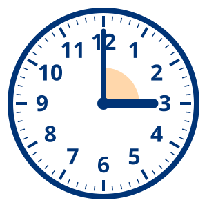{fig-alt="A clock at 3:00" style="max-height: 460px"}
:::
::: {.column width="55%"}
::: {.box .plain}
[Look · 观察]{.kicker}

[What do the two hands make? | 两根指针组成了什么？]{.bi .lead}

[The hands make a [ ]{.gap}. | 两根指针组成了一个[ ]{.gap}。]{.bi .frame}
:::


:::
::::

::: footer
[1 · Lesson intro · 课堂导入]{.phase} · option: Do now as a picture prompt
:::

::: notes
**When to choose it:** starting a new topic, or a class with newcomers who have little English: everyone can look and point, and the frame gives them words.

**SIOP:** features 7–8 (links to what students already know), and it starts the lesson's language.

**Pieces:** `.columns`, a picture, a `.box` with a question and a frame, ``.
:::

## [Quick review | 快速复习]{.bi} {#intro-review data-menu-title="1 · Do now: quick review"}

:::: {.columns}
::: {.column width="62%"}
1. What do we call a square corner?
2. Draw a right angle.
3. Name one thing in the room with a right angle.
4. Is a book's corner bigger or smaller than a right angle?
:::
::: {.column width="38%"}
::: {.box .dark style="align-items: center"}
[Timer · 计时]{.kicker}


:::
:::
::::

::: footer
[1 · Lesson intro · 课堂导入]{.phase} · option: Do now as a quick review
:::

::: notes
**When to choose it:** the lesson builds directly on the last one. Retrieval at the start helps students remember, and shows the teacher what to reteach.

**SIOP:** feature 8 (links between past learning and new). English only: it's review.

**Pieces:** a numbered list and a `.box .dark` timer.
:::

## [Today's lesson | 今天的课]{.bi} {#intro-agenda data-menu-title="1 · Agenda"}

::: {.chain style="font-size: 0.62em"}
::: {.box .plain style="text-align: center"}
[1 · Do now | 课前任务]{.bi}
:::

::: {.box .plain style="text-align: center"}
[2 · New words | 新词]{.bi}
:::

::: {.box style="text-align: center"}
[3 · Learn | 学习]{.bi}
:::

::: {.box .plain style="text-align: center"}
[4 · Talk | 交流]{.bi}
:::

::: {.box .plain style="text-align: center"}
[5 · Practice | 练习]{.bi}
:::

::: {.box .plain style="text-align: center"}
[6 · Exit ticket | 出门条]{.bi}
:::
:::

::: footer
[1 · Lesson intro · 课堂导入]{.phase} · option: agenda
:::

::: notes
**When to choose it:** longer lessons, or classes that need to see the plan. Show it again between phases: move the filled box (the one without `.plain`) to the phase you're in.

**SIOP:** features 23–26 (lesson delivery: pacing, students know what comes next).

**Pieces:** `.chain` (boxes with arrows between them); the current phase is a `.box` without `.plain`.
:::

# [New words | 新词]{.bi} {#background data-menu-title="2 · Key vocab, pre-taught"}

:::: {.columns}
::: {.column width="64%"}

:::
::: {.column width="36%"}
::: {.steps .stack}
1. [**Look** at the picture. | **看**图片。]{.bi}
2. [**Listen** to the word. | **听**单词。]{.bi}
3. [**Say** it twice. | **说**两遍。]{.bi}
4. [**Use** it in a sentence. | 用它**说**一句话。]{.bi}
:::
:::
::::

::: footer
[2 · Building background · 背景知识]{.phase} · default
:::

::: notes
**The default.** Pre-teach 4–6 key words before the content, so students meet them again in the input instead of all at once. Click each word: its card has the picture, 中文 and a read-aloud button. Students say each word, then use it in a sentence with a partner.

**SIOP:** feature 9 (key vocabulary emphasized: introduced, written, repeated, highlighted).

**Pieces:** `` in `.columns`, and Chalkline's `.steps` for the routine.
:::

## {#background-hook data-menu-title="2 · Interest hook" background-color="#14213D"}

[Hook · 导入]{.pill .absolute top=10 left=0}

::: {.cover .media}
::: placeholder
[Picture or 1-minute video: something that turns (a door, a fan, a clock, a dancer) | 图片或一分钟视频：会转动的东西（门、扇子、钟、舞者）]{.bi}
:::

::: {.box .plain}
::: row
[Think · 思考]{.kicker}

[What is turning? How far does it turn? | 什么在转动？转了多远？]{.bi .lead}
:::
:::
:::

::: footer
[2 · Building background · 背景知识]{.phase} · option: interest hook
:::

::: notes
**When to choose it:** a new topic, or a class that needs a reason to care first. A hero picture, a 1-minute video or one big question, then straight on to the words. Keep it short: it opens the lesson, it isn't the lesson.

**SIOP:** feature 7 (concepts linked to students' background experiences).

**Pieces:** the Slide kit's media slide: `.cover .media`, a picture or `` (here a placeholder), and a `.box` with the question. Swap the placeholder for `` and credit it.
:::

## [Where do things turn? | 生活中什么东西会转动？]{.bi} {#background-life data-menu-title="2 · Connect to your life"}

:::: {.columns}
::: {.column width="50%"}
::: {.tiles style="--cols: 2"}
::: placeholder
[Picture: a door opening]
:::

::: placeholder
[Picture: a folding fan]
:::

::: placeholder
[Picture: scissors]
:::

::: placeholder
[Picture: a clock]
:::
:::
:::
::: {.column width="50%"}
::: {.box .plain}
[Talk · 说一说]{.kicker}

[What turns in your home? | 你家里有什么会转动？]{.bi .lead}

[In my home, the [ ]{.gap} turns. | 在我家，[ ]{.gap}会转动。]{.bi .frame}
:::
:::
::::

::: footer
[2 · Building background · 背景知识]{.phase} · option: connect to your life
:::

::: notes
**When to choose it:** the topic feels far from students' lives. One question that links it to their own experience, with a frame so everyone can answer.

**SIOP:** feature 7 (links to background experiences).

**Pieces:** `.tiles` of pictures (here placeholders), a `.box` with a question and a frame.
:::

## [Last lesson: the right angle | 上节课：直角]{.bi} {#background-before data-menu-title="2 · What we learned before"}

:::: {.columns}
::: {.column width="40%"}
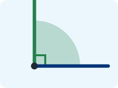{fig-alt="A right angle, with a small square in its corner" style="max-height: 360px"}
:::
::: {.column width="60%"}
- A right angle is a **square corner**.
- We found right angles in books, doors and windows.
- **Today:** angles bigger and smaller than a right angle.
:::
::::

::: footer
[2 · Building background · 背景知识]{.phase} · option: what we learned before
:::

::: notes
**When to choose it:** continuing a unit. One picture and three lines that link the last lesson to today. The last line says what's new.

**SIOP:** feature 8 (links between past learning and new concepts).

**Pieces:** `.columns`, a picture and a short list.
:::

## [Language focus: comparing | 语言重点：比较]{.bi} {#background-language data-menu-title="2 · Language point"}

::: {.tiles style="--cols: 1; --gap: 0.3em"}
::: {.box .plain}
::: row
[bigger than | 比…大]{.bi .pill}

[A straight angle is **bigger than** a right angle. | 平角**比**直角**大**。]{.bi}
:::
:::

::: {.box .plain}
::: row
[smaller than | 比…小]{.bi .pill}

[An acute angle is **smaller than** a right angle. | 锐角**比**直角**小**。]{.bi}
:::
:::

::: {.box .plain}
::: row
[the same as | 和…一样]{.bi .pill}

[Two right angles are **the same as** one straight angle. | 两个直角**和**一个平角**一样大**。]{.bi}
:::
:::
:::

::: footer
[2 · Building background · 背景知识]{.phase} · option: language point
:::

::: notes
**When to choose it:** the language objective is a form or a function (here: comparing), not only words. Teach it before the content, so students can use it while they learn. Say each example; students repeat it, then make their own.

**SIOP:** feature 9, and features 2 and 24 (the language objective, taught and supported).

**Pieces:** `.tiles` with one column; each `.box .plain` a `.row` with a `.pill` and an example sentence.
:::

## Shape words or turning words? {#background-sort data-menu-title="2 · Word sort"}

::: {.sort}
- **Shape words**
  - angle | An angle is a shape: two sides that meet.
  - vertex | The vertex is the point where the sides meet.
  - side | A side is one of the two lines of an angle.
- **Turning words**
  - rotate | To rotate is to turn around a point.
  - full turn | A full turn goes all the way around.
  - clockwise | Clockwise means turning the way a clock's hands go.
:::

::: footer
[2 · Building background · 背景知识]{.phase} · option: word sort
:::

::: notes
**When to choose it:** students already know some of the words. Sorting first shows what they know, and gets them thinking about meaning before you teach. English only: it's practice.

**SIOP:** features 8–9.

**Pieces:** `::: {.sort}`: each group a **bold** line, its items under it, a reason after the `|`.
:::

# [An angle | 角]{.bi} {#input data-menu-title="3 · One idea + picture"}

:::: {.columns}
::: {.column width="45%"}
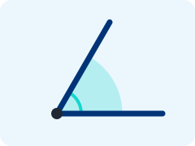{fig-alt="An angle: two sides that meet at a point" style="max-height: 400px"}
:::
::: {.column width="55%"}
::: {.box .plain}
[Key idea · 要点]{.kicker}

An angle is two  that meet at a point.

The point is the .
:::
:::
::::

::: footer
[3 · Input · 新知输入]{.phase} · default
:::

::: notes
**The default.** One key idea in short sentences, beside a picture that shows it. Point to the picture as you say each word. The details (an angle is made by turning one side) go in what you say, not on the slide.

**SIOP:** features 10–12 (speech students can follow, clear explanation, many ways to understand: picture, gesture, words).

**Pieces:** `.columns`, a picture, a `.box` with a `.kicker`, and `` glosses (a pop-up with picture and 中文).
:::

## {#input-picture data-menu-title="3 · Picture only"}

::: {.cover .media}
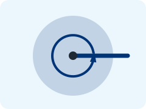{fig-alt="A full angle: one side turned all the way around"}
:::

::: footer
[3 · Input · 新知输入]{.phase} · option: picture only
:::

::: notes
**When to choose it:** the picture tells it best, and the teacher narrates. Here: a full angle. Say: *One side turns all the way around, back to where it started. That's a full angle.* Students show it with their arms.

**SIOP:** feature 12 (a variety of techniques: here, a picture and gesture).

**Pieces:** `.cover .media` with one picture: it fills the slide. Everything else is in the notes.
:::

## [Turn it and watch | 旋转，仔细看]{.bi} {#input-model data-menu-title="3 · Model: turn and watch"}

<iframe class="angle-frame" data-src="embeds/turning-angle.html" title="Turn an angle"></iframe>

::: footer
[3 · Input · 新知输入]{.phase} · option: model (interactive)
:::

::: notes
**When to choose it:** skills and processes, where students need to see it happen. Press **▶ Turn**: one side turns all the way around, stopping at the right angle, the straight angle and the full angle. Ask students to call out each name before it shows.

**SIOP:** features 11–12 (clear explanation, demonstration).

**Pieces:** an interactive page in the deck's `embeds/` folder, in a frame: `<iframe class="angle-frame" data-src="embeds/turning-angle.html"></iframe>`. From Unit 5. It works without the internet.
:::

## [Read: angles that turn | 阅读：会转动的角]{.bi} {#input-text data-menu-title="3 · Short text with glosses"}

::: {.tiles style="--cols: 2"}
::: {.box .plain}
[Part 1]{.kicker}

An angle has a  and two sides. When one side , the angle changes. It gets bigger or smaller.
:::

::: {.box .plain}
[Part 2]{.kicker}

When the two sides make one straight line, it is a **straight angle**. When one side turns all the way around, it is a **full angle**.
:::
:::

::: footer
[3 · Input · 新知输入]{.phase} · option: short text with glosses
:::

::: notes
**When to choose it:** reading is part of the content goal. Chunk the text into short parts; read part 1 together, then students read part 2 with a partner. Hover or tap the dotted words for their meaning.

**SIOP:** features 10 and 12 (adapted text, glosses), and reading as one of the four skills (feature 22).

**Pieces:** `.tiles` of two `.box .plain`, each a chunk with a `.kicker`; `` glosses a word in another form.
:::

## [Five angles | 五种角]{.bi} {#input-compare data-menu-title="3 · Compare"}

::: {.tiles style="--cols: 5; --pic-fit: contain; --pic-height: 6.5em; font-size: 0.75em; text-align: center"}
::: {.box .plain}
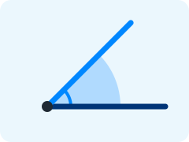{fig-alt="An acute angle"}

[Acute | 锐角]{.bi}

smaller than a right angle
:::

::: {.box .plain}
{fig-alt="A right angle"}

[Right | 直角]{.bi}

a square corner
:::

::: {.box .plain}
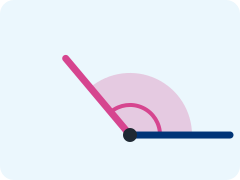{fig-alt="An obtuse angle"}

[Obtuse | 钝角]{.bi}

bigger than a right angle
:::

::: {.box .plain}
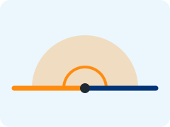{fig-alt="A straight angle"}

[Straight | 平角]{.bi}

a straight line
:::

::: {.box .plain}
{fig-alt="A full angle"}

[Full | 周角]{.bi}

all the way around
:::
:::

::: footer
[3 · Input · 新知输入]{.phase} · option: compare
:::

::: notes
**When to choose it:** content that's about differences, parts, or order. Side by side, students see what changes from one to the next.

**SIOP:** feature 12 (visuals and graphic organizers).

**Pieces:** `.tiles` with five columns (`--cols: 5`), each a `.box .plain` with a picture (`--pic-fit: contain` shows a drawing whole), a bilingual name and a short line.
:::

## [How clocks changed | 钟表的变化]{.bi} {#input-timeline data-menu-title="3 · Timeline"}

::: {.timeline-interactive #clocks title="How clocks changed"}

::: {.event date="1500 BC" title="Sundials"}
In ancient Egypt, people told the time from a shadow. The shadow turned as the sun moved.
:::

::: {.event date="AD 1300" title="Mechanical clocks"}
In Europe, the first clocks with gears were built in church towers.
:::

::: {.event date="AD 1656" title="The pendulum clock"}
Christiaan Huygens made a clock with a swinging pendulum. It was much more accurate.
:::

::: {.event date="AD 1927" title="The quartz clock"}
A small crystal that shakes very fast kept the time. Most watches today use one.
:::

::: {.event date="AD 1955" title="The atomic clock"}
Atoms keep the time. These clocks are the most accurate in the world.
:::

:::

::: footer
[3 · Input · 新知输入]{.phase} · option: timeline (interactive)
:::

::: notes
**When to choose it:** content where *when* matters: history, science, a process over time. Tap an event to zoom in. Here the link to angles: a clock's hands turn, and the angle between them tells the time.

**SIOP:** feature 12 (graphic organizers).

**Pieces:** `::: {.timeline-interactive}` with one `::: {.event date="…" title="…"}` per event (add `image="…"` for a picture). Events are sorted by date.
:::

## True or false? {#input-check data-menu-title="3 · Check for understanding"}

::: {.poll type="truefalse" correct="false"}
A straight angle is just a straight line. It is not an angle.
:::

::: footer
[3 · Input · 新知输入]{.phase} · option: check for understanding
:::

::: notes
**When to choose it:** after every two or three input slides. Everyone answers, so you see who needs it again. False: a straight angle has a vertex and two sides, made by turning. Ask a student who voted "false" to explain.

**SIOP:** feature 30 (assessment of understanding during the lesson) and feature 25 (students engaged).

**Pieces:** `::: {.poll type="truefalse" correct="false"}`. Also `type="choice"` with `options="…"`, and `type="smileys"`. Results collect on the Poll results slide (column 7).
:::

# [Let's do it together | 一起来做]{.bi} {#strategies data-menu-title="4 · We do together"}

:::: {.columns}
::: {.column width="40%"}
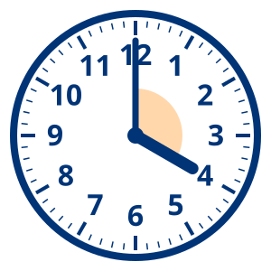{fig-alt="A clock at 4:00" style="max-height: 420px"}
:::
::: {.column width="60%"}
::: {.steps .stack}
1. [Find the vertex. *It's the middle of the clock.* | 找到顶点。*在钟面中心。*]{.bi}
2. [Compare with a right angle. Bigger or smaller? | 和直角比一比：大还是小？]{.bi}
3. [Name it. | 说出它的名称。]{.bi}
:::

[At 4:00, the hands make an [ ]{.gap} angle. | 4点时，两根指针组成一个[ ]{.gap}角。]{.bi .frame}
:::
::::

::: footer
[4 · Strategies · 学习策略]{.phase} · default
:::

::: notes
**The default.** After the model (I do), the class does one together (we do) before students work alone (you do). Step 1 is done for them, in italics; the class does steps 2 and 3 with you. At 4:00 the angle is obtuse.

**SIOP:** feature 14 (scaffolding: the teacher does less each time) and feature 13 (a strategy students can reuse: compare with a right angle).

**Pieces:** `.columns`, a picture, Chalkline's `.steps`, and a frame with `[ ]{.gap}`.
:::

## [Fill in the chart | 填一填]{.bi} {#strategies-organizer data-menu-title="4 · Graphic organizer"}

| Angle | Compared with a right angle | An example |
|:--|:--|:--|
| [Acute \| 锐角]{.bi} | [smaller]{.fragment} | [a clock at 1:00]{.fragment} |
| [Right \| 直角]{.bi} | [the same]{.fragment} | [a clock at 3:00]{.fragment} |
| [Obtuse \| 钝角]{.bi} | [bigger]{.fragment} | [a clock at 5:00]{.fragment} |
| [Straight \| 平角]{.bi} | [two right angles]{.fragment} | [a clock at 6:00]{.fragment} |

: {tbl-colwidths="[26,40,34]"}

::: footer
[4 · Strategies · 学习策略]{.phase} · option: graphic organizer
:::

::: notes
**When to choose it:** content with a structure students can see: compare, sequence, cause and effect. Students copy the chart and fill it in as you go; each click shows the next answer to check.

**SIOP:** feature 14 (scaffolding) and feature 12 (graphic organizers).

**Pieces:** a Markdown table; each answer a `.fragment`, so it appears on the next click.
:::

## [Easy to hard | 由易到难]{.bi} {#strategies-easy-hard data-menu-title="4 · Easy to hard"}

::: {style="font-size: 0.8em"}
::: row
[1]{.num}

Find a right angle in the room.
:::

::: row
[2]{.num}

Draw an angle smaller than a right angle. Name it.
:::

::: row
[3]{.num}

Draw an angle bigger than a right angle. Name it.
:::

::: row
[4]{.num}

Draw a straight angle. Mark its vertex.
:::

::: row
[5]{.num}

How many right angles make a full angle? Show it with a drawing.
:::

::: row
[6]{.num}

Make a clock show an obtuse angle. What time is it? Find two answers.
:::
:::

::: footer
[4 · Strategies · 学习策略]{.phase} · option: easy to hard
:::

::: notes
**When to choose it:** mixed levels in one class. Everyone starts at 1 and goes as far as they can; nobody waits, nobody is lost.

**SIOP:** feature 14 (scaffolding) and feature 15 (questions that move to higher-order thinking: number 6 has more than one answer).

**Pieces:** each challenge a `.row` with a `.num` (the Slide kit's easy-to-hard slide adds a small `.thumb` picture to each).
:::

## {#strategies-question data-menu-title="4 · Big question" .center}

::: cover
[Big question · 大问题]{.bi .kicker}

[Is a straight angle really an angle? | 平角真的是角吗？]{.bi .big}

[I think [ ]{.gap}, because [ ]{.gap}. | 我认为[ ]{.gap}，因为[ ]{.gap}。]{.bi .frame}
:::

::: footer
[4 · Strategies · 学习策略]{.phase} · option: big question
:::

::: notes
**When to choose it:** moving from facts to thinking. One question that has to be argued, with a frame for the reason. Give thinking time before anyone answers.

**SIOP:** feature 15 (a variety of questions that promote higher-order thinking) and feature 18 (wait time).

**Pieces:** `.cover` with a `.kicker`, `.big` text and a frame.
:::

## [Strategy: check with a corner | 方法：用直角来比]{.bi} {#strategies-strategy data-menu-title="4 · Strategy reminder"}

:::: {.columns}
::: {.column width="55%"}
::: {.steps .stack}
1. [Fold a paper to make a square corner. | 把纸折出一个直角。]{.bi}
2. [Put the corner on the vertex. | 把直角对准顶点。]{.bi}
3. [Line up one side. | 对齐一条边。]{.bi}
4. [Is the other side inside or outside? | 另一条边在里面还是外面？]{.bi}
:::
:::
::: {.column width="45%"}
::: {.box .plain}
[Use it when · 什么时候用]{.kicker}

[You're not sure if an angle is acute or obtuse. | 不确定一个角是锐角还是钝角时。]{.bi}
:::
:::
::::

::: footer
[4 · Strategies · 学习策略]{.phase} · option: strategy reminder
:::

::: notes
**When to choose it:** teaching how to learn, not only what. Name the strategy, show it once, and say when to use it. Students keep the folded corner for the rest of the unit.

**SIOP:** feature 13 (ample opportunities to use learning strategies).

**Pieces:** `.columns`, `.steps`, and a `.box` with "Use it when".
:::

## [Draw an angle: put the steps in order | 画角：排一排顺序]{.bi} {#strategies-order data-menu-title="4 · Put it in order"}

::: {.put-in-order first="Start" last="Done"}
- Draw a dot. | This is the vertex.
- Draw a straight line from the dot. | This is the first side.
- Turn, and draw a second line from the dot. | This is the second side.
- Draw a small curve between the sides. | This marks the angle.
:::

::: footer
[4 · Strategies · 学习策略]{.phase} · option: put it in order (interactive)
:::

::: notes
**When to choose it:** any process with steps: drawing, solving, an experiment. Students put the steps in order; the reasons show when it's right. From the Unit 4 math slides.

**SIOP:** feature 13 (strategies: a process students can follow again).

**Pieces:** `::: {.put-in-order first="…" last="…"}`, one step per line, a reason after the `|`.
:::

# [Think · Pair · Share | 思考 · 结对 · 分享]{.bi} {#interaction data-menu-title="5 · Think-Pair-Share"}

:::: {.columns}
::: {.column width="46%"}
::: {.box .plain style="font-size: 0.9em"}
- [**Listen** to the question. | **听**问题。]{.bi}
- [**Think** about your answer. | **想**一想你的答案。]{.bi}
- [**Talk** to your partner (2×). | 和同伴**说**（两次）。]{.bi}
- [**Share** with the whole class. | 和全班**分享**。]{.bi}
:::

::: {.tiles style="--pic-fit: contain; --pic-height: 3.6em; text-align: center"}
::: {.box .plain}
{fig-alt="Two students sitting side by side"}

[1 · Knee to knee | 膝对膝]{.bi}
:::

::: {.box .plain}
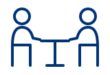{fig-alt="Two students facing each other at a table"}

[2 · Face to face | 面对面]{.bi}
:::

::: {.box .plain}
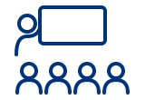{fig-alt="A teacher and the whole class"}

[3 · Whole class | 全班]{.bi}
:::
:::
:::
::: {.column width="54%"}
::: {.box}
[Ask · 提问]{.kicker}

[Where do you see a straight angle at home? | 你在家里哪里能看到平角？]{.bi}

[I see a straight angle when [ ]{.gap}. | 当[ ]{.gap}时，我看到了平角。]{.bi .frame}
:::

::: {.tiles style="font-size: 0.45em"}
::: {.box .dark style="align-items: center"}
[Think · 思考]{.kicker}


:::

::: {.box .dark style="align-items: center"}
[Share ×2 · 分享 ×2]{.kicker}


:::
:::
:::
::::

::: footer
[5 · Interaction · 互动交流]{.phase} · default
:::

::: notes
**The default.** Use it at least once every lesson. Every student thinks, then talks, before anyone answers to the class, so everyone gets time and practice. Each partner speaks once, with the frame.

**SIOP:** features 16–18 (frequent structured interaction, a grouping that fits, wait time).

**Pieces:** the Slide kit's Think-Pair-Share: a `.box` with the steps, `.tiles` of seating drawings, the question with a frame, and two timers in `.dark` boxes.
:::

## [Jigsaw: expert groups | 拼图学习：专家组]{.bi} {#interaction-jigsaw data-menu-title="5 · Jigsaw"}

:::: {.columns}
::: {.column width="31%"}
::: {style="font-size: 0.5em; --pic-fit: contain; --pic-height: 1.8em; --pad: 0.3em 0.7em; --gap: 0.25em"}
::: {.box .plain}
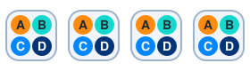{fig-alt="Four home groups, each with one A, B, C and D"}

[1 · Home group | 原小组]{.bi .kicker}

[Get a letter: A, B, C or D. | 每人领一个字母。]{.bi}
:::

::: {.box .plain}
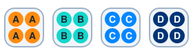{fig-alt="Four expert groups: all A, all B, all C, all D"}

[2 · Expert group | 专家组]{.bi .kicker}

[Do your piece. Agree on 3 key points. | 完成你的任务，总结3个要点。]{.bi}

::: {style="font-size: 0.42em; align-self: center"}

:::
:::

::: {.box .plain}
[3 · Back home: teach | 回原小组：讲解]{.bi .kicker}

[Teach your 3 points. Take notes. | 讲解3个要点，做笔记。]{.bi}

::: {style="font-size: 0.42em; align-self: center"}

:::
:::
:::
:::
::: {.column width="69%"}
::: puzzle
::: {.box style="--piece: #FFE4C7; --strong: #FF8C0F"}
::: row
[A]{.num}

{.thumb fig-alt="An acute angle"}

[Acute angles | 锐角]{.bi}
:::

[Find three acute angles in the room. Draw them. | 在教室里找三个锐角，画下来。]{.bi}
:::

::: {.box style="--piece: #CDF6F3; --strong: #14D7CD"}
::: row
[B]{.num}

{.thumb fig-alt="An obtuse angle"}

[Obtuse angles | 钝角]{.bi}
:::

[Find three obtuse angles in the room. Draw them. | 在教室里找三个钝角，画下来。]{.bi}
:::

::: {.box style="--piece: #D3E8FF; --strong: #0087FF"}
::: row
[C]{.num}

{.thumb fig-alt="A straight angle"}

[Straight angles | 平角]{.bi}
:::

[When do clock hands make a straight angle? | 钟面上什么时候是平角？]{.bi}
:::

::: {.box style="--piece: #D5DEEB; --strong: #003477"}
::: row
[D]{.num}

{.thumb fig-alt="A full angle"}

[Full angles | 周角]{.bi}
:::

[What turns all the way around? Find three things. | 什么东西会转一整圈？找三个。]{.bi}
:::
:::
:::
::::

::: footer
[5 · Interaction · 互动交流]{.phase} · option: jigsaw
:::

::: notes
**When to choose it:** a lot of content that splits into parts. Every student becomes an expert in one part and teaches it, so everyone has to speak.

**SIOP:** features 16–17 (interaction, groupings that support the objectives).

**Pieces:** the Slide kit's jigsaw: the three steps on the left with timers, and `::: puzzle` with four `.box`es that lock together, each with its tint (`--piece`) and letter colour (`--strong`).
:::

## [Group roles | 小组分工]{.bi} {#interaction-roles data-menu-title="5 · Group roles"}

::: {.tiles style="--cols: 4; text-align: center"}
::: {.box .plain}
[1]{.num}

[**Reader** | **朗读员**]{.bi}

[reads the task aloud | 大声读任务]{.bi .small}
:::

::: {.box .plain}
[2]{.num}

[**Writer** | **记录员**]{.bi}

[writes the group's answers | 写下小组的答案]{.bi .small}
:::

::: {.box .plain}
[3]{.num}

[**Checker** | **检查员**]{.bi}

[checks every angle with a corner | 用直角检查每个角]{.bi .small}
:::

::: {.box .plain}
[4]{.num}

[**Reporter** | **汇报员**]{.bi}

[tells the class | 向全班汇报]{.bi .small}
:::
:::

::: {.box .plain}
[Task · 任务]{.kicker}

[Find and name five angles in the picture book. | 在图画书里找出五个角并说出名称。]{.bi}
:::

::: footer
[5 · Interaction · 互动交流]{.phase} · option: group roles
:::

::: notes
**When to choose it:** groups where some students do everything and others nothing. A role gives each student a job, and a reason to speak. Swap roles next time.

**SIOP:** features 16–17, and feature 25 (all students engaged).

**Pieces:** `.tiles` with four columns, each role a `.box .plain` with a `.num`; a `.box` for the task.
:::

## [Talk frames | 交流句型]{.bi} {#interaction-frames data-menu-title="5 · Speaking frames"}

::: {.tiles style="--cols: 2; --gap: 0.3em"}
::: {.box .plain}
[Agree · 同意]{.kicker}

I agree with [ ]{.gap}, because [ ]{.gap}.
:::

::: {.box .plain}
[Disagree · 不同意]{.kicker}

I see it differently. I think [ ]{.gap}.
:::

::: {.box .plain}
[Add on · 补充]{.kicker}

I want to add that [ ]{.gap}.
:::

::: {.box .plain}
[Ask · 提问]{.kicker}

Can you say more about [ ]{.gap}?
:::
:::

::: footer
[5 · Interaction · 互动交流]{.phase} · option: speaking frames
:::

::: notes
**When to choose it:** discussions, debates, and giving feedback. Leave it up during any talk task, or print it for each table. The frames are English only: they are the language students are practicing.

**SIOP:** feature 16 (interaction) and feature 24 (the language objective, supported).

**Pieces:** `.tiles` with two columns; each frame a `.box .plain` with a `.kicker` and `[ ]{.gap}` blanks.
:::

## [Think in any language, report in English | 用任何语言思考，用英语汇报]{.bi} {#interaction-languages data-menu-title="5 · Any language, report in English"}

::: steps
1. [**Think** in any language. | 用任何语言**思考**。]{.bi}
2. [**Discuss** with your group in any language. | 用任何语言和小组**讨论**。]{.bi}
3. [**Plan** your answer in English. Use the frame. | 用英语**准备**答案，用句型。]{.bi}
4. [**Report** to the class in English. | 用英语向全班**汇报**。]{.bi}
:::

[An obtuse angle is bigger than [ ]{.gap}, but smaller than [ ]{.gap}. | 钝角比[ ]{.gap}大，但比[ ]{.gap}小。]{.bi .frame}

::: footer
[5 · Interaction · 互动交流]{.phase} · option: discuss in any language, report in English
:::

::: notes
**When to choose it:** new content that's hard. Students build the idea in the language they think in, then put it into English with a frame. Say clearly which language each step uses.

**SIOP:** feature 19 (ample opportunity to clarify key concepts in the first language) and feature 24 (the language objective).

**Pieces:** Chalkline's `.steps`, and a frame.
:::

## [Draw an angle you can find at home | 画一个家里能找到的角]{.bi} {#interaction-board data-menu-title="5 · Live board"}

::: {.live-board rooms="wbo"}
Scan to draw with us. Then write its name.
:::

::: footer
[5 · Interaction · 互动交流]{.phase} · option: live board
:::

::: notes
**When to choose it:** students have devices, and you want everyone's ideas on the screen at once. Students scan the QR code and draw on a shared whiteboard; the drawings show up live on this slide.

**SIOP:** feature 16 (interaction) and feature 25 (all students engaged).

**Pieces:** `::: {.live-board rooms="wbo"}` (a WBO whiteboard, no login). For a Padlet wall: `::: {.live-board src="…" join="…"}`. Needs the internet. See the Live boards deck in Start here.
:::

# [Angle hunt | 找角游戏]{.bi} {#practice data-menu-title="6 · Task instructions"}

:::: {.columns}
::: {.column width="58%"}
::: {.steps .stack}
1. [Find 5 angles in the room. | 在教室里找5个角。]{.bi}
2. [Draw each one. Mark the vertex. | 画下每个角，标出顶点。]{.bi}
3. [Name it: acute, right, obtuse, straight. | 写出名称：锐角、直角、钝角、平角。]{.bi}
4. [Write one sentence with *bigger than* or *smaller than*. | 用 *bigger than* 或 *smaller than* 写一句话。]{.bi}
:::
:::
::: {.column width="42%"}
::: {.box .dark style="align-items: center"}
[Timer · 计时]{.kicker}


:::


:::
::::

::: footer
[6 · Practice and application · 练习与运用]{.phase} · default
:::

::: notes
**The default.** The lesson's main task: numbered steps, the time, and the worksheet on the screen. Step 4 is the language objective, so the task practices both objectives.

**SIOP:** features 20–22 (hands-on, applying content and language, more than one skill: looking, drawing, writing, speaking) and feature 11 (clear task explanation).

**Pieces:** `.columns`, `.steps`, a timer in a `.box .dark`, and ``: the worksheet's pages (here the guide's own `angle-hunt.qmd`); tap one to open it large.
:::

## [Make a paper clock | 做一个纸钟]{.bi} {#practice-video data-menu-title="6 · Instructions + video"}

:::: {.columns}
::: {.column width="56%"}
::: placeholder
[Video: 1 minute, making a paper clock with two hands and a split pin | 视频：一分钟，用两根指针和一个两脚钉做纸钟]{.bi}
:::

::: {.box .plain style="font-size: 0.85em"}
[Instructions]{.kicker}

1. Cut out the clock face and two hands.
2. Join them with a split pin.
3. Make each angle: acute, right, obtuse, straight.
:::
:::
::: {.column width="44%"}
[Work gallery]{.kicker}


:::
::::

::: footer
[6 · Practice and application · 练习与运用]{.phase} · option: instructions + video + work gallery
:::

::: notes
**When to choose it:** making or doing something new, where seeing it once saves ten questions. Play the video, then leave the steps up while students work. The work gallery shows the worksheet, or photos of finished work.

**SIOP:** feature 20 (hands-on materials) and feature 11 (clear explanation).

**Pieces:** the Slide kit's instructions slide: `` (here a placeholder), a `.box` with steps, and ``.
:::

## [Stations | 学习站]{.bi} {#practice-stations data-menu-title="6 · Stations"}

::: {.tiles style="--cols: 4; font-size: 0.75em"}
::: {.box .plain}
[1]{.num}

**Clock**

Make 4 angles with the paper clock.
:::

::: {.box .plain}
[2]{.num}

**Draw**

Draw one of each angle. Label them.
:::

::: {.box .plain}
[3]{.num}

**Hunt**

Find 3 angles in a picture book.
:::

::: {.box .plain}
[4]{.num}

**Talk**

Compare two angles with a partner. Use the frames.
:::
:::

::: {.box .dark style="align-items: center; font-size: 0.6em"}
[Move every · 每站时间]{.kicker}


:::

::: footer
[6 · Practice and application · 练习与运用]{.phase} · option: stations
:::

::: notes
**When to choose it:** several activities in one lesson, or students on different steps. Groups move when the timer ends. Station 4 practices the language objective.

**SIOP:** features 20–22 (hands-on, all four skills across the stations) and feature 17 (grouping).

**Pieces:** `.tiles` with four columns, each station a `.box .plain` with a `.num`; one timer for the rotation.
:::

## [Make it on the clock | 在钟面上做角]{.bi} {#practice-clock data-menu-title="6 · Hands-on (interactive)"}

<iframe class="angle-frame" data-src="embeds/turning-angle.html?mode=clock" title="Angles on a clock"></iframe>

::: footer
[6 · Practice and application · 练习与运用]{.phase} · option: hands-on (interactive)
:::

::: notes
**When to choose it:** content you can touch and move. Students come up and drag the hour hand to make an angle you name; the class checks with their arms first. 3:00 and 9:00: right angles. 6:00: a straight angle. 1:00, 2:00, 10:00, 11:00: acute. 4:00, 5:00, 7:00, 8:00: obtuse.

**SIOP:** feature 20 (hands-on) and feature 21 (applying content knowledge).

**Pieces:** the angle explorer from Unit 5 in clock mode: `data-src="embeds/turning-angle.html?mode=clock"`.
:::

## [Write it | 写一写]{.bi} {#practice-write data-menu-title="6 · Write it"}

:::: {.columns}
::: {.column width="55%"}
::: {.box .plain}
[Model · 范例]{.kicker}

At 4:00, the clock hands make an obtuse angle. It is **bigger than** a right angle, but **smaller than** a straight angle.
:::

[At [ ]{.gap}, the clock hands make a [ ]{.gap} angle. It is [ ]{.gap} than a right angle.]{.frame}
:::
::: {.column width="45%"}
::: {.box .plain}
[Check · 检查]{.kicker}

- [ ] I named the angle.
- [ ] I compared it with a right angle.
- [ ] I used *bigger than* or *smaller than*.
- [ ] I started with a capital letter and ended with a full stop.
:::
:::
::::

::: footer
[6 · Practice and application · 练习与运用]{.phase} · option: write it
:::

::: notes
**When to choose it:** the language objective is about writing. Read the model together, write one with the frame, then students write their own and check it.

**SIOP:** feature 22 (integrating all four skills: here, writing) and feature 24 (the language objective).

**Pieces:** `.columns`, a model in a `.box`, a frame, and a checklist (`- [ ]`).
:::

## Sort the clocks {#practice-sort data-menu-title="6 · Interactive: sort it"}

::: {.sort}
- **Acute**
  - 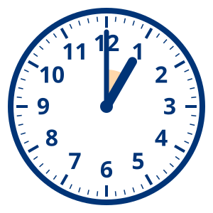 | At 1:00 the hands are close together: smaller than a right angle.
  - 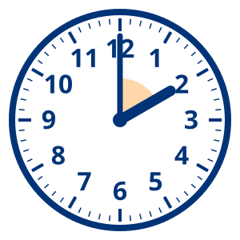 | At 2:00 the opening is smaller than a right angle.
  - 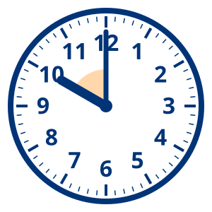 | At 10:00 the hands are two hours apart: smaller than a right angle.
- **Right**
  -  | At 3:00 the hands make a square corner.
  - 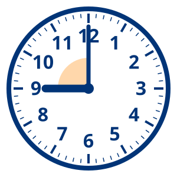 | At 9:00 the hands make a square corner too.
- **Obtuse**
  -  | At 4:00 the opening is bigger than a right angle, smaller than a straight angle.
  - 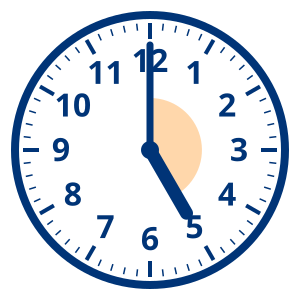 | At 5:00 the hands are almost in a line, but not quite.
  - 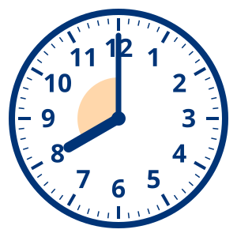 | At 8:00 the hands are four hours apart: bigger than a right angle.
- **Straight**
  - 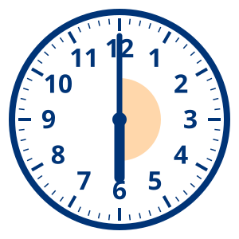 | At 6:00 the two hands make one straight line.
:::

::: footer
[6 · Practice and application · 练习与运用]{.phase} · option: interactive (sort it)
:::

::: notes
**When to choose it:** quick whole-class practice on the screen. Students come up and tap a clock, then its group. A wrong answer shows the reason. English only: it's practice. From Unit 5.

**SIOP:** feature 21 (applying content knowledge) and feature 29 (feedback: the reasons).

**Pieces:** `::: {.sort}` with pictures as items: ` | reason`.
:::

## Label the angle {#practice-label data-menu-title="6 · Interactive: label it"}

::: {.label-it image="images/MTH-001.svg"}
- Vertex | 29,78 | The vertex is the point where the two sides meet.
- Side | 75,78 | A side is one of the two lines.
- Angle | 47,62 | The angle is the opening between the sides.
:::

::: footer
[6 · Practice and application · 练习与运用]{.phase} · option: interactive (label it)
:::

::: notes
**When to choose it:** parts of a picture, a diagram or a map. Students drag each label to its dot; a wrong one shakes and shows why.

**SIOP:** feature 21 (applying content and language knowledge) and feature 9 (key vocabulary).

**Pieces:** `::: {.label-it image="…"}`, one line per label: the label, `|`, where its dot goes (`x,y` in percent: press **L** on the slide and tap the picture to find it), `|`, a reason.
:::

# [Did we do it? | 我们做到了吗？]{.bi} {#review data-menu-title="7 · Objectives check + exit ticket"}

:::: {.columns}
::: {.column width="50%"}
::: {.box .plain}
[Content objective · 内容目标]{.kicker}

[I can name five kinds of angle. | 我能说出五种角的名称。]{.bi}
:::

::: {.box .plain}
[Language objective · 语言目标]{.kicker}

[I can compare two angles with *bigger than* and *smaller than*. | 我能用 *bigger than* 和 *smaller than* 比较两个角。]{.bi}
:::

[Show me: 1 to 5 fingers. | 用1到5根手指表示。]{.bi .small}
:::
::: {.column width="50%"}
::: {.area .donow label="Exit ticket · 出门条"}
1. Draw an obtuse angle. Mark the vertex.
2. Finish the sentence: *A straight angle is [ ]{.gap} than a right angle.*

::: {.end style="align-self: center; font-size: 0.48em"}

:::
:::
:::
::::

::: footer
[7 · Review and assessment · 复习与评价]{.phase} · default
:::

::: notes
**The default.** Close every lesson where it started: read the two objectives again, students show 1–5 fingers for each, then answer two exit questions on paper: one for the content objective, one for the language objective. The exit questions are English only: they're assessment.

**SIOP:** features 27–30 (review of vocabulary and concepts, feedback, assessment against the objectives).

**Pieces:** `.columns`, two `.box .plain` with the objectives, and an `.area` for the exit ticket with a timer.
:::

## Angles quick-fire! {#review-quickfire data-menu-title="7 · Vocab review game"}

::: {.trivia title="Angles quick-fire!" seconds="10"}
- An angle smaller than a right angle | An acute angle
- The two sides make one straight line. What angle is it? | A straight angle
- One side turns all the way around, back to the start | A full angle
- 1 straight angle = how many right angles? | 2
- 1 full angle = how many right angles? | 4
- At 3:00, the clock hands make… | A right angle
- The point where the two sides of an angle meet | The vertex
:::

::: footer
[7 · Review and assessment · 复习与评价]{.phase} · option: vocab review game
:::

::: notes
**When to choose it:** many new words this lesson, and five minutes left. Point to a student, who answers out loud; press **Show the answer**, then **✓ Right** or **✗ Wrong**. English only: it's review.

**SIOP:** feature 27 (review of key vocabulary).

**Pieces:** `::: {.trivia title="…" seconds="10"}`, one question per line, the answer after the `|`. From Unit 5. Other games from the vocab list: ``, ``, ``: see the Review games deck in Unit 1.
:::

## Angles Jeopardy {#review-jeopardy data-menu-title="7 · Jeopardy"}

::: {.jeopardy teams="2"}
- **Names**
  - Smaller than a right angle | acute
  - A square corner | right
  - Bigger than a right angle, smaller than a straight angle | obtuse
  - One side turns all the way around | full
- **Parts**
  - The point where the sides meet | the vertex
  - An angle has two of these | sides
  - We measure angles in these | degrees
  - The curve that marks an angle | an arc
- **Clocks**
  - The angle at 3:00 | a right angle
  - The angle at 6:00 | a straight angle
  - Name a time with an acute angle | 1:00, 2:00, 10:00 or 11:00
  - Name a time with an obtuse angle | 4:00, 5:00, 7:00 or 8:00
- **Compare**
  - 2 right angles = 1 … | straight angle
  - 4 right angles = 1 … | full angle
  - 2 straight angles = 1 … | full angle
  - Which is bigger: acute or obtuse? | obtuse
:::

::: footer
[7 · Review and assessment · 复习与评价]{.phase} · option: Jeopardy
:::

::: notes
**When to choose it:** a review day, or the end of a unit (20–30 minutes). Teams take turns choosing a category and a number; bigger numbers are harder. Mark each answer **✓ Right** or **✗ Wrong**; the turn passes either way.

**SIOP:** features 27–28 (review of vocabulary and concepts) and feature 25 (engagement).

**Pieces:** `::: {.jeopardy teams="2"}`: each category a **bold** line, one clue per line under it, the answer after the `|`. Or from the vocab list: ``.
:::

## [Review: one question at a time | 复习：一题一题来]{.bi} {#review-set data-menu-title="7 · Review set"}

| | Question | Answer |
|:--|:--|:--|
| 1 | What do we call the point where two sides meet? | [the vertex]{.fragment} |
| 2 | Is an angle at 5:00 acute or obtuse? | [obtuse]{.fragment} |
| 3 | How many right angles make a straight angle? | [two]{.fragment} |
| 4 | Draw an angle smaller than a right angle. Name it. | [an acute angle]{.fragment} |
| 5 | Which is bigger: a straight angle or a full angle? Why? | [a full angle: it turns all the way around]{.fragment} |

: {tbl-colwidths="[6,56,38]"}

::: footer
[7 · Review and assessment · 复习与评价]{.phase} · option: review set
:::

::: notes
**When to choose it:** before a test, or for a class that prefers calm, structured review. Read a question, give thinking time, take answers (whiteboards work well), then click to show the answer and explain it. English only: it's review.

**SIOP:** features 27–29 (review of vocabulary and concepts, feedback).

**Pieces:** a Markdown table; each answer a `.fragment`, shown on the next click.
:::

## [Big idea | 核心概念]{.bi} {#review-bigidea data-menu-title="7 · Big idea summary"}

::: {.cover style="height: auto; padding: 0.6em 0"}
[An angle is a turn. | 角就是旋转。]{.bi .big style="text-align: center"}
:::

::: chain
::: {.box .plain style="text-align: center"}
[A quarter turn: right | 转四分之一圈：直角]{.bi}
:::

::: {.box .plain style="text-align: center"}
[A half turn: straight | 转半圈：平角]{.bi}
:::

::: {.box .plain style="text-align: center"}
[A full turn: full | 转一整圈：周角]{.bi}
:::
:::

::: footer
[7 · Review and assessment · 复习与评价]{.phase} · option: big idea summary
:::

::: notes
**When to choose it:** closing a topic or a unit. One big idea students can say in one sentence, and what follows from it. Students say it together, then explain it to a partner.

**SIOP:** feature 28 (review of key content concepts).

**Pieces:** the Slide kit's big idea: `.big` for the claim and `.chain` (boxes with arrows) for what follows.
:::

## [How well can I do it? | 我掌握得怎么样？]{.bi} {#review-self data-menu-title="7 · Self-assessment"}

| I can… | 1 | 2 | 3 | 4 |
|:--|:-:|:-:|:-:|:-:|
| [name five kinds of angle \| 说出五种角的名称]{.bi} | ☐ | ☐ | ☐ | ☐ |
| [find angles around me \| 找到身边的角]{.bi} | ☐ | ☐ | ☐ | ☐ |
| [compare angles with *bigger than* and *smaller than* \| 用 *bigger than* 和 *smaller than* 比较角]{.bi} | ☐ | ☐ | ☐ | ☐ |

: {tbl-colwidths="[64,9,9,9,9]"}

[1 = I need help · 4 = I can teach it | 1 = 我需要帮助 · 4 = 我能教别人]{.bi .small}

::: footer
[7 · Review and assessment · 复习与评价]{.phase} · option: self-assessment
:::

::: notes
**When to choose it:** students need practice judging their own learning, or you want to plan the next lesson's groups. Students copy the rows and tick a box for each, or show fingers. A 1 or 2 tells you who to see first next lesson.

**SIOP:** feature 30 (assessment of student learning) and feature 29 (feedback).

**Pieces:** a Markdown table with ☐ boxes, and a `.small` key.
:::

## [How did you do? | 你学得怎么样？]{.bi} {#review-poll data-menu-title="7 · Exit poll"}

::: {.poll type="smileys"}
How well can you name a straight angle and a full angle?
:::

::: footer
[7 · Review and assessment · 复习与评价]{.phase} · option: exit poll
:::

::: notes
**When to choose it:** a quick whole-class check instead of a paper exit ticket. Students tap a face; the next slide shows every poll's results from this lesson.

**SIOP:** feature 30 (assessment).

**Pieces:** `::: {.poll type="smileys"}`.
:::

## Poll results {.poll-summary-slide data-menu-title="7 · Poll results"}

::: {.poll-summary}
:::

::: footer
[7 · Review and assessment · 复习与评价]{.phase} · option: poll results
:::

## [Homework and next time | 作业和下节课]{.bi} {#review-homework data-menu-title="7 · Homework and next lesson"}

:::: {.columns}
::: {.column width="55%"}
::: {.box .plain}
[Homework · 作业]{.kicker}

[Angle hunt at home: find and draw 5 angles. Name each one. | 在家找角：找出并画下5个角，写出名称。]{.bi}

[Due: next lesson | 下节课交]{.bi .small}
:::
:::
::: {.column width="45%"}
::: {.box .plain}
[Next time · 下节课]{.kicker}

[Measuring angles with a protractor | 用量角器量角]{.bi}
:::
:::
::::

::: footer
[7 · Review and assessment · 复习与评价]{.phase} · option: homework and next lesson
:::

::: notes
**When to choose it:** when homework is set. Say what's next, so students see where the lesson leads.

**SIOP:** features 23–26 (lesson delivery).

**Pieces:** `.columns` with two `.box .plain`.
:::

## [Credits | 来源]{.bi} {#credits .credits}

:::: columns
::: column
### Pictures

- **Original drawings, made for Chalkline:** the angle and clock drawings, the title picture, the Think-Pair-Share seating and the jigsaw groups. Full list: `images/CREDITS.md` in Chalkline's guide.
- **Placeholders** (dashed boxes) mark pictures and videos still to find.
:::

::: column
### Sources

- **Activities and angle explorer:** adapted from the Chalkline sample's Unit 5, *Turning and Angles*, after a Grade 4 lesson plan, *旋转与角*.
- **The eight SIOP components and 30 features:** Echevarría, Vogt and Short, *Making Content Comprehensible for English Learners: The SIOP Model*.
:::
::::

::: notes
Credits. Every deck that uses outside pictures or sources ends with a slide like this one (see `CLAUDE.md`).
:::
