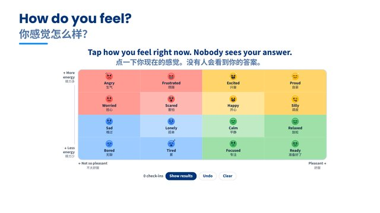
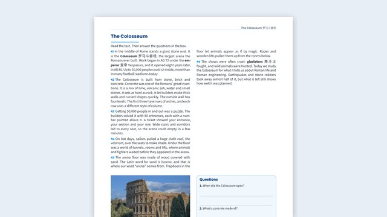
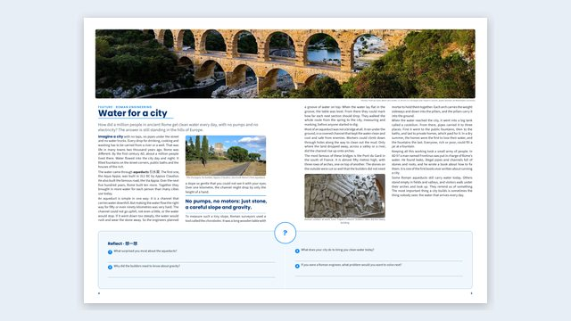
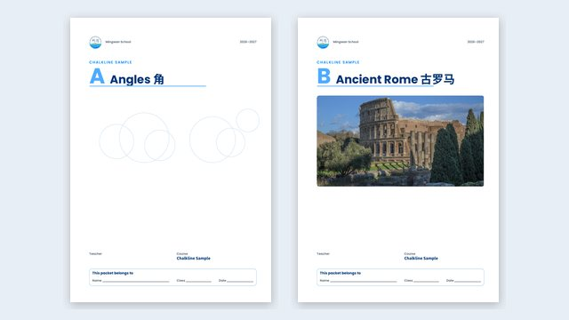
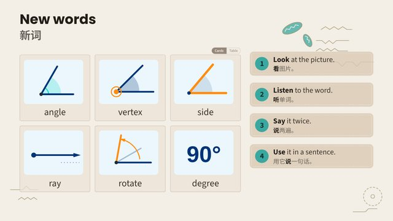

Everything here is ready to copy into your own lessons. Start with the five pages below: most lessons are made from them.

::: {.guide-cards}
::: {.guide-card}
{.guide-card-img fig-alt="A Template Library slide: a mood meter, a grid of feelings to tap"}

[Template Library](templates-slides.qmd){.guide-card-title}

**Slides.** Every tested slide layout, game and activity, in columns by purpose: start a lesson, words, explain, read, watch, tasks, talk, check, games, end. Copy the closest slide and change its words.
:::

::: {.guide-card}
{.guide-card-img fig-alt="A printable: a reading in two columns, a photo of the Colosseum and a box of questions"}

[Printable Templates](printables.qmd){.guide-card-title}

**Worksheets, handouts and checklists.** Each one is a page you copy, with the blocks it's made of: word banks, work spaces, recall questions, answers for the teacher edition.
:::

::: {.guide-card}
{.guide-card-img fig-alt="A two-page packet spread: a magazine feature about Roman aqueducts with a panorama across both pages"}

[Packet Templates](packet-templates.qmd){.guide-card-title}

**Every kind of packet page,** and what it's for: readings, word pages, organizers, sources, tests, timelines. Pages are printed on A3 and folded into a booklet.
:::

::: {.guide-card}
{.guide-card-img fig-alt="The covers of two example unit packets: Angles, and Ancient Rome with a photo of the Colosseum"}

[Example Units](examples/index.qmd){.guide-card-title}

**Three finished units:** Angles, Ancient Rome and Mesopotamia. Slides, printables and each unit's packet. Copy one to start your own unit.
:::

::: {.guide-card}
{.guide-card-img fig-alt="An Exemplar lesson slide: new words with drawings of angles, and four steps to learn them"}

[Exemplar Lesson](exemplar-slides.qmd){.guide-card-title}

**How to plan a lesson.** One lesson as a 2D deck: across, the seven phases; down, other ways to run each phase, and when to choose each one.
:::
:::

## Also in the guide

- **[Sample printables](samples/index.qmd):** the small printables the decks show in their galleries.
- **Your own:** **My templates** (your own slides to reuse) and **My themes** (your colour schemes), above this section in the sidebar.

## Making a lesson, step by step

1. **Slides:** open the Template Library, find the column for what you need, and copy the closest slide into your deck.
2. **Printables:** copy a page from Printable Templates or an example unit. Write key words as ``.
3. **Words and language:** add words to `vocab/data/vocab.csv` and sentence frames to `vocab/data/frames.csv`; pages and slides read them from there.
4. **The packet:** every printable in a unit goes into its packet by itself. Rebuild it with `python chalkline.py packets --unit 3`.

::: {.guide-credits}
Pictures on this page: slides and pages from Chalkline's guide. Photos in them: the Pont du Gard by Benh LIEU SONG, [CC BY-SA 3.0](https://creativecommons.org/licenses/by-sa/3.0), and the Colosseum by Wilfredor, CC0, both via [Wikimedia Commons](https://commons.wikimedia.org).
:::

::: {.callout-note title="Where this comes from, and how to turn it off" collapse="true"}
This guide is part of Chalkline. It's copied into your teacher site each time the site is built, and it updates when Chalkline does. It's not in your course's files, and students never see it.

Don't change the files in `course/guide/02-chalkline/`: they're replaced at every build. Copy a slide into your own lesson or into `course/guide/01-my-templates/` instead.

**To turn it off**, add this line to `_quarto.yml`:

```yaml
chalkline-guide: false
```

To bring it back, delete that line (or write `true`). Turning the guide off only hides these pages. Every template piece (boxes, tiles, timers, the puzzle and the rest) still works in your own slides.
:::
