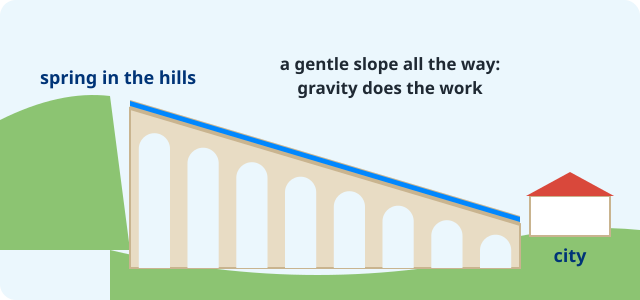

::: {.page-about name="Mixed page: text, pictures and tables" uses="an information handout: a few short sections, each with a picture or a table; a 'how it works' page: the idea, a drawing, the parts in a table; a reference page to keep in the packet" pieces="side-by-side (widths), pictures in a row (layout-ncol), Markdown tables, panel, recall"}
:::

<!--
How this page is laid out (copy what you need):
- Every picture has a size, so it never pushes the next section onto a new page:
  {width="100%" height="50mm"} fills its column and crops to that height, so pictures in a row match.
- A picture beside text: ::: {.side-by-side widths="3, 2"} (the text 3 parts, the picture 2).
- Two or three pictures in a row: ::: {layout-ncol=2}. Captions are small and grey, with no "Figure 1:".
- Tables: plain Markdown. In the PDF they take the page's width and the theme's colours. A column's width
  follows its longest cell; to set them yourself, add a caption line under the table: : {tbl-colwidths="[30,70]"}
- Credit an outside photo in its caption (who, the license, where from), and in images/CREDITS.md.
- One idea per section, a ## heading for each. Headings never sit alone at the foot of a page.
- End on a task that fills the rest of the last page (height="fill"), so no half-empty page is left.
-->

The Romans built roads all over their empire. Big cities also had an  to bring them water. Many of these still stand today. This page shows how they worked.

## How an aqueduct works

::: {.side-by-side widths="3, 2"}
::: {}
An aqueduct carries water from the hills to a city. It has no pumps.

1. Water comes out of a **spring** in the hills.
2. It runs along a **channel**. The channel slopes down a little, all the way to the city.
3. Where there is a valley, a **bridge** of arches carries the channel across.
4. In the city, the water fills tanks, fountains and baths.
:::

{width="100%"}
:::

## Two Roman builds

::: {layout-ncol=2}
{width="100%" height="50mm"}

{width="100%" height="50mm"}
:::

Both were built to last. The Pont du Gard is about 2,000 years old. People still walk on parts of the Via Appia.

## The parts of an aqueduct

| Part | What it does |
|---|---|
| the spring | Gives clean water, high in the hills. |
| the channel | Carries the water. It slopes down a little all the way. |
| the arches | Hold the channel up across a valley. |
| the tank | Stores the water at the edge of the city. |
| the pipes | Take water from the tank to fountains and baths. |

## Roads and aqueducts

|  | Roads | Aqueducts |
|---|---|---|
| What they carry | soldiers, carts, letters | water |
| Made of | layers of stone and gravel | stone, brick and concrete |
| Still in use? | Yes, some parts | A few, after 2,000 years |

::: {.panel title="Did you know?"}
The city of Rome had 11 aqueducts. Together they brought about one million cubic metres of water every day.
:::

## Check

::: {.recall lines="2"}
- Why does the water in an aqueduct keep moving? | The channel slopes down, so gravity pulls the water.
- What do the arches of the Pont du Gard do? | They hold the channel up across the valley.
:::

## Draw it

Draw an aqueduct from a spring to a city. Label the spring, the channel, the arches and the tank.

::: {.work-space height="fill" style="dots" label="My aqueduct"}
:::
