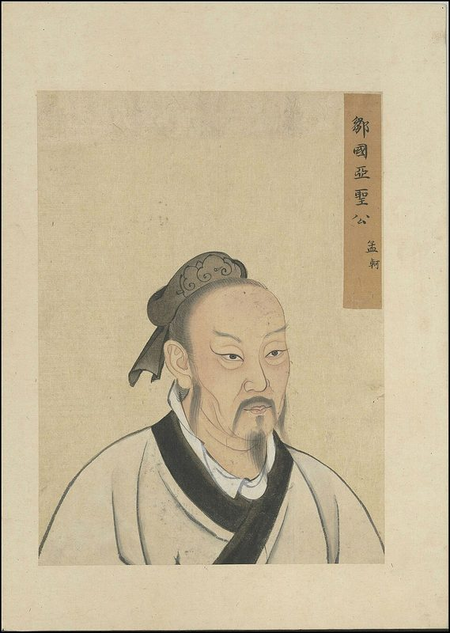
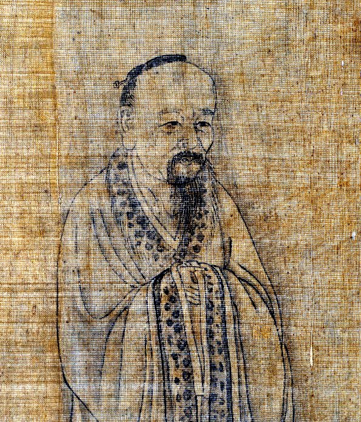
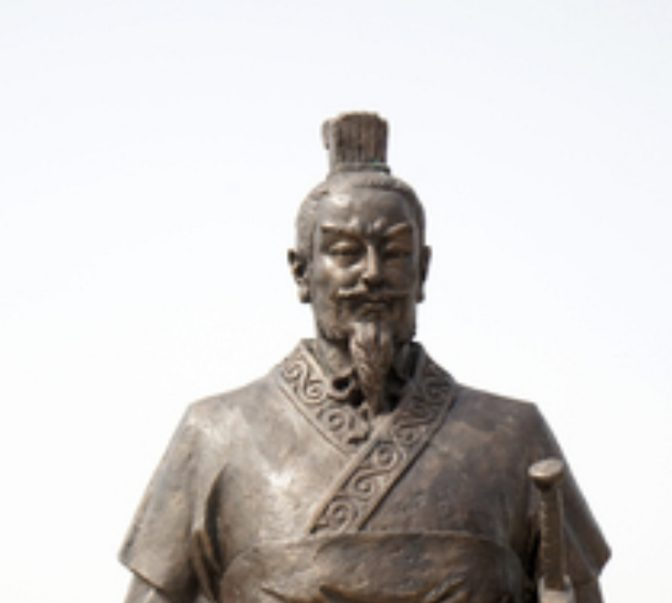

::: {.page-about name="Picture column" uses="a reading with pictures to look at: people, places, objects; a short article, with photos down the side; a source page: the pictures, then the text about them" pieces="picture-column, recall, work-space"}
:::

<!--
How this page works:
- ::: {.picture-column title="…"}: put the pictures first, each with its caption: .
  Then write the text as usual: paragraphs, lists, bold words.
- The pictures go down the left third of the page; the text goes in a box beside them. The text isn't lined
  up with the pictures: it runs on its own. (To put each picture beside its own words, use Picture steps.)
- side="right" puts the pictures on the right. box="false" leaves out the box around the text.
- height="46mm" gives every picture the same height, so three fit down an A4 page. A picture is cropped to fill
  that height; fit="contain" shows all of it instead (best for portraits and drawings). Leave out height and
  each picture keeps its own shape (a tall portrait then takes much more room than a wide photo).
-->

About 2,500 years ago, China was split into states that fought each other. Many thinkers asked: how can we live in peace?

::: {.picture-column title="The Hundred Schools of Thought" height="46mm" fit="contain"}

In the Warring States period, many thinkers travelled from state to state. They gave advice to kings. People called them the "Hundred Schools of Thought". Each  had a different answer to the same question: how should we live, and how should a state be ruled?

**Mencius** followed the teachings of Confucius. He believed that people are born good. A good king should be kind and look after his people. If he is cruel, the people may take away his power.

**Zhuangzi** was a Daoist. He told funny, strange stories. In one, he dreams he is a butterfly. When he wakes up, he asks: am I a man who dreamed of being a butterfly, or a butterfly dreaming that I am a man? He thought people should follow nature and not worry about rules.

**Han Fei** did not believe that people are born good. He thought a state needs clear, strict laws. Good actions get rewards, and bad actions get hard punishments. The king of Qin liked his ideas. Qin later united China.

Three thinkers, three answers:

- **Mencius:** be kind.
- **Zhuangzi:** follow nature.
- **Han Fei:** make strict laws.

People in China still read all three today.
:::

## Think about it

::: {.recall lines="2"}
- Which two thinkers disagreed about people being born good? | Mencius said people are born good; Han Fei said they are not.
- Which thinker would you ask for advice? Why? | I would ask Mencius, because a kind king makes people happy.
:::

::: {.work-space height="fill" style="lines" label="Draw or write: one idea from one thinker"}
:::
