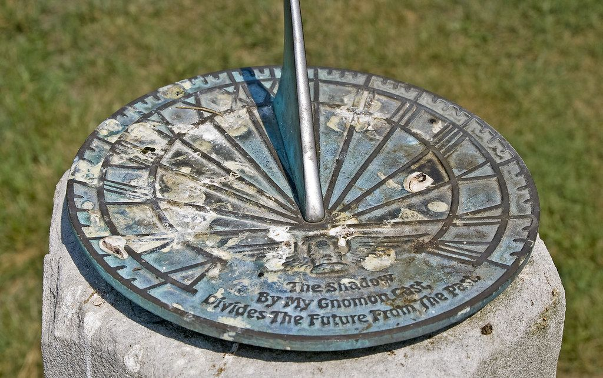
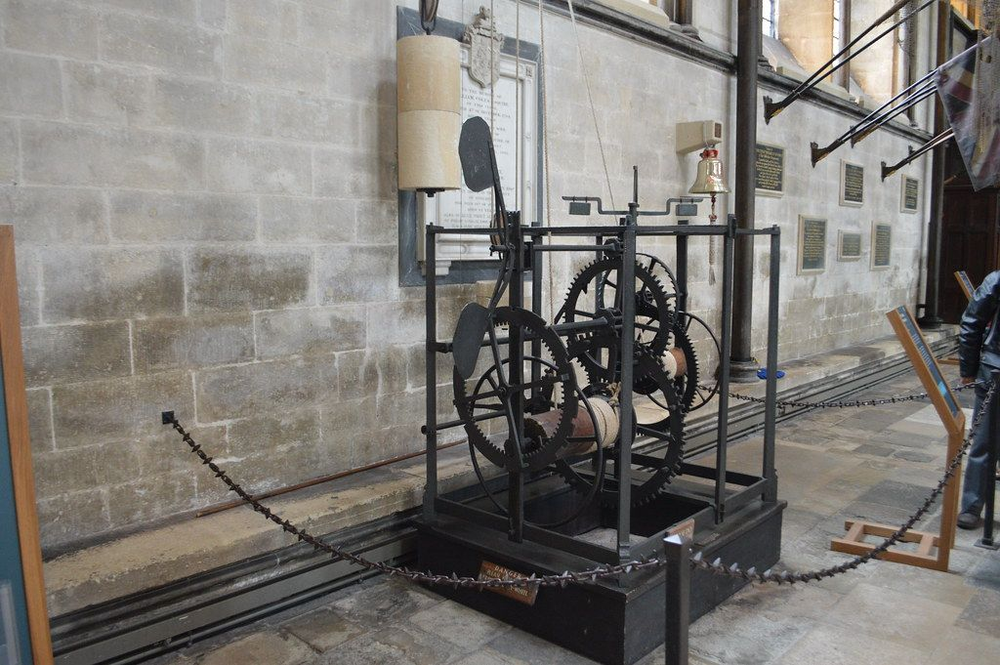
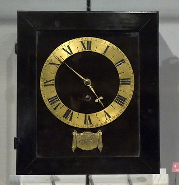
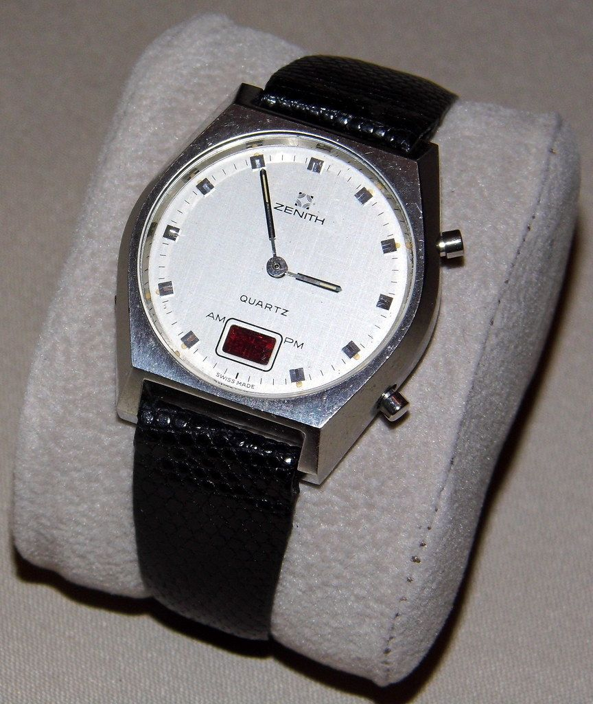
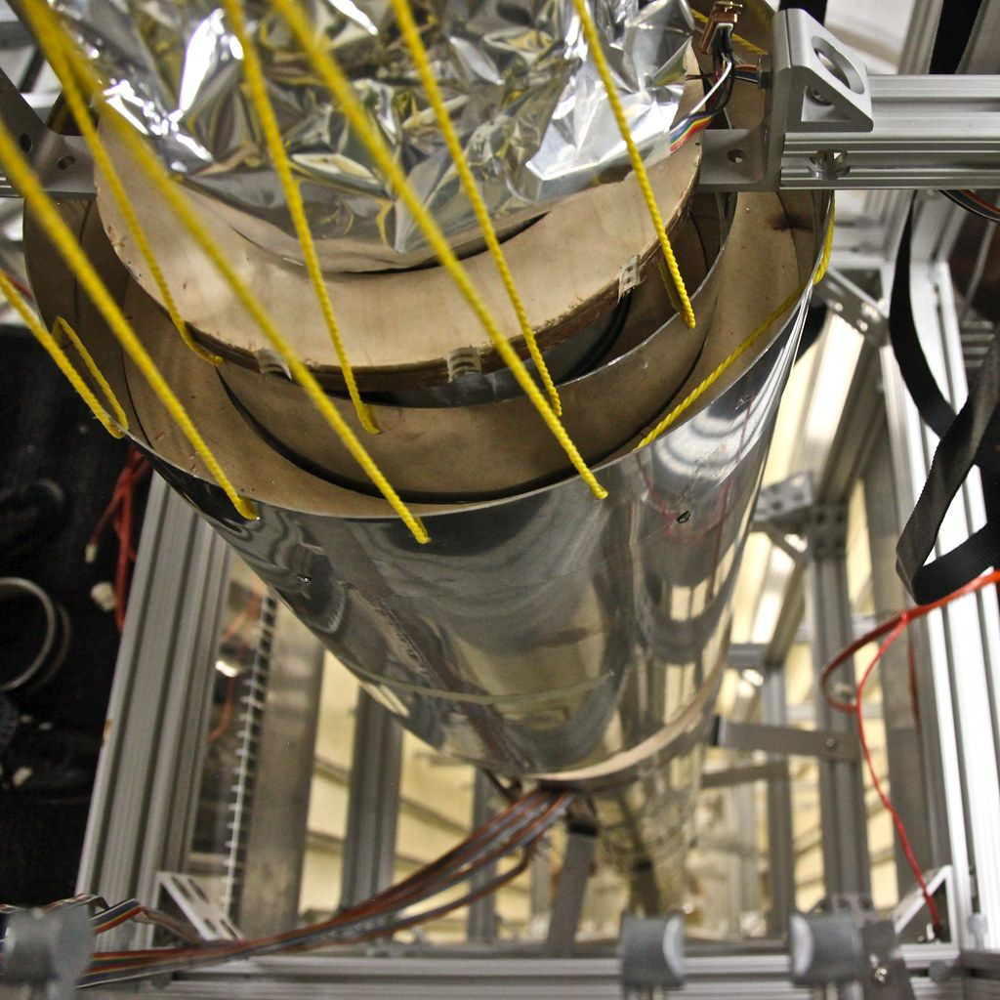

::: {.page-about name="Picture steps" uses="a process: how something works, one step at a time; instructions: how to make or build something, a picture for each step; a sequence or history: how something changed over time" pieces="picture-steps, recall"}
:::

<!--
How this page works:
- ::: picture-steps, then one line per step:  -  | Title | What happens.
  (Leave out the title for just the words:  -  | What happens.)
- The pictures go down the left third of the page; each step's number, title and words sit beside its picture.
- Every picture is the same height (height="31mm"; 34mm if you leave it out) and is cropped to fill its box. For drawings or
  diagrams that mustn't be cropped, add fit="contain".
- A step is never split across two pages. Five steps of 31mm and a question fill an A4 page.
- Keep each step to two or three short sentences.
-->

People have always wanted to know the time. Here is how clocks changed, step by step.

::: {.picture-steps height="31mm"}
-  | The sundial | The sun makes a shadow on a dial. As the sun moves across the sky, the shadow moves too. It only works on sunny days.
-  | The first machine clocks | About 700 years ago, people built big clocks with gears and falling weights. They had no faces. They rang a bell every hour.
-  | The pendulum clock | In 1656, Christiaan Huygens made a clock with a pendulum. A pendulum swings in the same time, again and again. Clocks were now right to about one minute a day.
-  | The quartz watch | A small battery makes a quartz crystal shake very fast, about 32,000 times a second. A chip counts the shakes. Watches were now cheap and very good.
-  | The atomic clock | Atomic clocks count the very fast changes of atoms. They are right to about one second in millions of years. Phones and GPS use their time.
:::

::: {.recall lines="2"}
- Why was the pendulum clock better than the first machine clocks? | A pendulum swings in the same time again and again, so it kept better time.
:::

<!-- Photos: credited in ../images/CREDITS.md (sundial: Ron Cogswell; Salisbury clock: Matt From London; pendulum clock: koopmanrob; quartz watch: France1978; atomic clock: Steve Jurvetson). -->
