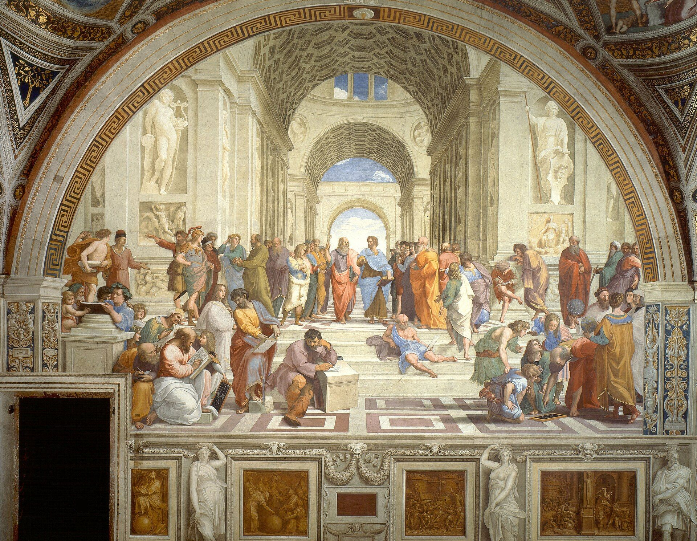
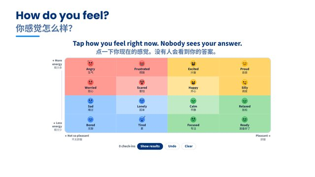
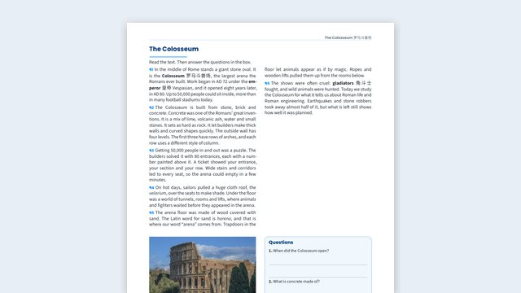
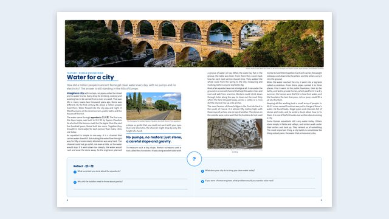
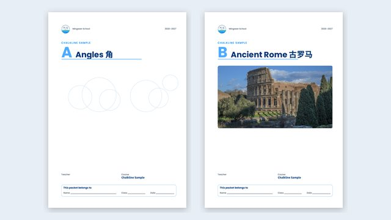
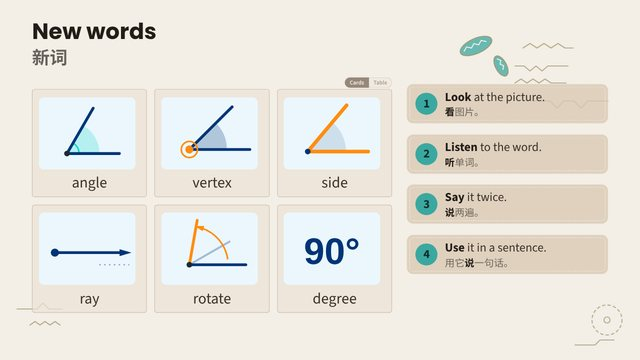

## [Ten minutes, five parts | 十分钟，五个部分]{.bi} {#agenda}

:::: {.columns}
::: {.column width="64%"}
::: {.tiles style="--cols: 1; --gap: 0.3em; font-size: 0.78em"}
::: box
::: row
[1]{.num}

[Why Chalkline | 为什么]{.bi}
:::
:::
::: {.box .plain}
::: row
[2]{.num}

[The guide: start from a template | 指南：从模板开始]{.bi}
:::
:::
::: {.box .plain}
::: row
[3]{.num}

[In class: words, tools, games | 课堂上：词汇、工具、游戏]{.bi}
:::
:::
::: {.box .plain}
::: row
[4]{.num}

[Your school's look | 学校的风格]{.bi}
:::
:::
::: {.box .plain}
::: row
[5]{.num}

[Your own course | 你自己的课程]{.bi}
:::
:::
:::
:::
::: {.column .hero width="36%"}
{fig-alt="The School of Athens by Raphael: philosophers talking and teaching in a great hall"}
:::
::::

::: footer
[Template Library]{.phase} · 1 · objectives, one at a time
:::

::: notes
The plan for the next ten minutes. The current part is the filled box: in your own decks, show a plan like this again between parts, with the next box filled in.
:::

## The usual way, and the Chalkline way {#usual-way}

::::: {.columns}
::: {.column width="50%"}
::: {.box .plain}
[The usual way]{.kicker}

- Slides in one app, worksheets in another
- The same words copied into a handout, a website, a packet
- Fix a typo in one place… and miss the other three
- A separate answer key to keep up to date
:::
:::
::: {.column width="50%"}
::: box
[The Chalkline way]{.kicker}

- **One plain-text file** per deck or worksheet
- Chalkline makes the slides, the web page and the PDF from it
- Fix it once: everything updates
- The answer key is in the same file, for teachers only
:::
:::
:::::

::: footer
[Template Library]{.phase} · 3 · two things side by side
:::

::: notes
Ask the room: how many places does the same lesson live for you right now? Slides, a doc, a shared drive, an LMS page, a printed packet…
:::

## One file, many outputs {#outputs}

::: {.cover style="height: auto; padding: 0.2em 0"}
[Write it once. Teach it everywhere.]{.big style="text-align: center; font-size: 1.5em"}
:::

::: {.tiles style="--cols: 3; font-size: 0.85em; text-align: center"}
::: {.box .plain}
[Slides]{.kicker}

to present, and a slide PDF
:::
::: {.box .plain}
[Web page]{.kicker}

for every deck and worksheet
:::
::: {.box .plain}
[Printable PDF]{.kicker}

a loose A4 sheet
:::
::: {.box .plain}
[Unit packet]{.kicker}

every printable, in one A3 booklet
:::
::: {.box .plain}
[Teacher edition]{.kicker}

every page with the answers written in
:::
::: {.box .plain}
[Two websites]{.kicker}

one for students and families, one for you
:::
:::

::: footer
[Template Library]{.phase} · 3 · big idea
:::

::: notes
Everything in this guide was made this way. Open any slide deck or worksheet file in VS Code to see how little is in it.
:::

## A slide is just text you can read {#plain-text}

::::: {.columns}
::: {.column width="46%"}
::: {.box .plain}
[This is a whole slide]{.kicker}

```{.markdown .friendly-text code-line-numbers="false"}
## Athens and Sparta

- Athens was a democracy.
- Citizens could .
- Sparta trained soldiers.
```

[`##` starts a slide. `-` makes a bullet. `` adds a pop-up with 中文 and 🔊.]{.fine}
:::
:::
::: {.column width="54%"}
::: {.box style="font-size: 0.9em"}
[Why it's easy]{.kicker}

- **Edit it like a document.** Change a word, save: the slide updates.
- **Or ask an AI to edit it.** Plain text is easy to change correctly.
- **It can't look messy.** The school style does fonts, colours and layout.
- **Write once.** The same words become the slides, the web page and the PDF.
:::
:::
:::::

```{=html}
<style>
  /* This slide's example reads like plain text, not code: the slide font, bigger, on a soft panel. */
  .reveal div.sourceCode:has(pre.friendly-text), .reveal pre.friendly-text { border: none; background: #ebf7fd; border-radius: 10px; }
  .reveal pre.friendly-text, .reveal pre.friendly-text code { font-family: "Source Sans 3", sans-serif; font-size: 0.95em; line-height: 1.5; color: #1F2933; background: #ebf7fd; }
  .reveal pre.friendly-text code span { color: inherit !important; font-weight: inherit; }
</style>
```

::: footer
[Template Library]{.phase} · 3 · two things side by side
:::

::: notes
For teachers new to this: you don't need to learn a language. Most slides are headings and bullet points, exactly as they look here. When you want something fancier (two columns, a box, a vocab pop-up, a poll), you don't write it from scratch: you copy it from the guide (next slide), or ask an AI assistant to.
:::

## [Start from the guide, not a blank page | 从指南开始，不从空白开始]{.bi} {#guide}

::: {.tiles style="--cols: 5; --pic-height: 5em; font-size: 0.6em; text-align: center"}
::: {.box .plain}
[{fig-alt="A Template Library slide: a mood meter"}](../templates-slides.html)

**Template Library**

every slide layout, game and activity
:::
::: {.box .plain}
[{fig-alt="A printable: a reading with a photo and questions"}](../printables.html)

**Printable Templates**

worksheets, handouts, picture layouts
:::
::: {.box .plain}
[{fig-alt="A packet spread about Roman aqueducts"}](../packet-templates.html)

**Packet Templates**

every kind of packet page
:::
::: {.box .plain}
[{fig-alt="The covers of two example unit packets"}](../examples/index.html)

**Example Units**

Angles, Ancient Rome, Mesopotamia
:::
::: {.box .plain}
[{fig-alt="An Exemplar lesson slide: new words with drawings of angles"}](../exemplar-slides.html)

**Exemplar Lesson**

how to plan a lesson, phase by phase
:::
:::

::: {.strip style="font-size: 0.6em; margin-top: 0.7em"}
[Where]{.pill}

**How to use Chalkline**, in the teacher site's sidebar. It updates with Chalkline. Keep your own favourites in **My templates** and **My themes**.
:::

::: footer
[Template Library]{.phase} · 3 · compare several things
:::

::: notes
Click a picture to open the page. The guide is copied into the teacher site at every build, so it's never in your own files and students never see it.
:::

## [Copy a slide into your lesson | 把幻灯片复制到你的课里]{.bi} {#copy}

::::: {.columns}
::: {.column width="58%"}
::: {.steps .stack style="font-size: 0.95em"}
1. [**Find it:** open the Template Library and press **O**. Look down the column for what you need: start · words · explain · read · watch · tasks · talk · check · games · end · looks.]{.step-text}
2. [**Copy its source:** classroom tools (**W**) › Slides › **‹›** View source, then **Copy**.]{.step-text}
3. [**Paste** it into your deck. Change the words and pictures; keep the pieces.]{.step-text}
4. [**Credit** any outside picture on your Credits slide.]{.step-text}
:::
:::
::: {.column width="42%"}
::: {.box .plain style="font-size: 0.8em"}
[Not sure how to plan a lesson?]{.kicker}

The **Exemplar Lesson** is one whole lesson laid out like a map: across, the seven phases; down, other ways to run each one, and when to choose it.
:::

::: {.box .plain style="font-size: 0.8em"}
[This deck]{.kicker}

Every slide in it was made this way. Its footer names the template it came from.
:::
:::
:::::

::: footer
[Template Library]{.phase} · 0 · copy a slide
:::

::: notes
Every Template Library slide has notes: what it's for, which pieces it's made of, and what else to look at. It also has a small reference number, so you can say "use slide 6.3" to a colleague or an AI assistant.
:::

## Printables and packets build themselves {#packets}

::::: {.columns}
::: {.column width="58%"}
- **A loose sheet:** A4, with Name and page numbers
- **A page in the unit packet:** printed on **A3 and folded** into a booklet
- **Ready-made blocks:** word banks, organizers, glossed readings, timelines
- **Three print themes** for a black-and-white copier

::: {.strip style="margin-top: 0.5em; font-size: 0.75em"}
[Teacher edition]{.pill}

The same pages, the answers written in red where students write theirs.
:::
:::
::: {.column .hero width="42%"}
{fig-alt="A two-page packet spread: a magazine feature about Roman aqueducts with a panorama across both pages"}
:::
:::::

::: footer
[Template Library]{.phase} · 3 · hero photo beside text
:::

::: notes
Packets are made fresh from the source files, not glued together, so they always match the latest worksheets. In the teacher edition nothing moves: the teacher's page 11 is the student's page 11. Open Example Units › Ancient Rome and flip through its packet.
:::

## Every unit gets a home page {#unit-page}

:::: {.columns}
::: {.column width="45%"}
{fig-alt="The covers of two example unit packets: Angles, and Ancient Rome with a photo of the Colosseum"}
:::
::: {.column width="55%"}
::: {.box .plain}
[Key idea]{.kicker}

Add a file to the unit's folder and it appears: the unit's **objectives**, every deck and printable, and **packet** buttons for the teacher edition and the student copy. Nothing to list by hand.
:::

[Try it: **How to use Chalkline › Example units › Ancient Rome**.]{.fine}
:::
::::

::: footer
[Template Library]{.phase} · 3 · one idea and a picture
:::

## [Words and language, built in | 词汇和语言，自带]{.bi} {#words}

::::: {.columns}
::: {.column width="58%"}
- Athens was a . Rome built an  and many an . Tap a dotted word.
- One list of words (`vocab.csv`), one of sentence frames (`frames.csv`): slides, printables and the vocab app all read them.
- **English is the goal; 中文 is support,** never in quizzes. Try the 中/EN switch.
:::
::: {.column width="42%"}

:::
:::::

::: footer
[Template Library]{.phase} · 2 · words glossed in a text
:::

::: notes
Try the pop-ups now. Then open the vocab app in the sidebar: every word in the course, searchable in English or Chinese. A new course's list starts with the starter unit's four words.
:::

## Two websites from the same files {#websites}

::::: {.columns}
::: {.column width="50%"}
::: {.box .plain}
[Students and families]{.kicker}

- Slides, worksheets, vocab
- Games to play at home
- No answer keys, notes or teacher tools
:::
:::
::: {.column width="50%"}
::: box
[Teachers]{.kicker}

- Everything, plus **answer keys** and **speaker notes**
- The **toolbox**, teacher editions, and this guide
- **Who sees it** on the overview shows what students get
:::
:::
:::::

::: {.strip style="font-size: 0.7em; margin-top: 0.6em"}
[One label]{.pill}

`audience: [teacher, student]`. Leave out `student` and the file stays in the teacher site.
:::

::: footer
[Template Library]{.phase} · 3 · two things side by side
:::

## [Classroom tools in every deck | 每套幻灯片都有课堂工具]{.bi} {#tools}

:::: {.columns}
::: {.column width="58%"}
::: {.steps .stack style="font-size: 0.95em"}
1. [**Timer** (**T**), **clock** (**K**), **notes** (**S**), **draw** (**C**)]{.step-text}
2. [**Toolbox** (**W**): name picker, groups, scoreboard, noise meter, traffic light, dice, the unit's vocab and packet…]{.step-text}
3. [**Routines:** Think-Pair-Share and more, step by step, with a timer]{.step-text}
4. [**Polls** and **games**: no devices, no accounts]{.step-text}
:::
:::
::: {.column width="42%"}

:::
::::

::: footer
[Template Library]{.phase} · 6 · a task with a timer
:::

::: notes
Start the timer to show it. It keeps running in a small box if you change slides. Press W now to open the toolbox. Class lists stay in this browser only: never uploaded, never in the course files.
:::

## Quick check {#poll}

::::: {style="font-size: 1.15em; margin-top: 0.6em"}
::: {.poll type="choice" options="Template Library | Packets | Vocab pop-ups | Classroom tools"}
Which feature will you try first?
:::
:::::

::: footer
[Template Library]{.phase} · 8 · multiple choice
:::

::: notes
Tap an answer on the board (or press 1–4), then press R or click Show results. No `correct=`, so it's a vote.
:::

## Slides can do anything a web page can

:::: {.columns}
::: {.column width="68%"}
```{=html}
<link rel="stylesheet" href="odyssey/odyssey.css">
<div class="odyssey"></div>
<script src="odyssey/odyssey.js"></script>
```
:::
::: {.column .ody-side width="32%"}
**The Odyssey 奥德赛:** ten years, ten stops, one hero trying to get home.

Press **Play**, or hover a stop for its story.

::: {.callout-tip title="Made with AI" icon=false}
This map is about 150 lines of code. An AI assistant wrote it from one paragraph: *"Make an interactive map of Odysseus's journey home: numbered stops, a ship that sails the route, and the story of each stop on hover."*

Maps, timelines, games, simulations: if a web page can do it, a slide can too.
:::
:::
::::

::: notes
The code lives in this unit's `odyssey/` folder. To make your own, describe what you want to an AI assistant (Claude, for example) and ask for a self-contained HTML/JavaScript block for a Quarto reveal.js slide. In the slide PDF the whole route is shown at once.
:::

## So what else can you do?

[**71 ready-made features,** all working today: 52 here, 19 more for talk, STEM and printables on the next slide. Click one to see it.]{.cat-lead}

:::: {.catalog}

:::: {.cat-col}
::: {.cat-box .cat-games}
[Review games]{.cat-head} [8]{.cat-n}

[Snowman](../templates-slides.html#/snowman){.chip} [Word scramble](../templates-slides.html#/scramble){.chip} [Picture reveal](../templates-slides.html#/picture-reveal){.chip} [Matching](../templates-slides.html#/matching-pictures){.chip} [Memory](../templates-slides.html#/memory){.chip} [Jeopardy, with teams](../templates-slides.html#/review-jeopardy){.chip} [Word Blitz](../templates-slides.html#/blitz){.chip} [Bingo, printed cards](../templates-slides.html#/bingo){.chip}

[**Review games page:** any game, any unit](../../../review-games.html){.chip .chip-wide}
:::

::: {.cat-box .cat-learn}
[Learning activities]{.cat-head} [7]{.cat-n}

[Label a photo](../templates-slides.html#/label-photo){.chip} [Put it on the timeline](../templates-slides.html#/timeline-activity){.chip} [Sort it, with reasons](../templates-slides.html#/practice-sort){.chip} [Venn diagram](../templates-slides.html#/venn){.chip} [Build the sentence](../templates-slides.html#/sentence){.chip} [Fill in the blanks](../templates-slides.html#/fill-blanks){.chip} [Put it in order](../templates-slides.html#/strategies-order){.chip}
:::
::::

::: {.cat-box .cat-teach}
[Teach with it]{.cat-head} [11]{.cat-n}

[Timeline: tap to zoom in](../templates-slides.html#/input-timeline){.chip} [Timeline across slides](../templates-slides.html#/timeline-static){.chip} [Story map](#/slides-can-do-anything-a-web-page-can){.chip} [Diagram you can hover](../templates-slides.html#/drawio){.chip} [Video in a slide](../templates-slides.html#/video){.chip} [Step-by-step answers](../templates-slides.html#/quiz-list){.chip} [Zoom and glide](../templates-slides.html#/zoom){.chip} [Full-screen titles](../templates-slides.html#/section){.chip} [Photos with captions](../templates-slides.html#/input-picture){.chip} [Quick reference: every link on one slide](../templates-slides.html#/quick-ref){.chip} [Speaker notes: press S]{.chip .chip-key}
:::

::: {.cat-box .cat-board}
[On the board]{.cat-head} [8]{.cat-n}

[Tap-to-vote polls](../templates-slides.html#/choice){.chip} [True or false checks](../templates-slides.html#/quiz-list){.chip} [PDF gallery](../templates-slides.html#/packet-page){.chip} [Write on a worksheet](../templates-slides.html#/worksheet){.chip} [Download it with notes](../templates-slides.html#/worksheet){.chip} [Chalkboard](../templates-slides.html#/worksheet){.chip} [Vocab pop-ups, 中文, read aloud](../templates-slides.html#/glossed){.chip} [Timers](../templates-slides.html#/timers){.chip}
:::

::: {.cat-box .cat-tools}
[Toolbox on every slide: press W]{.cat-head} [18]{.cat-n}

[Name picker, with class lists]{.chip .chip-key data-icon="hand"} [Groups]{.chip .chip-key data-icon="users"} [Routines: Think-Pair-Share and more]{.chip .chip-key data-icon="repeat"} [Scoreboard]{.chip .chip-key data-icon="trophy"} [Voice level]{.chip .chip-key data-icon="volume-2"} [Noise meter]{.chip .chip-key data-icon="mic"} [Traffic light]{.chip .chip-key data-icon="traffic-cone"} [QR code]{.chip .chip-key data-icon="qr-code"} [Stopwatch]{.chip .chip-key data-icon="timer"} [Dice]{.chip .chip-key data-icon="dices"} [Slide size]{.chip .chip-key data-icon="ruler"} [Reset for the next class]{.chip .chip-key data-icon="rotate-ccw"} [Clock (K)]{.chip .chip-key data-icon="clock"} [Spotlight]{.chip .chip-key data-icon="flashlight"} [Music from YouTube]{.chip .chip-key data-icon="music"} [Unit vocab, any slide]{.chip .chip-key data-icon="book-a"} [Unit packet, any slide]{.chip .chip-key data-icon="files"} [View source: how a slide is made (U)]{.chip .chip-key data-icon="code"}
:::

::::

```{=html}
<style>
  /* Chalkline's design values (ui/ui.css): the same chips, borders and corners as the tools and games */
  .reveal .cat-lead { display: block; margin: -0.25em 0 0.4em; font-size: 0.62em; color: var(--ui-muted); }
  .reveal .catalog { display: grid; grid-template-columns: repeat(3, minmax(0, 1fr)); gap: 10px; font-size: 0.47em; }
  .reveal .cat-box { padding: 8px 12px 8px; border: 1px solid var(--ui-line); border-top: 3px solid var(--cat); border-radius: var(--ui-r); background: var(--ui-surface); box-shadow: var(--ui-shadow-sm); }
  .reveal .cat-box p { margin: 0 0 3px; line-height: 1.6; }
  .reveal .cat-games { --cat: #0087ff; }
  .reveal .cat-learn { --cat: #d6458f; }
  .reveal .cat-col { display: flex; flex-direction: column; gap: 10px; }
  .reveal .cat-col .cat-box { flex: 1; }
  .reveal .cat-teach { --cat: #2e9e4f; }
  .reveal .cat-board { --cat: #ff8c0f; }
  .reveal .cat-tools { --cat: #7b4fc9; grid-column: 1 / -1; }
  .reveal .cat-head { color: var(--ui-ink); font-size: 1.2em; font-weight: 700; }
  .reveal .cat-n { margin-left: 6px; padding: 0 8px; border-radius: 999px; background: var(--ui-soft); color: var(--ui-muted); font-size: 0.85em; font-weight: 700; }
  .reveal .chip { display: inline-flex; align-items: center; gap: 5px; margin: 0 2px 3px 0; padding: 0 9px; border: 1px solid var(--ui-line); border-radius: var(--ui-r-sm); background: var(--ui-surface); color: var(--ui-ink); font-weight: 500; line-height: 1.6; white-space: nowrap; text-decoration: none; }
  .reveal a.chip:hover { border-color: var(--ui-line-strong); background: var(--ui-soft); }
  .reveal .chip-key { background: var(--ui-soft); }
  .reveal .chip .ui-icon { color: var(--ui-muted); }
  .reveal .chip-wide { margin-top: 4px; background: var(--ui-accent-soft); }
</style>
<script>
  // The toolbox chips get the toolbox's own line icons (ui/icons.js loads at the end of the page).
  window.addEventListener("load", function () {
    if (!window.ChalklineIcons) return;
    document.querySelectorAll(".catalog [data-icon]").forEach(function (chip) { chip.prepend(ChalklineIcons.el(chip.dataset.icon)); });
  });
</script>
```

::: notes
Every chip with a solid border opens a working example in another deck: press the browser's Back button to come back here. The toolbox tools (grey) are on every slide: press **W** to open them, right here. In a slide, a link to another deck is just `[text](../templates-slides.html#/quiz-list)`.
:::

## And for talk, STEM, printables and whole units {#more-features}

[**19 more:** talk and group work, things to drag and build, and the printables and units to copy. Click one to see it.]{.cat-lead}

:::: {.catalog .catalog-3}

::: {.cat-box .cat-talk}
[Talk and group work]{.cat-head} [7]{.cat-n}

[Mood check-in](../templates-slides.html#/mood-meter){.chip} [Think-Pair-Share](../templates-slides.html#/tps){.chip} [Jigsaw](../templates-slides.html#/interaction-jigsaw){.chip} [Group roles](../templates-slides.html#/interaction-roles){.chip} [Stations](../templates-slides.html#/practice-stations){.chip} [Live drawing board](../templates-slides.html#/interaction-board){.chip} [Padlet wall](../templates-slides.html#/padlet){.chip}
:::

::: {.cat-box .cat-stem}
[STEM you can move]{.cat-head} [4]{.cat-n}

[Drag a triangle: angles add to 180°](../templates-slides.html#/explorer){.chip} [GeoGebra graphs with sliders](../templates-slides.html#/sliders){.chip} [Blocks that become Python](../templates-slides.html#/blocks){.chip} [Turn an angle from acute to full](../examples/example-angles/angle-explorer.html){.chip}
:::

::: {.cat-box .cat-print}
[Printables and units]{.cat-head} [8]{.cat-n}

[Printable templates](../printables.html){.chip} [Pages with pictures](../printables.html#page-layouts-with-pictures){.chip} [Packet pages](../packet-templates.html){.chip} [A worksheet with its answers](../examples/example-angles/turning-angles-worksheet.html){.chip} [Example unit: Angles](../examples/example-angles/index.html){.chip} [Example unit: Ancient Rome](../examples/example-rome/index.html){.chip} [Example unit: Mesopotamia](../examples/example-mesopotamia/index.html){.chip} [Exemplar lesson](../exemplar-slides.html){.chip}
:::

::::

```{=html}
<style>
  .reveal .catalog-3 { grid-template-columns: repeat(3, minmax(0, 1fr)); font-size: 0.55em; }
  .reveal .cat-talk { --cat: #d6458f; }
  .reveal .cat-stem { --cat: #0aa6a6; }
  .reveal .cat-print { --cat: #e0a800; }
</style>
```

::: notes
The talk chips open the Template Library's "talk" column. The STEM chips open live interactives (the triangle, the angle and the block coding are saved in the course and work offline; GeoGebra needs the internet). The printables chips open the guide's printable and packet templates. The example units are whole units, slides and printables and their packet, to copy into `course/units/` and change.
:::

## [It always looks like your school | 永远是你学校的样子]{.bi} {#schemes}

::: {.tiles style="--cols: 4; --gap: 0.45em; font-size: 0.85em"}
::: {.box .scheme-default}
[Default]{.kicker}

[A pill]{.pill} The brand colours, on white.
:::
::: {.box .scheme-sky}
[Sky]{.kicker}

[A pill]{.pill} Calm, for long reading.
:::
::: {.box .scheme-lagoon}
[Lagoon]{.kicker}

[A pill]{.pill} Loud: openers and games.
:::
::: {.box .scheme-night}
[Night]{.kicker}

[A pill]{.pill} Dark, for a dim room.
:::
:::

::: {.strip style="font-size: 0.75em; margin-top: 0.9em"}
[Your school]{.pill}

Colours, fonts and logos are set once, in `brand/`, for slides, pages and PDFs. Add your own scheme in **My themes**. A deck: `slide-scheme: night` · try them: the palette, top right
:::

::: footer
[Template Library]{.phase} · 11 · colour schemes
:::

::: notes
Click the palette at the top right of this slide: try every scheme on this slide, or on the whole deck. Nothing is saved: reload to undo. The Template Library's Colour schemes slide shows all eight.
:::

## Editing with an AI assistant {#ai}

::: {.chain style="font-size: 0.85em; margin-top: 0.6em"}
::: {.box .plain style="text-align: center"}
**Open** your course folder in Claude, Gemini, WorkBuddy…
:::
::: {.box .plain style="text-align: center"}
**Start with** *"Read CLAUDE.md first and follow it."*
:::
::: {.box style="text-align: center"}
**Ask** in plain words: *"Add a slide about the Silk Road, with Chinese glosses."*
:::
::: {.box .plain style="text-align: center"}
**Check** the page in the browser
:::
:::

::: {.strip style="font-size: 0.75em; margin-top: 1em"}
[Keeps a log]{.pill}

If it changes how Chalkline works, it writes down what and why in `TOOL-CHANGES.md`: send that file to John now and then.
:::

::: footer
[Template Library]{.phase} · 1 · agenda
:::

::: notes
`CLAUDE.md` holds the course's rules: English first, 中文 as support, credit every picture, start slides from the Template Library. While you work on one worksheet, only that file is rebuilt, so checking is quick. A teacher's own tools go in `_extensions/my-tools/`, outside Chalkline, so updating Chalkline never loses them.
:::

## [Get your own course | 建立你自己的课程]{.bi} {#start}

::::: {.columns}
::: {.column width="56%"}
::: {.steps .stack style="font-size: 0.95em"}
1. [**Install** (once): VS Code, Quarto, Python 3, Git, Chrome or Edge]{.step-text}
2. [**Make an empty folder**, open it in VS Code, and run the line on the right in **Terminal › New Terminal**]{.step-text}
3. [**Start:** double-click **Start Chalkline** (the first time: 5–10 minutes)]{.step-text}
4. [**Make it yours:** change **My Course** in `_quarto.yml`]{.step-text}
:::
:::
::: {.column width="44%"}
::: {.box .plain style="font-size: 0.8em"}
[The one line]{.kicker}

`quarto use template insufficientdoubt/project-chalkline`
:::

::: {.box .plain style="font-size: 0.8em"}
[Then]{.kicker}

Your site opens with a **starter unit**: a slide deck, a handout and four words.
:::
:::
:::::

::: footer
[Template Library]{.phase} · 6 · a task with steps
:::

::: notes
Step by step: the Quick Start, in Getting started. Just want to look first? The online version: insufficientdoubt.github.io/project-chalkline. The site opens at localhost:4100, in the teacher version, and updates every time you save. You can also clone the repository in VS Code (Git: Clone) instead: the same course, plus Chalkline's history and planning notes. New features later: `python chalkline.py update` gets the newest tested release; your lessons stay as they are.
:::

## How a course is organized {#folders}

::: {.box .plain style="font-size: 0.9em"}
```{.text code-line-numbers="false"}
course/units/01-first-unit/
  index.qmd                 the unit page: title, objectives
  welcome-slides.qmd        a slide deck
  classroom-words.qmd       a printable (web page + PDF + packet)
  images/                   pictures, with CREDITS.md
course/guide/01-my-templates/   your own slides to reuse
vocab/data/vocab.csv        the vocab words
vocab/data/frames.csv       sentence frames, grammar, questions
brand/                      colors, fonts, logos, My themes
```
:::

::: footer
[Template Library]{.phase} · 0 · the pieces
:::

::: notes
The three example units in "How to use Chalkline" are laid out the same way. Copy one into `course/units/` to start a unit.
:::

## Make your own unit {#unit}

::: {.steps .stack style="font-size: 0.95em"}
1. [**Copy** the starter unit, or an example unit from **How to use Chalkline**, into `course/units/`, and rename it: `02-ancient-rome`]{.step-text}
2. [**Change** the title and objectives in its `index.qmd`]{.step-text}
3. [**Make** the slides from the **Template Library** and the printables from the **Printable Templates**; keep the labels at the top]{.step-text}
4. [**Add** your words to `vocab/data/vocab.csv`]{.step-text}
5. [**Save:** the unit is on the site. When a printable is done: `python chalkline.py packets --unit 2`]{.step-text}
:::

::: footer
[Template Library]{.phase} · 0 · copy a slide
:::

::: notes
A new deck or worksheet from a template: Terminal › Run Task… › New slide deck or worksheet.
:::

## [How ready do you feel? | 你准备好了吗？]{.bi} {#exit}

::::: at-bottom
::: {.poll type="smileys"}
How ready do you feel to make your first unit?
:::
:::::

::: footer
[Template Library]{.phase} · 10 · exit poll
:::

## [Credits | 来源]{.bi} {#credits .credits}

:::: columns
::: column
### Pictures

- **Title:** [*The School of Athens*](https://commons.wikimedia.org/wiki/File:%22The_School_of_Athens%22_by_Raffaello_Sanzio_da_Urbino.jpg), Raphael (about 1510), public domain, via Wikimedia Commons.
- **The guide's pages** (the pictures of slides and packet pages): made for Chalkline. Photos in them: the [Pont du Gard](https://commons.wikimedia.org/wiki/File:Pont_du_Gard_BLS.jpg) by Benh LIEU SONG, [CC BY-SA 3.0](https://creativecommons.org/licenses/by-sa/3.0), and the [Colosseum](https://commons.wikimedia.org/wiki/File:Colosseum_of_Rome_and_Roman_forum.jpg) by Wilfredor, CC0, both via Wikimedia Commons.
- **The vocab pictures and the Odyssey map:** original, made for Chalkline.
:::
::::
