# [How this library works | 这个模板库怎么用]{.bi} {#how data-menu-title="0 · How this library works"}

::::: {.columns}
::: {.column width="52%"}
:::: {style="font-size: 0.62em"}
::: {.box .plain}
[Across → · 横向 →]{.kicker}

[Columns by purpose: start a lesson, explain, read, check, review… | 按用途分列：开始上课、讲解、阅读、检查、复习……]{.bi}
:::

::: {.box .plain}
[Down ↓ · 纵向 ↓]{.kicker}

[Every option for that purpose. The top one is the default. | 这个用途的所有选项。最上面的是默认选项。]{.bi}
:::

::: {.box .plain}
[Notes (S) · 备注]{.kicker}

[**Use it for** (ideas, in any subject), **Pieces** (how it's made), **Also see**. | **用途**（适用于任何学科）、**组成**（怎么做的）、**另见**。]{.bi}
:::

::: {.box .accent}
[Tips · 小提示]{.kicker}

[**O**: see every slide. The **palette** (top right) tries other colours and looks. | 按 **O** 查看所有幻灯片。右上角的**调色板**可以试试其他颜色和风格。]{.bi}
:::
:::
::::
::: {.column width="48%"}
::: {.tiles style="--cols: 2; --gap: 0.25em; font-size: 0.44em"}
::: {.box .plain}
::: row
[1]{.num}

[Start a lesson | 开始上课]{.bi}
:::
:::

::: {.box .plain}
::: row
[2]{.num}

[Words and language | 词汇与语言]{.bi}
:::
:::

::: {.box .plain}
::: row
[3]{.num}

[Explain and show | 讲解与展示]{.bi}
:::
:::

::: {.box .plain}
::: row
[4]{.num}

[Read and follow | 阅读与跟读]{.bi}
:::
:::

::: {.box .plain}
::: row
[5]{.num}

[Watch and look | 观看]{.bi}
:::
:::

::: {.box .plain}
::: row
[6]{.num}

[Tasks and instructions | 任务与指令]{.bi}
:::
:::

::: {.box .plain}
::: row
[7]{.num}

[Talk and work together | 交流合作]{.bi}
:::
:::

::: {.box .plain}
::: row
[8]{.num}

[Check understanding | 检查理解]{.bi}
:::
:::

::: {.box .plain}
::: row
[9]{.num}

[Review games | 复习游戏]{.bi}
:::
:::

::: {.box .plain}
::: row
[10]{.num}

[End a lesson | 结束上课]{.bi}
:::
:::

::: {.box .plain}
::: row
[11]{.num}

[Looks and settings | 外观与设置]{.bi}
:::
:::
:::
:::
:::::

::: footer
[0 · How to use this library · 怎么用]{.phase} · how this library works
:::

::: notes
**Use it for:** the first slide to show a new colleague, or an AI assistant, before they make slides.

**Pieces:** `.columns` with `.box .plain` boxes, `.kicker` labels and bilingual text; `.tiles` (two columns) of `.row`s with a `.num`.

**Also see:** the Exemplar lesson (how to plan one lesson with these slides).
:::

## [Copy a slide into your lesson | 把幻灯片复制到你的课里]{.bi} {#copy data-menu-title="0 · Copy a slide"}

::: {.steps .stack style="font-size: 0.82em"}
1. [**Find it:** press **O**, look down a column, open the one you like. | **找到它：**按 **O**，在一列里往下看，打开你喜欢的那张。]{.bi}
2. [**Copy its source:** classroom tools (**W**) › Slides › **‹›** (View source), then **Copy**. | **复制源代码：**课堂工具（**W**）› Slides › **‹›**（查看源代码），然后**复制**。]{.bi}
3. [**Paste** it into your deck and change the words and pictures. Keep the pieces. | **粘贴**到你的幻灯片里，换上你的文字和图片，保留结构。]{.bi}
4. [**Credit** any outside picture on your Credits slide. | 在来源页上**注明**所有外来图片。]{.bi}
:::

::: {.box .plain style="font-size: 0.7em"}
[Printables · 打印材料]{.kicker}

[Worksheets, handouts, cards and checklists are on their own page: **Printable templates**, in this guide. | 练习单、讲义、卡片和检查表在单独的页面：本指南里的**打印模板**。]{.bi}
:::

::: footer
[0 · How to use this library · 怎么用]{.phase} · copy a slide
:::

::: notes
**Use it for:** showing a colleague how to reuse a slide · a reminder for yourself · the steps an AI assistant should follow.

**Pieces:** Chalkline's `.steps .stack` (numbered cards, one under another) and a `.box .plain`.

**Also see:** Printable templates (a page in this guide); My templates (your own copies, above this guide).
:::

## [The pieces every slide uses | 每张幻灯片的组成部分]{.bi} {#pieces data-menu-title="0 · The pieces"}

::: {.tiles style="--cols: 4; --gap: 0.45em; font-size: 0.68em"}
::: box
[`.box`]{.kicker}

A box, in the scheme's colour.
:::

::: {.box .plain}
[`.box .plain`]{.kicker}

A quieter box.
:::

::: {.box .dark}
[`.box .dark`]{.kicker}

A dark band.
:::

::: {.box .accent}
[`.box .accent`]{.kicker}

The accent colour.
:::

::: {.box .plain}
[`.kicker`]{.kicker}

[`.pill`]{.pill} [3]{.num}

A label, a tag, a number (`.num`).
:::

::: {.box .plain}
[`.big` and `.lead`]{.kicker}

[Big words]{.big style="font-size: 1.6em"}

[Lead text, a little bigger.]{.lead}
:::

::: {.box .plain}
[Gaps and frames]{.kicker}


:::

::: {.box .plain}
[Bilingual]{.kicker}

[English | 中文]{.bi}
:::
:::

::: {.strip style="font-size: 0.6em; margin-top: 0.7em"}
[Layout]{.pill}

`.columns` (side by side) · `.tiles` (a grid: `--cols: 3`) · `.chain` (boxes with arrows) · `.cover` (fills the slide, centred) · `.row` (in a line)
:::

::: footer
[0 · How to use this library · 怎么用]{.phase} · the pieces every slide uses
:::

::: notes
**Use it for:** a quick reference while writing slides · checking what a class looks like in each colour scheme (try the palette).

**Pieces:** every box style, label and layout piece of the slide kit, each showing itself. They take their colours from the slide's scheme (`styles/layout.scss`).

**Also see:** Looks and settings (column 11).
:::

# {#intro data-menu-title="1 · Lesson intro"}

::::: intro-grid
::: {.area .content label="Content objective · 内容目标"}
::: lesson-info
| | |
|--:|:--|
| [Math \| 数学]{.bi} | [Grade 4 · [today]{.today} \| 四年级 · [今天]{.today}]{.bi} |
| [Topic \| 课题]{.bi} | [Turning and angles \| 旋转与角]{.bi} |
| [Objective \| 学习目标]{.bi} | [I can name five kinds of angle. \| 我能说出五种角的名称。]{.bi} |
| [Homework \| 作业]{.bi} | [Angle hunt at home \| 在家找角]{.bi} |

: {tbl-colwidths="[25,75]"}
:::
:::

::: {.area .language label="Language objective · 语言目标"}
[Vocab · 词汇]{.pill .tag}



[Sentence frames · 句型]{.pill .tag}


:::

::: {.area .donow label="Do now · 课前任务"}
1. [Find two corners in the room. | 在教室里找两个角。]{.bi}
2. [Draw them in your book. | 把它们画在本子上。]{.bi}
3. [Which one is bigger? | 哪个更大？]{.bi}

::: {.end style="align-self: center; font-size: 0.48em"}

:::
:::
:::::

```{=html}
<script>
  // Today's date: "4 November" in English, "11月4日" in 中文 (the visitor's own clock)
  document.querySelectorAll("#intro .today").forEach(function (el) {
    var d = new Date();
    el.textContent = el.closest(".bil-zh") ? (d.getMonth() + 1) + "月" + d.getDate() + "日"
      : d.toLocaleDateString("en-GB", { day: "numeric", month: "long" });
  });
</script>
```

::: footer
[1 · Start a lesson · 开始上课]{.phase} · default: lesson intro
:::

::: notes
**Use it for:** the first slide of every lesson: students start the Do now while you take the register · a substitute's lesson (everything on one slide) · an observation lesson (objectives visible at once).

**Pieces:** `::: intro-grid`, a strict grid (`exemplar.css`): the content and language areas on the left, the Do now on the right, as tall as both, so their top and bottom edges always line up. Inside: two labelled `.area`s (content, language), a `.lesson-info` table, ``, a frame (``, from the language list), and a Do now `.area` with ``. The vocab gallery shows this sample's words; in your course, use your unit's words.

**Also see:** Lesson intro without a Do now; Objectives one at a time; Project calendar.
:::

## {#intro-nodonow data-menu-title="1 · Lesson intro without a Do now"}

::::: {.intro-grid .no-donow}
::: {.area .content label="Content objective · 内容目标"}
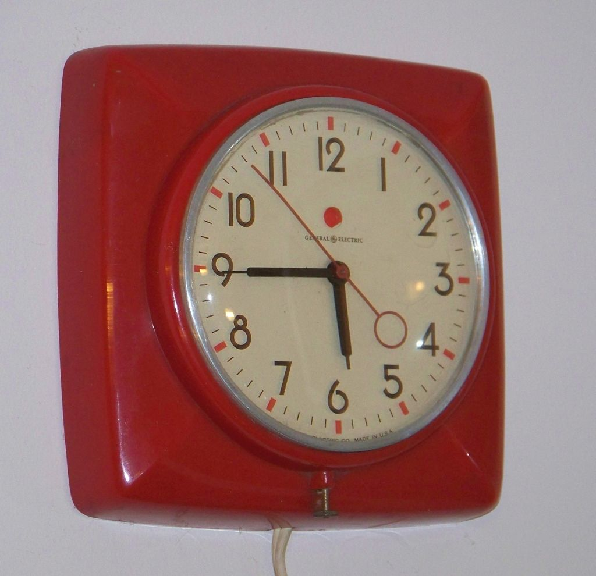{.preview fig-alt="Today's lesson: clock hands and other things that turn make angles"}

::: lesson-info
| | |
|--:|:--|
| [Math \| 数学]{.bi} | [Grade 4 · [today]{.today} \| 四年级 · [今天]{.today}]{.bi} |
| [Topic \| 课题]{.bi} | [Turning and angles \| 旋转与角]{.bi} |
| [Objective \| 学习目标]{.bi} | [I can name five kinds of angle. \| 我能说出五种角的名称。]{.bi} |
| [Homework \| 作业]{.bi} | [Angle hunt at home \| 在家找角]{.bi} |

: {tbl-colwidths="[25,75]"}
:::
:::

::: {.area .language label="Language objective · 语言目标"}
[I can compare two angles with *bigger than* and *smaller than*. | 我能用 *bigger than* 和 *smaller than* 比较两个角。]{.bi .obj}

[Vocab · 词汇]{.pill .tag}



[Sentence frames · 句型]{.pill .tag}


:::
:::::

```{=html}
<script>
  document.querySelectorAll("#intro-nodonow .today").forEach(function (el) {
    var d = new Date();
    el.textContent = el.closest(".bil-zh") ? (d.getMonth() + 1) + "月" + d.getDate() + "日"
      : d.toLocaleDateString("en-GB", { day: "numeric", month: "long" });
  });
</script>
```

::: footer
[1 · Start a lesson · 开始上课]{.phase} · lesson intro without a Do now
:::

::: notes
**Use it for:** a lesson that starts with the teacher · a test or presentation day · a lesson whose picture says what it's about.

**Pieces:** `::::: {.intro-grid .no-donow}` (`exemplar.css`): two `.area`s side by side. In the content area, a picture with `{.preview}` (a wide strip, cropped to fit) above the `.lesson-info` table; in the language area, the objective (`{.bi .obj}`), `` and a frame (``, from the language list).

**Also see:** Lesson intro (with a Do now).
:::

## [Today we will… | 今天我们要…]{.bi} {#intro-objectives data-menu-title="1 · Objectives, one at a time"}

:::: {.columns}
::: {.column width="64%"}
::: {.tiles style="--cols: 1"}
::: {.box .plain}
[Content objective · 内容目标]{.kicker}

[I can name five kinds of angle. | 我能说出五种角的名称。]{.bi .lead}
:::

::: {.box .plain}
[Language objective · 语言目标]{.kicker}

[I can compare two angles with *bigger than* and *smaller than*. | 我能用 *bigger than* 和 *smaller than* 比较两个角。]{.bi .lead}
:::
:::
:::
::: {.column .hero width="36%"}
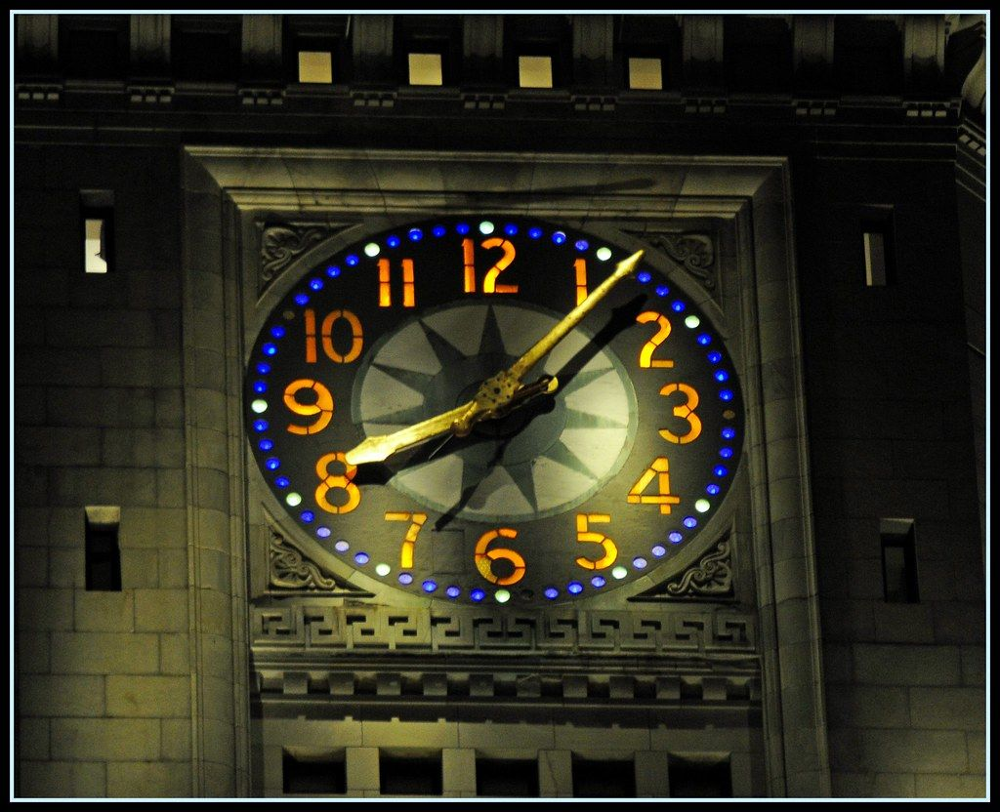{fig-alt="A big tower clock at night. Its two hands make an angle."}
:::
::::

::: footer
[1 · Start a lesson · 开始上课]{.phase} · objectives, one at a time
:::

::: notes
**Use it for:** a class that needs each objective read and unpacked · a new topic, with a photo to set the scene · a second language objective.

**Pieces:** `.columns`: on the left `.tiles` with one column (`--cols: 1`), two `.box .plain` with a `.kicker` and `.lead` text; on the right a hero picture, `::: {.column .hero}` (`exemplar.css`): a photo that fills the column, cropped to fit. Credit it on the Credits slide.

**Also see:** Hero photo beside the text (column 3).
:::

## [I can… | 我能…]{.bi} {#intro-ican data-menu-title="1 · I can…"}

::::: {.columns}
::: {.column width="64%"}
::: {.cover style="height: auto; padding: 0.4em 0"}
[I can name five kinds of angle. | 我能说出五种角的名称。]{.bi .big}
:::

::: {.box .plain}
[And I can say it · 我还能说出来]{.kicker}

[A straight angle is bigger than a right angle. | 平角比直角大。]{.bi .lead}
:::
:::
::: {.column .hero width="36%"}
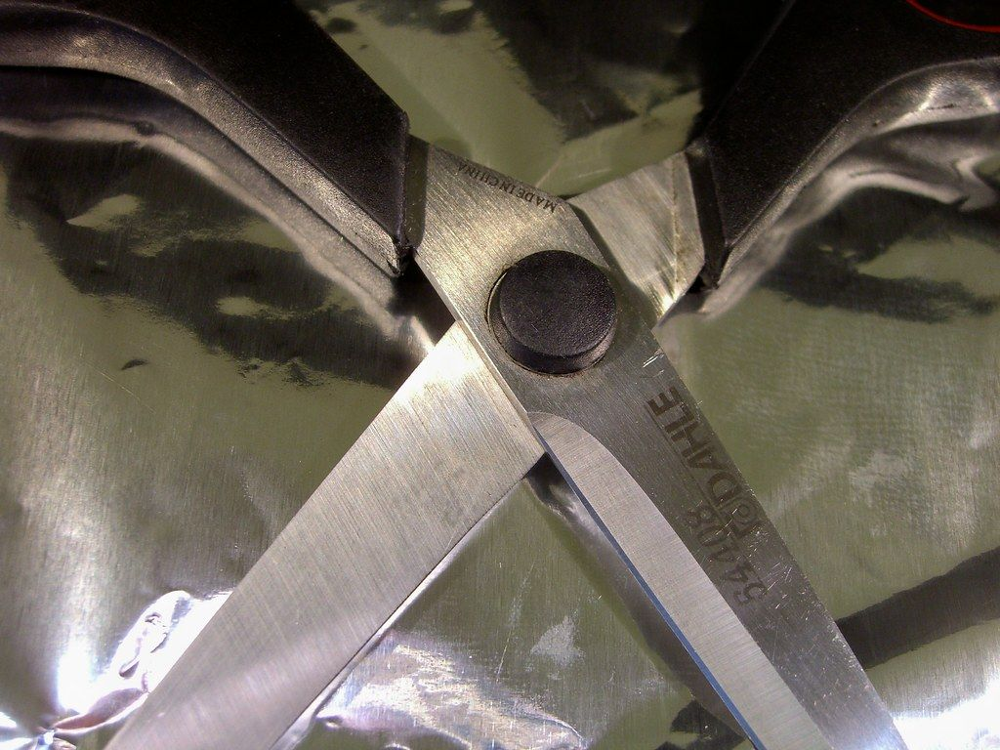{fig-alt="Open scissors. The two blades make an angle."}
:::
:::::

::: footer
[1 · Start a lesson · 开始上课]{.phase} · I can…
:::

::: notes
**Use it for:** one objective, said together · the target of a skills lesson (PE, music, art) · the success criterion of a project day.

**Pieces:** `.columns`: `.cover` with `.big` text and a `.box .plain` with a `.kicker` and `.lead` text, beside a hero picture (`::: {.column .hero}`). Ask: *where is the angle in the picture? Where is the vertex?*

**Also see:** Did we do it? (column 10).
:::

## [What do you notice? | 你注意到了什么？]{.bi} {#intro-picture data-menu-title="1 · Do now: picture prompt"}

:::: {.columns}
::: {.column width="46%"}
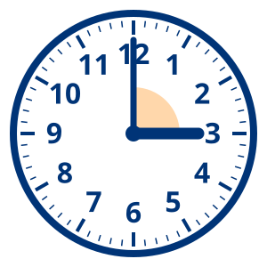{fig-alt="A clock at 3:00" style="width: 100%; height: 520px; max-height: none; max-width: none"}
:::
::: {.column width="54%"}
::: {.box .plain}
[Look · 观察]{.kicker}

[What do the two hands make? | 两根指针组成了什么？]{.bi .lead}


:::


:::
::::

::: footer
[1 · Start a lesson · 开始上课]{.phase} · Do now: picture prompt
:::

::: notes
**Use it for:** a new topic: everyone can look and point · a math 'notice and wonder' · a science phenomenon to explain · an artwork or primary source.

**Pieces:** `.columns`, a picture, a `.box` with a question and a frame (``, from the language list), ``.

**Also see:** Interest hook; A picture that fills the screen (column 3).
:::

## Quick review {#intro-review data-menu-title="1 · Do now: quick-fire review"}

::: {.trivia title="Last lesson: quick-fire!" seconds="10"}
- What do we call a square corner? | A right angle
- How many right angles does a square have? | 4
- Name one thing in this room with a right angle. | A door, a book, a window, a desk…
- A book's corner is ___ a right angle. Bigger, smaller or the same? | The same: it is a right angle
- Where do the two sides of an angle meet? | At the vertex
:::

::: footer
[1 · Start a lesson · 开始上课]{.phase} · Do now: quick-fire review
:::

::: notes
**Use it for:** retrieval of the last lesson's facts · times tables or formulas warm-up · vocab warm-up.

**Pieces:** the quick-fire game, `::: {.trivia title="…" seconds="10"}`: one question per line, the answer after the `|` (the same game as the vocab review in column 7).

**Also see:** Quick-fire (column 9).
:::

## [Today's lesson | 今天的课]{.bi} {#agenda data-menu-title="1 · Agenda"}

::: {.chain style="font-size: 0.62em"}
::: {.box .plain style="text-align: center"}
[1 · Do now | 课前任务]{.bi}
:::

::: {.box .plain style="text-align: center"}
[2 · New words | 新词]{.bi}
:::

::: {.box style="text-align: center"}
[3 · Learn | 学习]{.bi}
:::

::: {.box .plain style="text-align: center"}
[4 · Talk | 交流]{.bi}
:::

::: {.box .plain style="text-align: center"}
[5 · Practice | 练习]{.bi}
:::

::: {.box .plain style="text-align: center"}
[6 · Exit ticket | 出门条]{.bi}
:::
:::

::: footer
[1 · Start a lesson · 开始上课]{.phase} · agenda
:::

::: notes
**Use it for:** long lessons · a class that needs to see the plan · show it again between phases, with the current one filled in · the steps of a lab or a project day.

**Pieces:** `.chain` (boxes with arrows between them); the current step is a `.box` without `.plain`.

**Also see:** Project calendar; Section opener.
:::

## [Project plan: two weeks | 项目计划：两周]{.bi} {#intro-agenda data-menu-title="1 · Project calendar"}

[**Our project:** make a guide to the angles in our school. | **我们的项目：**为学校里的角做一本指南。]{.bi .pbl-question}

::::::: pbl-cal
[Week 1 [第一周]{.wk-zh}]{.wk}

::: {.day .launch .past}
[Mon 9]{.date} [Launch]{.stage}

- [x] Hear the big question
- [x] Make teams of four
:::

::: {.day .research .past}
[Tue 10]{.date} [Research]{.stage}

- [x] Hunt for angles
- [x] Take photos
:::

::: {.day .research .today}
[Wed 11]{.date} [Research]{.stage}

- [ ] Name each angle
- [ ] Sort the photos

[Due: 10 photos]{.due}
:::

::: {.day .build}
[Thu 12]{.date} [Plan]{.stage}

- [ ] Choose your best 5
- [ ] Plan your page
:::

::: {.day .build}
[Fri 13]{.date} [Build]{.stage}

- [ ] Write a sentence for each photo
:::

[Week 2 [第二周]{.wk-zh}]{.wk}

::: {.day .build}
[Mon 16]{.date} [Build]{.stage}

- [ ] Finish your page

[Due: draft]{.due}
:::

::: {.day .feedback}
[Tue 17]{.date} [Feedback]{.stage}

- [ ] Gallery walk
- [ ] Two stars and a wish
:::

::: {.day .feedback}
[Wed 18]{.date} [Revise]{.stage}

- [ ] Fix one thing
- [ ] Add one thing
:::

::: {.day .present}
[Thu 19]{.date} [Practise]{.stage}

- [ ] Practise your talk

[Due: final guide]{.due}
:::

::: {.day .present}
[Fri 20]{.date} [Present]{.stage}

- [ ] Show Grade 3 our guide
- [ ] Reflect

[Due: presentation]{.due}
:::
:::::::

::: footer
[1 · Start a lesson · 开始上课]{.phase} · project calendar
:::

::: notes
**Use it for:** a project over two weeks (PBL) · a unit plan with due dates · a revision timetable before tests · a club or event schedule.

**Pieces:** `::::: pbl-cal` (`exemplar.css`): a `[Week 1]{.wk}` label, then five `::: {.day .research}` cards per week. Click a box to tick it. Add `.today` to today's card (it gets a frame and a *Today* label) and `.past` to the days before it (greyed out; write their tasks as `- [x]`, so they start ticked). In each card: a `[Tue 10]{.date}`, a `[Research]{.stage}`, a checklist (`- [ ] …`) and, on a due day, a `[Due: …]{.due}` badge. The stage classes are `.launch`, `.research`, `.build`, `.feedback` and `.present`. Change the dates and tasks for your own project.

**Also see:** Agenda.
:::

## {#section data-menu-title="1 · Section opener" .center}

::: cover
[Part 2 · Spring and Autumn & Warring States | 第 2 节 · 春秋战国]{.bi .kicker}

[The Hundred Schools of Thought | 百家争鸣]{.bi .big}

::: tiles
::: {.box .plain}
::: row
[1]{.num}

[Why it happened | 争鸣原因]{.bi}
:::
:::

::: {.box .plain}
::: row
[2]{.num}

[The ideas | 治国主张]{.bi}
:::
:::

::: {.box .plain}
::: row
[3]{.num}

[The debate | 智慧对决]{.bi}
:::
:::
:::
:::

::: footer
[1 · Start a lesson · 开始上课]{.phase} · section opener
:::

::: notes
**Use it for:** the start of a new part of the unit · a chapter title with its three parts · the title of a project's phase.

**Pieces:** `.cover` (fills the slide and centres it), `.kicker`, `.big`, `.tiles` of `.box .plain`, each a `.row` with a `.num`.

**Also see:** Agenda.
:::

## {#background-hook data-menu-title="1 · Interest hook" background-color=""}

[Hook · 导入]{.pill .absolute top=10 left=0}

::: {.cover .media}
::: placeholder
[Picture or 1-minute video: something that turns (a door, a fan, a clock, a dancer) | 图片或一分钟视频：会转动的东西（门、扇子、钟、舞者）]{.bi}
:::

::: {.box .plain}
::: row
[Think · 思考]{.kicker}

[What is turning? How far does it turn? | 什么在转动？转了多远？]{.bi .lead}
:::
:::
:::

::: footer
[1 · Start a lesson · 开始上课]{.phase} · interest hook
:::

::: notes
**Use it for:** a new topic, before any words · a mystery picture to discuss · a one-minute video before reading · a question to come back to at the end.

**Pieces:** the Slide kit's media slide: `.cover .media`, a picture or `` (here a placeholder), and a `.box` with the question. Swap the placeholder for `` and credit it.

**Also see:** Do now: picture prompt; Video that fills the slide (column 5).
:::

## [How do you feel? | 你感觉怎么样？]{.bi} {#mood-meter data-menu-title="1 · Check-in: mood meter"}

::: {.mood-meter}
[Tap how you feel right now. Nobody sees your answer. | 点一下你现在的感觉。没有人会看到你的答案。]{.bi}
:::

::: footer
[1 · Start a lesson · 开始上课]{.phase} · check-in: mood meter
:::

::: notes
**Use it for:** a check-in as students come in (one tap each, on the board) · after a test or a break · before a hard conversation · teaching feeling words (the 中文 is under each one).

**How it works:** each tap says only "Thank you!", so the next student can't see what was chosen. **Show results** (or R) when everyone is done: each feeling shows its count, and each colour its total. Read the room, not the names: lots of red or blue? Start with something calm. **Undo** takes back the last tap; **Clear** (tap twice) starts again. Answers stay in this browser until you clear them.

**The colours:** up is more energy, right is more pleasant. Red: high energy, unpleasant. Yellow: high energy, pleasant. Blue: low energy, unpleasant. Green: low energy, pleasant. Every colour is OK to feel.

**Pieces:** `::: {.mood-meter}` with the instruction inside (`mood.html`). Your own words for a colour: `yellow="Excited|兴奋, Proud|自豪, Happy|开心, Silly|调皮"` (four, top to bottom, left to right; known feelings get their face).

**Also see:** Check-in: feelings pie; Pie vote (column 8).
:::

## [How are you feeling today? | 你今天感觉怎么样？]{.bi} {#mood-pie data-menu-title="1 · Check-in: feelings pie"}

::: {.pie-vote preset="feelings"}
[Tap the feeling that fits you best. | 点一下最像你的感觉。]{.bi}
:::

::: {.fine style="text-align: center; margin-top: 0.4em"}
[It's OK to feel any way. Every feeling matters. | 什么感觉都可以。每一种感觉都很重要。]{.bi}
:::

::: footer
[1 · Start a lesson · 开始上课]{.phase} · check-in: feelings pie
:::

::: notes
**Use it for:** a quick check-in the class can see · "How do you feel about the test?" · a feeling before and after a story or a game.

**How it works:** each tap adds a slice to the pie as it happens, so everyone sees the class's mood grow. Want it private? Add `hidden="true"`: the chart stays covered until you press **Show chart** (or R).

**Pieces:** `::: {.pie-vote preset="feelings"}` (`mood.html`): eight feelings, each with its face and 中文.

**Also see:** Check-in: mood meter; Pie vote with your own answers (column 8).
:::

# [New words | 新词]{.bi} {#words data-menu-title="2 · Key words, pre-taught"}

:::: {.columns}
::: {.column width="64%"}

:::
::: {.column width="36%"}
::: {.steps .stack}
1. [**Look** at the picture. | **看**图片。]{.bi}
2. [**Listen** to the word. | **听**单词。]{.bi}
3. [**Say** it twice. | **说**两遍。]{.bi}
4. [**Use** it in a sentence. | 用它**说**一句话。]{.bi}
:::
:::
::::

::: footer
[2 · Words and language · 词汇与语言]{.phase} · default: key words, pre-taught
:::

::: notes
**Use it for:** pre-teaching 4 to 6 words before a reading or a lab · the words of a new unit · revision before a test.

**Pieces:** `` in `.columns`, and Chalkline's `.steps` for the routine.

**Also see:** Vocab gallery alone; Word sort with pictures.
:::

## [Today's words | 今天的词语]{.bi} {#intro-words data-menu-title="2 · Vocab gallery alone"}



::: footer
[2 · Words and language · 词汇与语言]{.phase} · vocab gallery alone
:::

::: notes
**Use it for:** a word wall for the lesson · students choose a word to explain to a partner · a picture dictionary for newcomers.

**Pieces:** `` alone on the slide: the cards grow to fill it; click one for its full card.

**Also see:** Key words, pre-taught.
:::

## Mountains and sea {#glossed data-menu-title="2 · Words glossed in a text"}

::::: {.columns}
::: {.column width="58%"}
- Greece is a rocky  with many islands.
- Mountains split the land into small valleys.
- Each valley grew its own : one city and its farms.
- The sea connected them. Greeks traded by ship and started a  wherever they found good land.
:::
::: {.column width="42%"}

:::
:::::

::: footer
[2 · Words and language · 词汇与语言]{.phase} · words glossed in a text
:::

::: notes
**Use it for:** any text with key words: hover or tap a dotted word for its card · science explanations · history narratives · word problems.

**Pieces:** `` in the text (a pop-up with picture and 中文); `` beside it, as a list. From the Ancient Greece unit.

**Also see:** Short text in chunks (column 4).
:::

## [Language focus: comparing | 语言重点：比较]{.bi} {#background-language data-menu-title="2 · Language focus: comparing"}

::::: compare-rows
::: {.box .plain}
[>]{.sym}

[bigger than | 比…大]{.bi .phrase}

[A straight angle is **bigger than** a right angle. | 平角**比**直角**大**。]{.bi}
:::

::: {.box .plain}
[<]{.sym}

[smaller than | 比…小]{.bi .phrase}

[An acute angle is **smaller than** a right angle. | 锐角**比**直角**小**。]{.bi}
:::

::: {.box .plain}
[=]{.sym}

[the same as | 和…一样]{.bi .phrase}

[Two right angles are **the same as** one straight angle. | 两个直角**和**一个平角**一样大**。]{.bi}
:::
:::::

::: footer
[2 · Words and language · 词汇与语言]{.phase} · language focus: comparing
:::

::: notes
**Use it for:** a grammar point students need for the task · comparatives and superlatives · cause and effect (because, so) · sequence words (first, then, finally).

**Pieces:** `::::: compare-rows` (`exemplar.css`): each `.box .plain` holds a symbol (`[>]{.sym}`), the phrase (`{.bi .phrase}`) and an example sentence, in three columns with room between them.

**Also see:** Language points from the list.
:::

## [Today's language | 今天的语言点]{.bi} {#points data-menu-title="2 · Language points"}



::: footer
[2 · Words and language · 词汇与语言]{.phase} · language points from the list
:::

::: notes
**Use it for:** the language objective of a lesson · a reference while students talk or write · a unit's language, all on one slide (`unit=5`).

**Pieces:** ``: the points from `vocab/data/frames.csv` (grammar, phrases, frames, questions), each in its own look. `` for a unit's. (Here the guide's own copies, `GD-…`; use your course's IDs.)

**Also see:** Question formats; Talk frames.
:::

## [Ask and answer | 提问与回答]{.bi} {#question-formats data-menu-title="2 · Question formats"}

::::: {.columns}
::: {.column width="50%"}

:::
::: {.column width="50%"}

:::
:::::

::: footer
[2 · Words and language · 词汇与语言]{.phase} · question formats (oracy)
:::

::: notes
**Use it for:** oracy practice: partners take turns asking with the format, then answering with a frame · comparing two texts, two shapes, two places · a debate warm-up.

**Pieces:** two `` questions in `.columns`; each shows its answer frames and a worked example (`examples=false` hides it).

**Also see:** Talk frames; Think-Pair-Share (column 7).
:::

## [Talk frames | 交流句型]{.bi} {#interaction-frames data-menu-title="2 · Talk frames"}

::: {.tiles style="--cols: 2; --gap: 0.3em"}
::: {.box .plain}
[Agree · 同意]{.kicker}


:::

::: {.box .plain}
[Disagree · 不同意]{.kicker}


:::

::: {.box .plain}
[Add on · 补充]{.kicker}


:::

::: {.box .plain}
[Ask · 提问]{.kicker}


:::
:::

::: footer
[2 · Words and language · 词汇与语言]{.phase} · talk frames
:::

::: notes
**Use it for:** any discussion · peer feedback · a debate · leave it up during group work.

**Pieces:** `.tiles` with two columns; each frame a `.box .plain` with a `.kicker` and a bilingual frame, `[English [ ]{.gap} | 中文 [ ]{.gap}]{.bi}`.

**Also see:** Question formats; Group roles (column 7).
:::

## Shape words or turning words? {#background-sort data-menu-title="2 · Word sort with pictures"}

::::: sort-big
::: {.sort}
- **Shape words**
  - 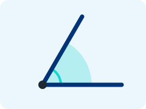 angle | An angle is a shape: two sides that meet.
  - 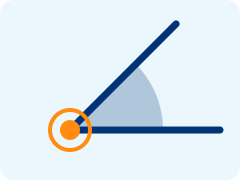 vertex | The vertex is the point where the sides meet.
  - 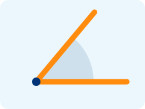 side | A side is one of the two lines of an angle.
- **Turning words**
  - 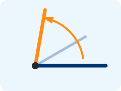 rotate | To rotate is to turn around a point.
  - 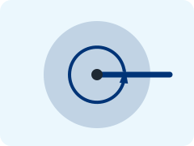 full turn | A full turn goes all the way around.
  - 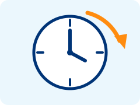 clockwise | Clockwise means turning the way a clock's hands go.
:::
:::::

::: footer
[2 · Words and language · 词汇与语言]{.phase} · word sort with pictures
:::

::: notes
**Use it for:** finding out what students already know · sorting words by topic, part of speech or sound · living / non-living, solid / liquid / gas.

**Pieces:** `::: {.sort}`: each group a **bold** line, its items under it, a reason after the `|`. A picture before the word (` vertex`) puts it on the card; `::::: sort-big` around it (`exemplar.css`) makes the picture cards bigger.

**Also see:** Sort it (column 8).
:::

## Quick reference {#quick-ref data-menu-title="2 · Links on one slide"}

::: {.quick-ref}
- [Line-by-line reading](#/input-reading)
- [Stations](#/practice-stations)
- [Rate yourself](#/review-stars)
- [Quick-fire](#/quickfire)
- [Colour schemes](#/schemes)
:::

::: footer
[2 · Words and language · 词汇与语言]{.phase} · links on one slide
:::

::: notes
**Use it for:** a unit's key slides and pages in one place · a menu for a review lesson · links to the readings and videos of a project.

**Pieces:** `::: {.quick-ref}` with a list of links (`#/slide-id` for a slide in this deck, or a web address). From the Ancient Greece unit.

**Also see:** Agenda (column 1).
:::

# [An angle | 角]{.bi} {#one-idea data-menu-title="3 · One idea and a picture"}

:::: {.columns}
::: {.column width="45%"}
{fig-alt="An angle: two sides that meet at a point"}
:::
::: {.column width="55%"}
::: {.box .plain}
[Key idea · 要点]{.kicker}

An angle is two  that meet at a point.

The point is the .
:::
:::
::::

::: footer
[3 · Explain and show · 讲解与展示]{.phase} · default: one idea and a picture
:::

::: notes
**Use it for:** any new idea: one key sentence and a picture that shows it · a definition in science · a rule in grammar · a historical event and its image.

**Pieces:** `.columns`, a picture (alone in its column, it fills the column), a `.box` with a `.kicker`, and `` glosses (a pop-up with picture and 中文).

**Also see:** Hero photo beside the text; A picture that fills the screen.
:::

## {#input-picture data-menu-title="3 · A picture that fills the screen"}

::: {.cover .media .bleed}
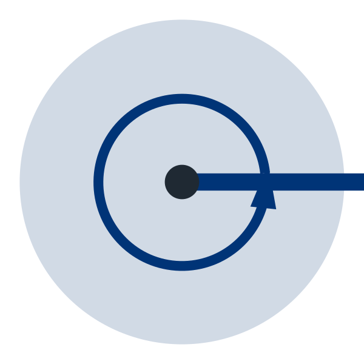{fig-alt="A full angle: one side turned all the way around"}
:::

::: footer
[3 · Explain and show · 讲解与展示]{.phase} · a picture that fills the screen
:::

::: notes
**Use it for:** the picture tells it best and you narrate · a map to talk about · a photo to look at closely · an artwork.

**Pieces:** `.cover .media .bleed` with one picture: it fills the whole screen, top to bottom, with no box behind it (`full-angle.svg` is the full-angle drawing without its background). Everything else is in the notes.

**Also see:** Hook (column 1).
:::

## Look closely {#hero data-menu-title="3 · Hero photo beside text"}

::::: {.columns}
::: {.column width="60%"}
- Find the **arm**: a long line down the side of the pillar.
- Find the **animal**: a fox, ready to jump.
- The carvings are : the stone around them was cut away.

[The wood and wires hold the pillar up while archaeologists work.]{.fine}
:::
::: {.column .hero width="40%"}
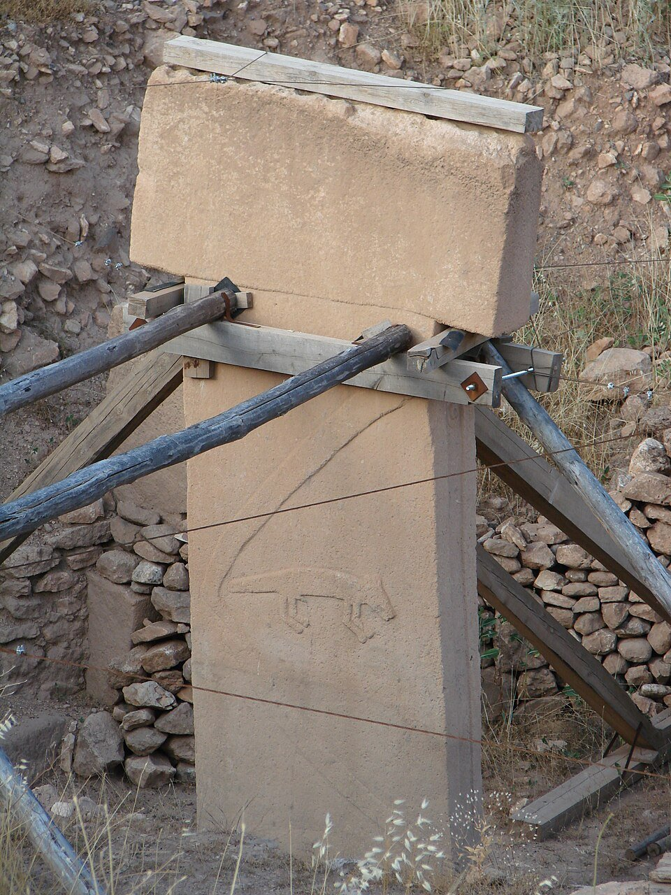{fig-alt="A T-shaped stone pillar with a long carved arm on its side and a carved fox below it"}
:::
:::::

::: footer
[3 · Explain and show · 讲解与展示]{.phase} · hero photo beside the text
:::

::: notes
**Use it for:** look closely at a photo: find and name its parts · an object from a museum · a specimen in science · a place in geography.

**Pieces:** `.columns`; on the right `::: {.column .hero}`: a photo that fills its column, cropped to fit (`exemplar.css`). A `.fine` line for a small note. From the Göbekli Tepe unit.

**Also see:** Label it (column 8).
:::

## [Five angles | 五种角]{.bi} {#input-compare data-menu-title="3 · Compare several things"}

::: {.tiles style="--cols: 5; --pic-fit: contain; --pic-height: 6.5em; font-size: 0.75em; text-align: center"}
::: {.box .plain}
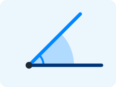{fig-alt="An acute angle"}

[Acute | 锐角]{.bi}

smaller than a right angle
:::

::: {.box .plain}
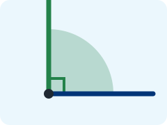{fig-alt="A right angle"}

[Right | 直角]{.bi}

a square corner
:::

::: {.box .plain}
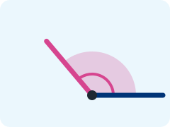{fig-alt="An obtuse angle"}

[Obtuse | 钝角]{.bi}

bigger than a right angle
:::

::: {.box .plain}
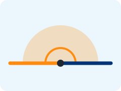{fig-alt="A straight angle"}

[Straight | 平角]{.bi}

a straight line
:::

::: {.box .plain}
{fig-alt="A full angle"}

[Full | 周角]{.bi}

all the way around
:::
:::

::: footer
[3 · Explain and show · 讲解与展示]{.phase} · compare several things
:::

::: notes
**Use it for:** kinds of something side by side (angles, triangles, rocks, clouds) · stages of a process · the parts of a whole · five characters of a story.

**Pieces:** `.tiles` with five columns (`--cols: 5`), each a `.box .plain` with a picture (`--pic-fit: contain` shows a drawing whole), a bilingual name and a short line.

**Also see:** From small to big; Two things side by side.
:::

## [From small to big | 从小到大]{.bi} {#small-to-big data-menu-title="3 · From small to big"}

::: chain
::: {.box .plain style="text-align: center"}
{fig-alt="An acute angle" width="100%"}

### [acute | 锐角]{.bi}
:::

::: {.box .plain style="text-align: center"}
{fig-alt="A right angle" width="100%"}

### [right | 直角]{.bi}
:::

::: {.box .plain style="text-align: center"}
{fig-alt="An obtuse angle" width="100%"}

### [obtuse | 钝角]{.bi}
:::

::: {.box .plain style="text-align: center"}
{fig-alt="A straight angle" width="100%"}

### [straight | 平角]{.bi}
:::

::: {.box .plain style="text-align: center"}
{fig-alt="A full angle" width="100%"}

### [full | 周角]{.bi}
:::
:::

::: strip
[Say it]{.pill}

[An acute angle is smaller than a right angle. An obtuse angle is bigger than a right angle and smaller than a straight angle. | 锐角比直角小。钝角比直角大，比平角小。]{.bi}
:::

::: footer
[3 · Explain and show · 讲解与展示]{.phase} · from small to big
:::

::: notes
**Use it for:** anything in order of size, time or strength · the life cycle of a plant · numbers on a scale · from city-state to empire.

**Pieces:** `::: chain` of `.box .plain` (arrows between them), each a picture and a `###` name; a `::: strip` with a `.pill` and the sentence to say. From the angles unit.

**Also see:** Compare several things.
:::

## [Athens and Sparta | 雅典和斯巴达]{.bi} {#two-things data-menu-title="3 · Two things side by side"}

::::: {.columns}
::: {.column width="50%"}
::: {.box .plain}
[Athens · 雅典]{.kicker}

- A :  voted on laws
- Famous for plays, art and 
- A strong navy and lots of trade
- Boys went to school to read, write and speak in public
:::
:::
::: {.column width="50%"}
::: box
[Sparta · 斯巴达]{.kicker}

- Two kings and a council of elders
- Life was built around the army
- Boys left home at 7 to train as soldiers
- The strongest army on land in Greece
:::
:::
:::::

::: footer
[3 · Explain and show · 讲解与展示]{.phase} · two things side by side
:::

::: notes
**Use it for:** compare two of anything: two cities, two characters, two animals, two methods · before a Venn diagram · before a debate.

**Pieces:** `.columns` with two boxes (`.box .plain` and `.box`, so they look different), each with a `.kicker` title and a list. From the Ancient Greece unit (rewritten from callouts, so it follows the colour scheme).

**Also see:** Venn sort (column 8); Question formats (column 2).
:::

## [Big idea | 核心概念]{.bi} {#review-bigidea data-menu-title="3 · Big idea"}

::: {.cover style="height: auto; padding: 0.6em 0"}
[An angle is a turn. | 角就是旋转。]{.bi .big style="text-align: center"}
:::

::: chain
::: {.box .plain style="text-align: center"}
[A quarter turn: right | 转四分之一圈：直角]{.bi}
:::

::: {.box .plain style="text-align: center"}
[A half turn: straight | 转半圈：平角]{.bi}
:::

::: {.box .plain style="text-align: center"}
[A full turn: full | 转一整圈：周角]{.bi}
:::
:::

::: footer
[3 · Explain and show · 讲解与展示]{.phase} · big idea
:::

::: notes
**Use it for:** closing a topic: one sentence and what follows from it · a theme in literature · a law in science · a unit's essential question, answered.

**Pieces:** the Slide kit's big idea: `.big` for the claim and `.chain` (boxes with arrows) for what follows.

**Also see:** Section opener (column 1).
:::

## [What defined the Warring States era? | 春秋战国有什么整体的时代特征？]{.bi} {#big-claim data-menu-title="3 · Big claim with three reasons"}

::: {.cover style="height: auto; padding: 0.6em 0"}
[Turmoil · Change · Growth | 动荡 · 变化 · 发展]{.bi .big style="text-align: center"}
:::

::: chain
::: {.box .plain style="text-align: center"}
[Economic change | 经济之变]{.bi}
:::

::: {.box .plain style="text-align: center"}
[Social change | 社会之变]{.bi}
:::

::: {.box .plain style="text-align: center"}
[A debate of ideas | 思想之辩]{.bi}
:::
:::

[The pre-Qin thinkers all wanted to save a troubled world, so their ideas grew out of their time. (Hu Shih) | 先秦诸子皆为忧世之乱而思以拯济之，故其学皆应时而生。——胡适]{.bi .fine}

::: footer
[3 · Explain and show · 讲解与展示]{.phase} · big claim with three reasons
:::

::: notes
**Use it for:** a claim and three reasons or causes · three features of an era · three properties of a material.

**Pieces:** `.cover` with `.big` text, then three `.box`es in a row.

**Also see:** Big idea.
:::

## [Confucius · on government | 孔子 · 政治主张]{.bi} {#source data-menu-title="3 · Source, meaning, takeaway"}

::: {.box .plain}
::: row
[Source · 原文]{.kicker}

[Analects 2.1 · 《论语·为政》]{.fine}
:::

[The Master said: "Govern by virtue, and you are like the North Star. It stays in its place, and all the other stars turn toward it." | 子曰：“为政以德，譬如北辰，居其所而众星共之。”]{.bi .lead}
:::

:::: {.columns}
::: {.column width="62%"}
::: box
[Meaning · 解读]{.kicker}

[If a ruler leads by being good, people will follow him, like stars around the North Star. | 统治者如果用道德来治理国家，百姓就会像群星环绕北极星一样围绕着他。]{.bi}
:::
:::
::: {.column width="38%"}
::: {.box .dark}
[Takeaway · 要点]{.kicker}

[Rule by virtue | 为政以德]{.bi .big style="font-size: var(--step-3)"}
:::
:::
::::

::: footer
[3 · Explain and show · 讲解与展示]{.phase} · source, meaning, takeaway
:::

::: notes
**Use it for:** a quotation, explained · a primary source in history · a poem's line · a law of physics in words.

**Also see:** Line-by-line reading (column 4).
:::

## [Warring States thinkers · five schools | 战国诸子 · 五大学派]{.bi} {#cards data-menu-title="3 · Profile cards"}

::: tiles
::: box
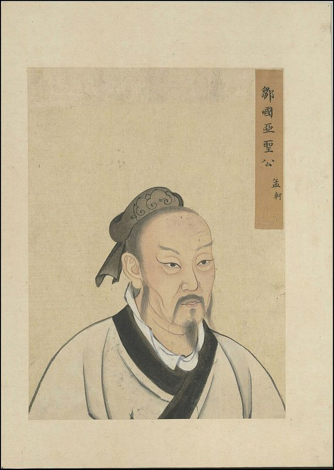{fig-alt="Mencius" style="--pic-position: 50% 60%"}

### [Confucianism | 儒家]{.bi}
[Mencius | 孟子]{.bi .muted}

**[Kind government | 仁政]{.bi}**

[《孟子》]{.bi .fine .end}
:::

::: box
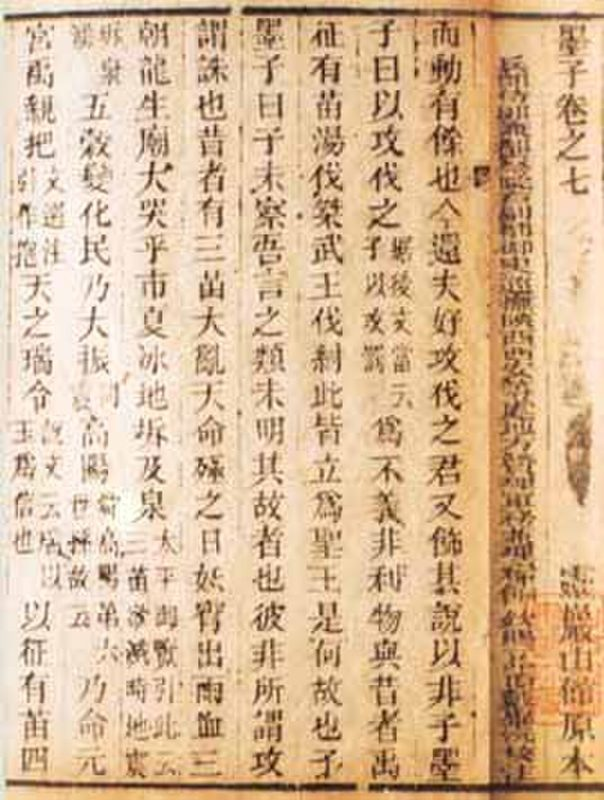{fig-alt="The book Mozi" style="--pic-position: 50% 30%"}

### [Mohism | 墨家]{.bi}
[Mozi | 墨子]{.bi .muted}

**[Love everyone, no wars of attack | 兼爱非攻]{.bi}**

[《墨子》]{.bi .fine .end}
:::

::: box
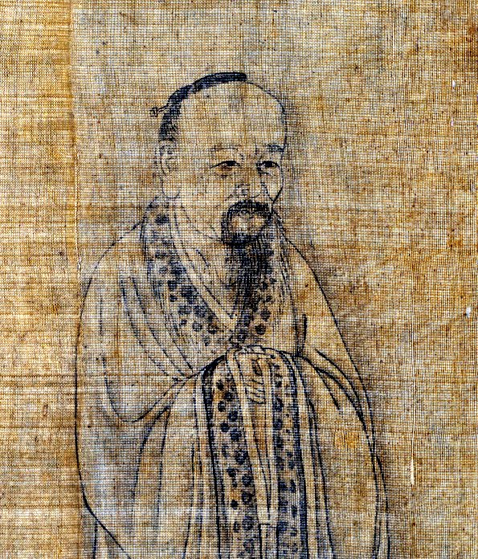{fig-alt="Zhuangzi" style="--pic-position: 50% 20%"}

### [Daoism | 道家]{.bi}
[Zhuangzi | 庄子]{.bi .muted}

**[Follow nature | 顺应自然]{.bi}**

[《庄子》]{.bi .fine .end}
:::

::: {.box .spot}
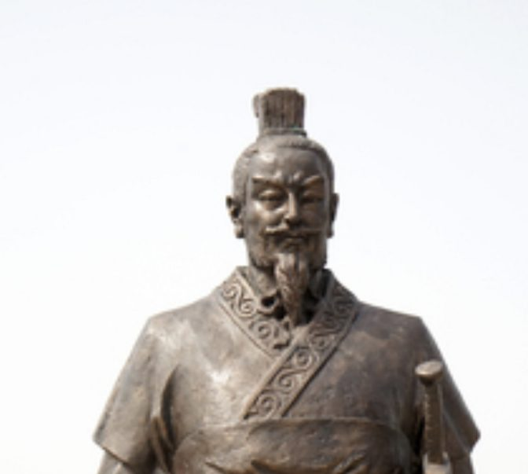{fig-alt="A statue of Han Fei" style="--pic-position: 50% 25%"}

### [Legalism | 法家]{.bi}
[Han Fei | 韩非]{.bi .muted}

**[Rule by law, a strong ruler | 以法治国]{.bi}**

[《韩非子》]{.bi .fine .end}
:::

::: box
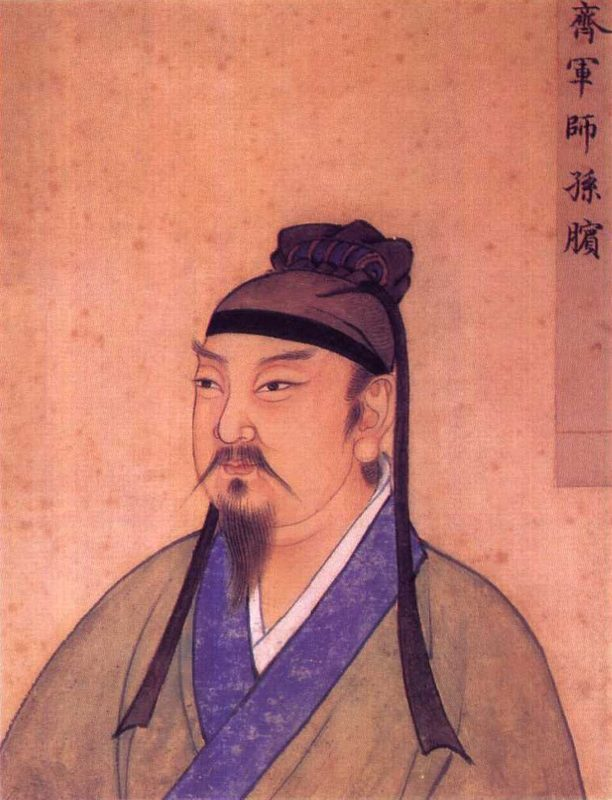{fig-alt="Sun Bin" style="--pic-position: 50% 60%"}

### [Military thinkers | 兵家]{.bi}
[Wu Qi, Sun Bin | 吴起 孙膑]{.bi .muted}

**[Military strategy | 军事战略]{.bi}**

[《孙膑兵法》]{.bi .fine .end}
:::
:::

::: strip
[Think · 思考]{.pill}

[Which school's ideas did Warring States rulers like best? | 哪一个学派的主张最受战国统治者欢迎？]{.bi}
:::

::: footer
[3 · Explain and show · 讲解与展示]{.phase} · profile cards
:::

::: notes
**Use it for:** people, places or things, one card each · five schools of thought · the planets · the characters of a novel · the elements of a group.

**Also see:** Looks: the same cards as a game, a scroll (column 11).
:::

## [Straight angle | 平角]{.bi} {#rule data-menu-title="3 · A rule with a picture"}

::::: {.columns}
::: {.column width="45%"}
{fig-alt="A straight angle: the two sides make one straight line through the vertex, with a half circle shaded"}
:::
::: {.column width="55%"}
- [Turn one side until the two sides make a straight line. | 旋转一条边，直到两条边成一条直线。]{.bi}
- [This is a . | 这就是平角。]{.bi}
- [It still has a  and two sides. | 它仍然有一个顶点和两条边。]{.bi}

::: {.strip style="margin-top: 0.6em"}
[Rule]{.pill}

[1 straight angle = 2 right angles | 1 平角 = 2 直角]{.bi .lead}
:::
:::
:::::

::: footer
[3 · Explain and show · 讲解与展示]{.phase} · a rule with a picture
:::

::: notes
**Use it for:** a definition with its rule · a formula with a picture (area of a triangle) · a spelling or grammar rule with an example.

**Pieces:** `.columns`: a picture (alone in its column, it fills it) and a list; the rule in a `.strip` with a `.pill`. From the angles unit (its `.equation` rewritten as a strip, so it follows the colour scheme).

**Also see:** One idea and a picture.
:::

## How the Republic worked [made in draw.io]{.drawio-label} {#drawio data-menu-title="3 · Diagram from draw.io"}

```{=html}
<link rel="stylesheet" href="drawio/drawio-live.css">
<div class="drawio-live" data-src="drawio/republic.svg"></div>
<script src="drawio/drawio-live.js"></script>
```

::: {.small-note}
Hover (or tap) a box to focus on it.
:::

::: footer
[3 · Explain and show · 讲解与展示]{.phase} · diagram from draw.io
:::

::: notes
**Use it for:** how a system works: government, a food web, the water cycle, a computer network · a timeline with branches · a mind map.

**Pieces:** a diagram drawn in draw.io (`drawio/republic.drawio`); its picture (`republic.svg`) on the slide with `drawio-live.js`: point at a box and the rest fades. `python chalkline.py drawio` updates the picture. From the Ancient Rome unit.

**Also see:** Lesson summary (column 10).
:::

## [Turn it and watch | 旋转，仔细看]{.bi} {#input-model data-menu-title="3 · Model it (interactive)"}

<iframe class="angle-frame" data-src="embeds/turning-angle.html" title="Turn an angle"></iframe>

::: footer
[3 · Explain and show · 讲解与展示]{.phase} · model it (interactive)
:::

::: notes
**Use it for:** a process students need to see happen · angles and turns · fractions of a circle · the hands of a clock.

**Pieces:** an interactive page in the deck's `embeds/` folder, in a frame: `<iframe class="angle-frame" data-src="embeds/turning-angle.html"></iframe>`. From Unit 5. It works without the internet.

**Also see:** Math explorers.
:::

## Angles in a triangle {#explorer data-menu-title="3 · Math explorer"}

<iframe class="stem-frame" data-src="embeds/stem/triangle.html" title="Angles in a triangle"></iframe>

::: footer
[3 · Explain and show · 讲解与展示]{.phase} · math explorer
:::

::: notes
**Use it for:** explore a rule by dragging: angles of a triangle add to 180° · a variable in an experiment · predict, then drag to check.

**Pieces:** an interactive page in the guide's `embeds/stem/` folder (JSXGraph, saved in the course, works offline), in a frame: `<iframe class="stem-frame" data-src="embeds/stem/triangle.html">`. From the STEM unit.

**Also see:** Graph with sliders; Model it.
:::

## Parabolas: move the sliders {#sliders data-menu-title="3 · Graph with sliders"}

<iframe class="stem-frame" data-src="embeds/stem/parabola.html" title="Parabola in GeoGebra"></iframe>

::: footer
[3 · Explain and show · 讲解与展示]{.phase} · graph with sliders
:::

::: notes
**Use it for:** what a number in a formula does to its graph · speed and distance · supply and demand · any GeoGebra activity.

**Pieces:** GeoGebra in a frame (`embeds/stem/parabola.html`; needs the internet). The commands that make the graph are in the page. From the STEM unit.

**Also see:** Math explorer.
:::

## Blocks become Python {#blocks data-menu-title="3 · Code: blocks and Python"}

<iframe class="stem-frame" data-src="embeds/stem/blocks.html" title="Blocks and Python"></iframe>

::: footer
[3 · Explain and show · 讲解与展示]{.phase} · code: blocks and Python
:::

::: notes
**Use it for:** coding: blocks beside the same program in Python · logic and loops · algorithms in math.

**Pieces:** Blockly (saved in the course, works offline) in a frame: `embeds/stem/blocks.html`. From the STEM unit.

**Also see:** Build the sentence (column 8): for lines of code.
:::

# [Read: angles that turn | 阅读：会转动的角]{.bi} {#chunks data-menu-title="4 · Short text in chunks"}

::: {.tiles style="--cols: 2"}
::: {.box .plain}
[Part 1]{.kicker}

An angle has a  and two sides. When one side , the angle changes. It gets bigger or smaller.
:::

::: {.box .plain}
[Part 2]{.kicker}

When the two sides make one straight line, it is a **straight angle**. When one side turns all the way around, it is a **full angle**.
:::
:::

::: footer
[4 · Read and follow · 阅读与跟读]{.phase} · default: short text in chunks
:::

::: notes
**Use it for:** a short reading in two parts: read part 1 together, part 2 in pairs · a word problem · a science explanation · instructions.

**Pieces:** `.tiles` of two `.box .plain`, each a chunk with a `.kicker`; `` glosses a word in another form.

**Also see:** Line-by-line reading.
:::

## [Read: the big wheel | 阅读：摩天轮]{.bi} {#input-reading data-menu-title="4 · Line-by-line reading"}

::::: {.columns}
::: {.column width="63%"}
::: reading-scroll
[A Ferris wheel is a very big wheel. It has seats all around it. | 摩天轮是一个非常大的轮子，四周都有座位。]{.bi}

[The center of the wheel does not move. It is like a . | 轮子的中心不动，它就像一个**顶点**。]{.bi .fragment}

[Long metal arms go out from the center. They are like the  of an angle. | 长长的金属臂从中心伸出来，就像角的**边**。]{.bi .fragment}

[Look at two arms next to each other. They make a small . | 看相邻的两根臂，它们组成一个小小的**锐角**。]{.bi .fragment}

[The wheel turns slowly. Your seat  around the center. | 轮子慢慢转动，你的座位绕着中心**旋转**。]{.bi .fragment}

[After a quarter turn, you have turned a . | 转了四分之一圈，你就转过了一个**直角**。]{.bi .fragment}

[After half a turn, you are at the top. You have turned a . | 转了半圈，你就到了最高处。你转过了一个**平角**。]{.bi .fragment}

[Look down! The people below look very small. | 往下看！下面的人看起来很小。]{.bi .fragment}

[The wheel keeps turning. You go down the other side. | 轮子继续转动，你从另一边下来。]{.bi .fragment}

[After one full turn, you are back where you started. | 转了一整圈，你又回到了起点。]{.bi .fragment}

[You have turned a . That is four right angles! | 你转过了一个**周角**，也就是四个直角！]{.bi .fragment}

[Next time you see a wheel, look for the angles. | 下次看到轮子时，找一找里面的角吧。]{.bi .fragment}
:::
:::
::: {.column .hero width="37%"}
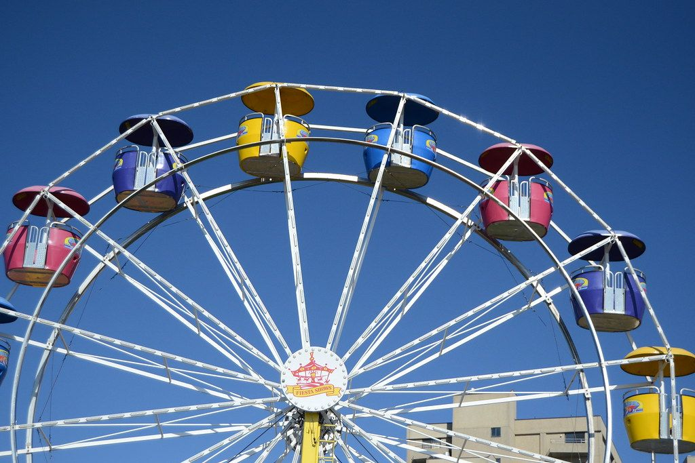{fig-alt="A colourful Ferris wheel in a blue sky. Its metal arms go out from the center."}
:::
:::::

::: footer
[4 · Read and follow · 阅读与跟读]{.phase} · line-by-line reading
:::

::: notes
**Use it for:** a story read aloud together · walking through a math proof one step at a time · a lab procedure, step by step · a primary source with glossed words · a worked example before students try one.

**Pieces:** `::: reading-scroll` (`exemplar.css`, and `reading-scroll.html` in the deck's `include-after-body`): one `[English | 中文]{.bi .fragment}` per paragraph (leave `.fragment` off the first line), with `` glosses inside the English. Beside it, a hero picture (`::: {.column .hero}`). The box also scrolls with the mouse wheel.

**Also see:** Short text in chunks; Source, meaning, takeaway (column 3).
:::

## Ancient Greece on a timeline {#timeline-static data-menu-title="4 · Timeline"}

::::: {.columns}
::: {.column width="58%"}
::: {.timeline}
- **776 BC** · The first recorded  at Olympia.
- **About 508 BC** · Athens starts a .
- **447–432 BC** · The Parthenon  is built in Athens.
- **399 BC** · The  Socrates dies in Athens.
:::

[BC means "before Christ": the years count *down* toward year 1.]{.fine}
:::
::: {.column .hero width="42%"}
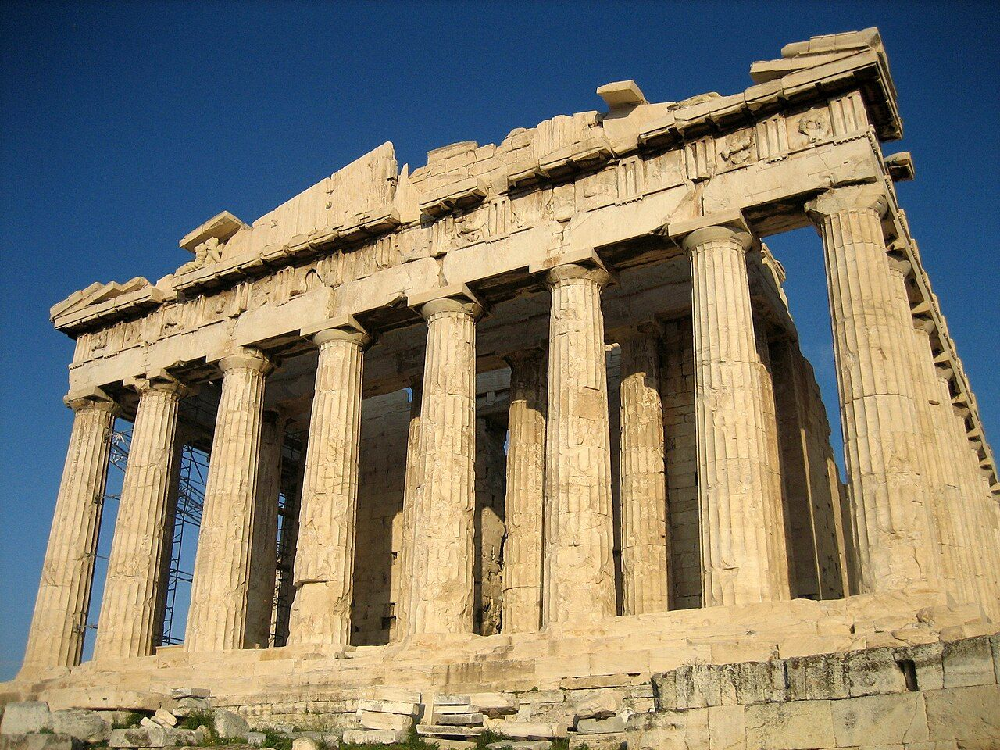{fig-alt="The Parthenon, a ruined marble temple with rows of columns, under a blue sky"}
:::
:::::

::: footer
[4 · Read and follow · 阅读与跟读]{.phase} · timeline
:::

::: notes
**Use it for:** a few dates in order · the steps of a life cycle · a story's events · the history of an invention.

**Pieces:** `::: {.timeline}` with a list (`**date** · event`), beside a hero photo. From the Ancient Greece unit.

**Also see:** Timeline (interactive); Put it on the timeline (column 8).
:::

## [How clocks changed | 钟表的变化]{.bi} {#input-timeline data-menu-title="4 · Timeline (interactive)"}

::: {.timeline-interactive #clocks title="How clocks changed"}

::: {.event date="1500 BC" title="Sundials" image="images/photo-sundial.jpg"}
In ancient Egypt, people told the time from a shadow. The shadow turned as the sun moved.
:::

::: {.event date="AD 1300" title="Mechanical clocks" image="images/photo-salisbury-clock.jpg"}
In Europe, the first clocks with gears were built in church towers. This one, in Salisbury, England, still works.
:::

::: {.event date="AD 1656" title="The pendulum clock" image="images/photo-huygens-clock.jpg"}
Christiaan Huygens made a clock with a swinging pendulum. It was much more accurate. This is his first one, from 1656.
:::

::: {.event date="AD 1927" title="The quartz clock" image="images/photo-quartz-watch.jpg"}
A small crystal that shakes very fast kept the time. Most watches today use one.
:::

::: {.event date="AD 1955" title="The atomic clock" image="images/photo-atomic-clock.jpg"}
Atoms keep the time. These clocks are the most accurate in the world.
:::

:::

::: footer
[4 · Read and follow · 阅读与跟读]{.phase} · timeline (interactive)
:::

::: notes
**Use it for:** events where *when* matters: history, the history of science, a novel's plot · tap an event to zoom in.

**Pieces:** `::: {.timeline-interactive}` with one `::: {.event date="…" title="…" image="…"}` per event: every event has a photo (credited on the Credits slide). Events are sorted by date.

**Also see:** Timeline; Put it on the timeline (column 8).
:::

## [Fill in the chart | 填一填]{.bi} {#strategies-organizer data-menu-title="4 · Table that fills in"}

::: big-table
| Angle | Compared with a right angle | An example |
|:--|:--|:--|
| [Acute \| 锐角]{.bi} | [smaller]{.fragment} | [a clock at 1:00]{.fragment} |
| [Right \| 直角]{.bi} | [the same]{.fragment} | [a clock at 3:00]{.fragment} |
| [Obtuse \| 钝角]{.bi} | [bigger]{.fragment} | [a clock at 5:00]{.fragment} |
| [Straight \| 平角]{.bi} | [two right angles]{.fragment} | [a clock at 6:00]{.fragment} |

: {tbl-colwidths="[26,40,34]"}
:::

::: footer
[4 · Read and follow · 阅读与跟读]{.phase} · table that fills in
:::

::: notes
**Use it for:** a graphic organizer students copy and fill in · compare and contrast · cause and effect · properties of shapes or materials.

**Pieces:** a Markdown table inside `::: big-table` (`exemplar.css`: the table fills the slide's width, with bigger text); each answer a `.fragment`, so it appears on the next click.

**Also see:** Table with reasons.
:::

## [Why did the Hundred Schools appear? | 为什么会出现百家争鸣？]{.bi} {#reasons-table data-menu-title="4 · Table with reasons"}

::: big-table
| | |
|:--|:--|
| [Politics \| 政治]{.bi} | [[The old order fell apart. No one idea was in charge. \| 礼崩乐坏，诸侯争霸，没有一种学说取得独尊地位。]{.bi}]{.fragment} |
| [Economy \| 经济]{.bi} | [[Iron tools and ox plows made more food, enough to feed scholars. \| 铁器和牛耕推广，农业发展，能够供养知识分子。]{.bi}]{.fragment} |
| [Science \| 科技]{.bi} | [[New tools and new knowledge spread. \| 新的工具和知识不断传播。]{.bi}]{.fragment} |
| [Education \| 教育]{.bi} | [[Schools opened to more people, not only nobles. \| 私学兴起，教育不再只属于贵族。]{.bi}]{.fragment} |

: {tbl-colwidths="[24,76]"}
:::

::: footer
[4 · Read and follow · 阅读与跟读]{.phase} · table with reasons
:::

::: notes
**Use it for:** causes of an event, one by one · the parts of an argument · reasons for and against.

**Also see:** Table that fills in.
:::

## [Review: one question at a time | 复习：一题一题来]{.bi} {#review-set data-menu-title="4 · Review set"}

::: {.big-table style="font-size: 0.82em"}
| | Question | Answer |
|:--|:--|:--|
| 1 | What do we call the point where two sides meet? | [the vertex]{.fragment} |
| 2 | Is an angle at 5:00 acute or obtuse? | [obtuse]{.fragment} |
| 3 | How many right angles make a straight angle? | [two]{.fragment} |
| 4 | Draw an angle smaller than a right angle. Name it. | [an acute angle]{.fragment} |
| 5 | Which is bigger: a straight angle or a full angle? Why? | [a full angle: it turns all the way around]{.fragment} |

: {tbl-colwidths="[6,56,38]"}
:::

::: footer
[4 · Read and follow · 阅读与跟读]{.phase} · review set
:::

::: notes
**Use it for:** calm review before a test: a question, thinking time, then the answer · homework answers · a set of word problems.

**Pieces:** a Markdown table in `::: big-table` (bigger text); each answer a `.fragment`, shown on the next click.

**Also see:** Quiz list (column 8).
:::

# [Make a paper clock | 做一个纸钟]{.bi} {#video-task data-menu-title="5 · Video with instructions"}

:::: {.columns}
::: {.column width="63%"}
::: {.placeholder .video-slot}
[Video: 1 minute, making a paper clock with two hands and a split pin | 视频：一分钟，用两根指针和一个两脚钉做纸钟]{.bi}
:::
:::
::: {.column width="37%"}
::: {.box .plain style="font-size: 0.7em"}
[Instructions · 步骤]{.kicker}

1. [Cut out the clock face and two hands. | 剪下钟面和两根指针。]{.bi}
2. [Join them with a split pin. | 用两脚钉把它们连起来。]{.bi}
3. [Make each angle: acute, right, obtuse, straight. | 做出每种角：锐角、直角、钝角、平角。]{.bi}
:::

::: {.gallery-slot}
[Work gallery · 作品展示]{.kicker}


:::
:::
::::

::: footer
[5 · Watch and look · 观看]{.phase} · default: video with instructions
:::

::: notes
**Use it for:** making something: watch once, then follow the steps · a lab demo · a craft · a sports skill.

**Pieces:** the video gets most of the slide (a real one is 16:9: `` in the wide column, here a `.placeholder .video-slot`); beside it a `.box` with the steps and `` for the work gallery.

**Also see:** Video that fills the slide.
:::

## [Watch: the Odyssey in five minutes | 观看：五分钟了解《奥德赛》]{.bi} {#video data-menu-title="5 · Video that fills the slide"}



::: {.box .plain .print-only}
[Video (shown in class) · 视频]{.kicker}

▶ TED-Ed, *Everything you need to know to read Homer's "Odyssey"*, 5 minutes: <https://www.youtube.com/watch?v=8Z9FQxcCAZ0>
:::

::: footer
[5 · Watch and look · 观看]{.phase} · video that fills the slide
:::

::: notes
**Use it for:** a short video to start a topic · a documentary clip · a song or poem performed · a how-to.

**Pieces:** `` with no size fills the room left on the slide. The `.print-only` box shows instead of the video in the slide PDF. From the Ancient Greece unit. If YouTube is blocked, use a file you may show: ``.

**Also see:** Video with instructions.
:::

## [Before you leave: self-check | 离开前：自我检查]{.bi} {#packet-page data-menu-title="5 · Packet page on the screen"}

:::: {.columns}
::: {.column .packet-page width="42%"}
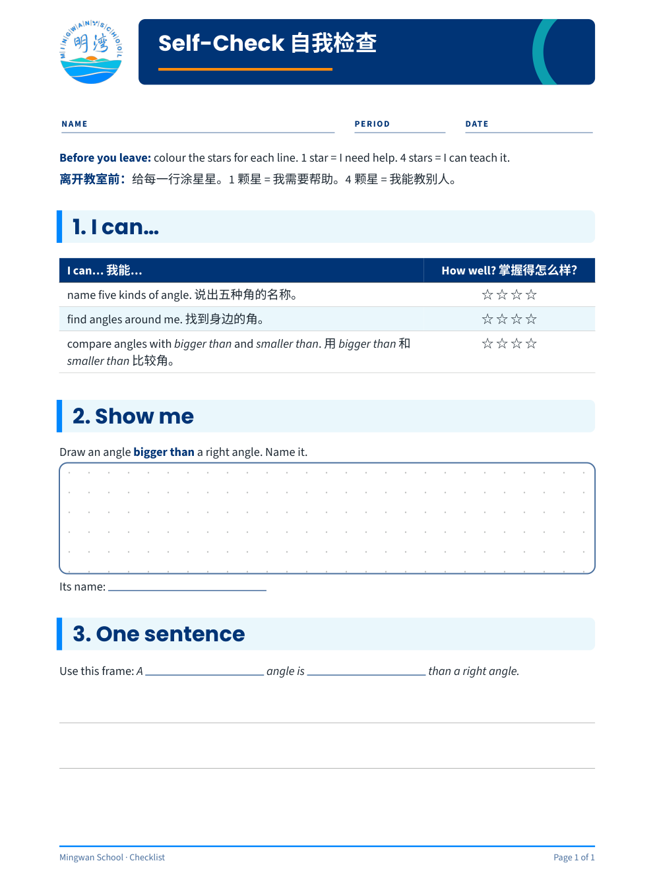{fig-alt="The Self-Check page in the packet: three I can lines with four stars each, a box to draw an angle, and a sentence frame"}
:::
::: {.column width="58%"}
::: {.box .plain}
[Before you leave · 离开教室前]{.kicker}

::: {.steps .stack style="font-size: 0.82em"}
1. [Open your packet to **Self-Check**. | 打开学习包，找到**自我检查**。]{.bi}
2. [Colour the stars for each line. | 给每一行涂星星。]{.bi}
3. [Draw and name an angle. Write one sentence. | 画一个角并写出名称，再写一句话。]{.bi}
4. [Show your teacher at the door. | 在门口给老师看。]{.bi}
:::
:::

[1 ★ = I need help · 4 ★ = I can teach it | 1 ★ = 我需要帮助 · 4 ★ = 我能教别人]{.bi .small}
:::
::::

::: footer
[5 · Watch and look · 观看]{.phase} · packet page on the screen
:::

::: notes
**Use it for:** show which packet page to do · go through a worksheet together · homework instructions · a self-check before leaving.

**Pieces:** `.columns`: a picture of the packet page (`images/page-self-check.png`, page 1 of `self-check.qmd` in this guide; make yours from your own printable's PDF) in a `.packet-page` column (`exemplar.css`: paper with a shadow), and `.steps` in a `.box`.

**Also see:** Worksheet gallery.
:::

## [This week's printables | 本周的打印材料]{.bi} {#worksheet data-menu-title="5 · Worksheet gallery"}



::: footer
[5 · Watch and look · 观看]{.phase} · worksheet gallery
:::

::: notes
**Use it for:** show the pages students will get · zoom into a page to explain a question · a station's instructions.

**Pieces:** ``: every page as a picture; tap one to open it large.

**Also see:** Packet page on the screen.
:::

## [Look closely: children's games | 仔细看：儿童游戏]{.bi} {#zoom data-menu-title="5 · Zoom into a big picture"}

::: {.zoom-image start="0.56,0.88,5" height="560"}
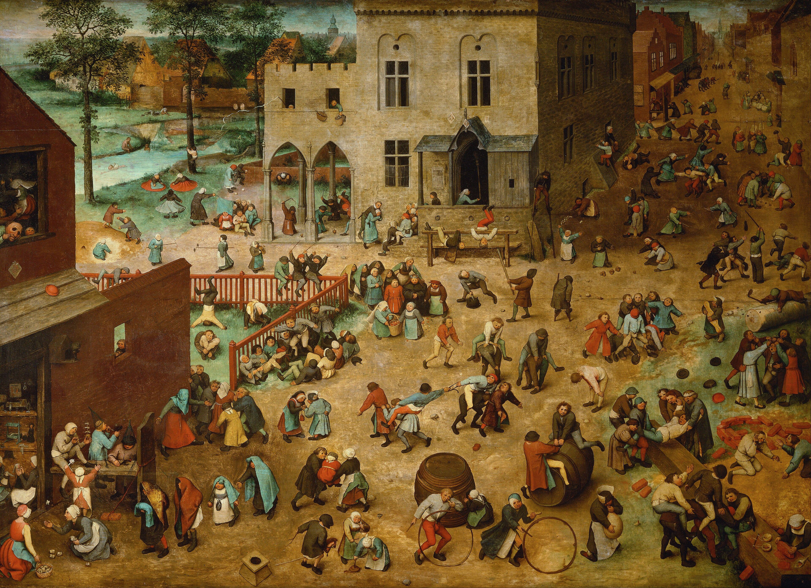{fig-alt="Pieter Bruegel the Elder, Children's Games, 1560: a town square full of children playing"}
:::

::: footer
[5 · Watch and look · 观看]{.phase} · zoom into a big picture
:::

::: notes
**Use it for:** start on one detail, ask "What is happening here?", then zoom out to the whole · a painting or a primary source, part by part · a map: zoom from the city to the country · a microscope or space photo · a detailed diagram (a cell, an engine) · "find and count" (how many games can you find?).

**How it works:** scroll or pinch to zoom, drag to move, double-tap to zoom in. The buttons: − and +, **Whole picture** (a slow zoom out: the reveal), ↺ back to the start, and ⌖, which copies the view on the screen as `start="x,y,zoom"` to paste into the slide. Every time the slide comes up it starts at `start`.

**Pieces:** `::: {.zoom-image start="0.56,0.88,5"}` around one picture (`zoom.html`). Use a big file (3000 px or more wide) so the details stay sharp. Here: Pieter Bruegel the Elder, *Children's Games* (1560), public domain, from Wikimedia Commons.

**Also see:** A picture, full screen; A picture that fills the screen (column 3).
:::

## {#full-picture data-menu-title="5 · A picture, full screen" background-image="images/units/colosseum-forum.jpg" background-size="cover" background-color="#000"}

::: notes
**Use it for:** a picture with nothing on it: "What do you see?" · a quiet moment before a topic · a place to imagine yourself in · a photo to talk about in pairs.

**Pieces:** a slide with no title or footer, only `background-image="images/your-picture.jpg"` in its heading's `{}`. `background-size="cover"` fills the screen (and may cut the edges); `"contain"` shows the whole picture with bars, here black (`background-color="#000"`). Credit the picture in `images/CREDITS.md` and on the Credits slide.

**Also see:** Zoom into a big picture; YouTube, full screen.
:::

## {#full-youtube data-menu-title="5 · YouTube, full screen" background-iframe="https://www.youtube.com/embed/8Z9FQxcCAZ0?rel=0" background-interactive="true"}

::: notes
**Use it for:** a video with nothing around it: a song, a clip to discuss, a how-to.

**Pieces:** a slide with no title or footer, only `background-iframe="https://www.youtube.com/embed/VIDEO-ID?rel=0"` and `background-interactive="true"` (so you can press play) in its heading's `{}`. Use the *embed* link: `youtube.com/embed/` and the video's ID (the letters after `v=`). If YouTube is blocked at school, use a video file: `background-video="clip.mp4"`. The slide PDF shows it blank, so put the link in the notes or on the slide before. Here: TED-Ed, the Odyssey in five minutes.

**Also see:** Video that fills the slide; Video with instructions.
:::

# [Angle hunt | 找角游戏]{.bi} {#task data-menu-title="6 · A task with a timer"}

:::: {.columns}
::: {.column width="58%"}
::: {.steps .stack style="font-size: 0.92em"}
1. [Find 5 angles in the room. | 在教室里找5个角。]{.bi}
2. [Draw each one. Mark the vertex. | 画下每个角，标出顶点。]{.bi}
3. [Name it: acute, right, obtuse, straight. | 写出名称：锐角、直角、钝角、平角。]{.bi}
4. [Write one sentence with *bigger than* or *smaller than*. | 用 *bigger than* 或 *smaller than* 写一句话。]{.bi}
:::
:::
::: {.column width="42%"}



:::
::::

::: footer
[6 · Tasks and instructions · 任务与指令]{.phase} · default: a task with a timer
:::

::: notes
**Use it for:** the main task of any lesson: numbered steps, the worksheet, the time · a lab · a writing task · test instructions.

**Pieces:** `.columns`, `.steps`, ``, and under it a timer in one row, ``: what to do, the time, and the buttons stacked: the worksheet's pages (here the guide's own `angle-hunt.qmd`); tap one to open it large.

**Also see:** Stations; Easy to hard.
:::

## [Stations | 学习站]{.bi} {#practice-stations data-menu-title="6 · Stations"}

:::: {.columns}
::: {.column width="56%"}
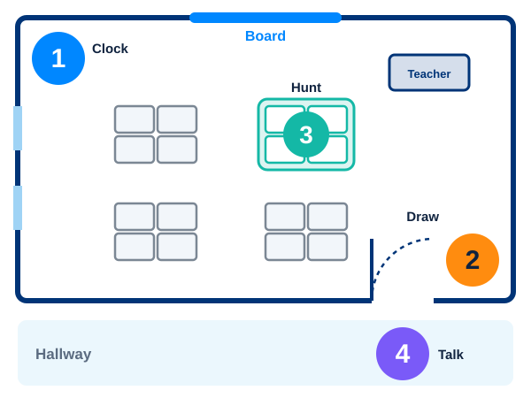{fig-alt="A map of the classroom: station 1 in the top left corner, station 2 in the bottom right corner, station 3 at a group of desks, station 4 in the hallway outside the door"}
:::
::: {.column width="44%"}
::: {.station-list style="font-size: 0.74em"}
::: {.row .st1}
[1]{.num}

[**Clock** · Make 4 angles with the paper clock. | **钟** · 用纸钟做出4个角。]{.bi}
:::

::: {.row .st2}
[2]{.num}

[**Draw** · Draw one of each angle. Label them. | **画** · 每种角画一个，标上名称。]{.bi}
:::

::: {.row .st3}
[3]{.num}

[**Hunt** · Find 3 angles in a picture book. | **找** · 在图画书里找3个角。]{.bi}
:::

::: {.row .st4}
[4]{.num}

[**Talk** · Compare two angles with a partner. Use the frames. | **说** · 和同伴比较两个角，用句型。]{.bi}
:::
:::


:::
::::

::: footer
[6 · Tasks and instructions · 任务与指令]{.phase} · stations
:::

::: notes
**Use it for:** several activities in one lesson · learning centres · revision stations before a test · a lab with rotating groups.

**Pieces:** `.columns`: a map of the room (`images/stations-map.svg`, an original drawing: two stations in corners, one at a desk cluster, one in the hallway) beside the station list, each a `.row` with a coloured `.num` (`.st1` to `.st4`, the map's colours), and under them a timer in one row, ``: the instruction, the time, and the buttons stacked. Draw your own room's map, or photograph the room and put numbers on it.

**Also see:** A task with a timer.
:::

## [Drum kit: easy to hard | 架子鼓：由易到难]{.bi} {#easy-to-hard data-menu-title="6 · Easy to hard, with pictures"}

:::: {.columns style="font-size: 0.8em"}
::: column
### Part 1: two events per sprite

::: row
[1]{.num}

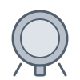{.thumb fig-alt="A bass drum" style="object-fit: contain"}

**Bass drum:** a loud low sound + smaller and bigger.
:::

::: row
[2]{.num}

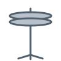{.thumb fig-alt="A hi-hat" style="object-fit: contain"}

**Hi-hat:** a high crash sound + smaller and bigger.
:::

::: row
[3]{.num}

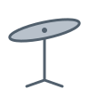{.thumb fig-alt="A ride cymbal" style="object-fit: contain"}

**Ride cymbal:** a medium crash sound + shake left and right.
:::

::: row
[4]{.num}

{.thumb fig-alt="Two stars" style="object-fit: contain"}

**Stars:** appear and disappear, turn forever (opposite ways!).
:::
:::
::: column
### Part 2: three events per sprite

::: row
[5]{.num}

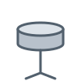{.thumb fig-alt="A snare drum" style="object-fit: contain"}

**Snare drum:** a sound + smaller and bigger + a fast jump.
:::

::: row
[6]{.num}

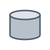{.thumb fig-alt="A tom drum" style="object-fit: contain"}

**Tom:** a sound + smaller and bigger + fast up and down.
:::

::: row
[7]{.num}

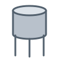{.thumb fig-alt="A floor tom" style="object-fit: contain"}

**Floor tom:** the same sprite and code as the tom. Just add legs!
:::

::: row
[8]{.num}

{.thumb fig-alt="A dancing cat" style="object-fit: contain"}

**Dancing character:** dances forever, says "hee hee!", and gets bigger and smaller when touched. (Not only a cat!)
:::
:::
::::

::: footer
[6 · Tasks and instructions · 任务与指令]{.phase} · easy to hard, with pictures
:::

::: notes
**Use it for:** chained challenges on one project (coding, building, art) · mixed levels: everyone starts at 1 · extension tasks.

**Pieces:** the Slide kit's drum kit slide: `.columns` with a `###` heading for each part; each challenge a `.row` with a `.num`, a small `.thumb` picture (`object-fit: contain` shows a whole drawing) and its words.

**Also see:** Easy to hard, a list.
:::

## [Easy to hard | 由易到难]{.bi} {#easy-to-hard-list data-menu-title="6 · Easy to hard, a list"}

::: {style="font-size: 0.95em; display: flex; flex-direction: column; gap: 0.35em; margin-top: 0.4em"}
::: row
[1]{.num}

Find a right angle in the room.
:::

::: row
[2]{.num}

Draw an angle smaller than a right angle. Name it.
:::

::: row
[3]{.num}

Draw an angle bigger than a right angle. Name it.
:::

::: row
[4]{.num}

Draw a straight angle. Mark its vertex.
:::

::: row
[5]{.num}

How many right angles make a full angle? Show it with a drawing.
:::

::: row
[6]{.num}

Make a clock show an obtuse angle. What time is it? Find two answers.
:::
:::

::: footer
[6 · Tasks and instructions · 任务与指令]{.phase} · easy to hard, a list
:::

::: notes
**Use it for:** practice questions that get harder · a choice board: do three · math problem sets · writing prompts from short to long.

**Pieces:** each challenge a `.row` with a `.num`.

**Also see:** Easy to hard, with pictures.
:::

## [Group task · prepare your statement | 小组任务 · 准备发言]{.bi} {#group-task data-menu-title="6 · Group task"}

:::: {.columns}
::: {.column width="64%"}
::: steps
1. [Each person chooses one thinker | 每人选择一个思想家]{.bi}
2. [Sit with others from your school | 同一学派的同学坐在一起]{.bi}
3. [Use the frames: problem, solution, reason | 用句型准备：问题、方案、原因]{.bi}
:::

::: {.box .plain}
[Done when · 完成标准]{.kicker}

[Every member can say one idea and one reason from their school. | 每位成员都能说出本学派的一个主张和一个理由。]{.bi}
:::
:::
::: {.column width="36%"}
::: {.box .dark style="align-items: center"}
[Timer · 计时]{.kicker}


:::

::: {.box .plain}
[Materials · 材料]{.kicker}

[Worksheet, parts 1 and 2 | 学习单 第 1–2 部分]{.bi}

[Hand in parts 1 and 2. | 上交第 1–2 部分。]{.bi .fine}
:::
:::
::::

::: footer
[6 · Tasks and instructions · 任务与指令]{.phase} · group task
:::

::: notes
**Use it for:** a group prepares a statement, a poster or a presentation · a debate's preparation · a lab report in groups.

**Also see:** Group roles (column 7).
:::

## [Write it | 写一写]{.bi} {#practice-write data-menu-title="6 · Write it"}

:::: {.columns}
::: {.column width="55%"}
::: {.box .plain}
[Model · 范例]{.kicker}

At 4:00, the clock hands make an obtuse angle. It is **bigger than** a right angle, but **smaller than** a straight angle.
:::


:::
::: {.column width="45%"}
::: {.box .plain .cross-off}
[Check · 检查]{.kicker}

- [ ] I named the angle.
- [ ] I compared it with a right angle.
- [ ] I used *bigger than* or *smaller than*.
- [ ] I started with a capital letter and ended with a full stop.
:::
:::
::::

::: footer
[6 · Tasks and instructions · 任务与指令]{.phase} · write it
:::

::: notes
**Use it for:** a writing task with a model, a frame and a checklist · a lab conclusion · a paragraph answer · peer marking (tick the checklist together).

**Pieces:** `.columns`, a model in a `.box`, a frame (``, from the language list), and a checklist (`- [ ]`) in a `.box .cross-off`: click a box and its line is crossed out. Read each check aloud and tick it to show students how.

**Also see:** Language points (column 2).
:::

## [Strategy: check with a corner | 方法：用直角来比]{.bi} {#strategies-strategy data-menu-title="6 · Strategy reminder"}

:::: {.columns}
::: {.column width="55%"}
::: {.steps .stack}
1. [Fold a paper to make a square corner. | 把纸折出一个直角。]{.bi}
2. [Put the corner on the vertex. | 把直角对准顶点。]{.bi}
3. [Line up one side. | 对齐一条边。]{.bi}
4. [Is the other side inside or outside? | 另一条边在里面还是外面？]{.bi}
:::
:::
::: {.column width="45%"}
::: {.placeholder style="min-height: 8.5em"}
[Picture: a folded paper corner held against an angle | 图片：把折好的纸角放在一个角上比一比]{.bi}
:::

::: {.box .plain}
[Use it when · 什么时候用]{.kicker}

[You're not sure if an angle is acute or obtuse. | 不确定一个角是锐角还是钝角时。]{.bi}
:::
:::
::::

::: footer
[6 · Tasks and instructions · 任务与指令]{.phase} · strategy reminder
:::

::: notes
**Use it for:** teach a learning strategy: name it, show it, say when to use it · checking work · estimating · finding the main idea.

**Pieces:** `.columns`, `.steps`, a picture of the strategy in use (here a placeholder: a photo of a student's own folded corner works best), and a `.box` with "Use it when".

**Also see:** Write it.
:::

## [Make it on the clock | 在钟面上做角]{.bi} {#practice-clock data-menu-title="6 · Hands-on, on the screen"}

<iframe class="angle-frame" data-src="embeds/turning-angle.html?mode=clock" title="Angles on a clock"></iframe>

::: footer
[6 · Tasks and instructions · 任务与指令]{.phase} · hands-on, on the screen
:::

::: notes
**Use it for:** students come up and move something on the board · make a time, an angle, a fraction · check with the class first.

**Pieces:** the angle explorer from Unit 5 in clock mode: `data-src="embeds/turning-angle.html?mode=clock"`.

**Also see:** Model it (column 3).
:::

## [Make a museum card | 制作博物馆卡片]{.bi} {#museum-card data-menu-title="6 · Make something"}

::::: {.columns}
::: {.column width="62%"}

:::
::: {.column width="38%"}
::: {.box .plain style="font-size: 0.72em"}
[Instructions · 步骤]{.kicker}

[Watch how ink is made. Then make a card for one thinker. | 看看墨是怎么做的，然后为一位思想家做一张卡片。]{.bi}

1. [Write his name, school and big idea. | 写出他的名字、学派和主要思想。]{.bi}
2. [Draw one picture for his idea. | 为他的思想画一幅画。]{.bi}
:::

::: {.box .dark style="font-size: 0.72em"}
[Done when · 完成标准]{.kicker}

[Your card has a name, a school, a big idea and a picture. | 卡片上有名字、学派、主要思想和一幅画。]{.bi}
:::
:::
:::::

::: footer
[6 · Tasks and instructions · 任务与指令]{.phase} · make something
:::

::: notes
**Use it for:** make a card, a poster or a model: a video of how, the steps, and an example · a craft · a lab.

**Pieces:** `.columns`: a video with no size (``) fills its column (here a CC0 video on Wikimedia Commons; needs the internet); the steps in a `.box`, and what done looks like in a `.box .dark`. To show a finished example too, see Video with instructions (column 5). From the Slide kit.

**Also see:** Video with instructions (column 5).
:::

# [Think · Pair · Share | 思考 · 结对 · 分享]{.bi} {#tps data-menu-title="7 · Think-Pair-Share"}

:::: {.columns}
::: {.column width="46%"}
::: {.box .plain style="font-size: 0.9em"}
- [**Listen** to the question. | **听**问题。]{.bi}
- [**Think** about your answer. | **想**一想你的答案。]{.bi}
- [**Talk** to your partner (2×). | 和同伴**说**（两次）。]{.bi}
- [**Share** with the whole class. | 和全班**分享**。]{.bi}
:::

::: {.tiles style="--pic-fit: contain; --pic-height: 3.6em; text-align: center"}
::: {.box .plain}
{fig-alt="Two students sitting side by side"}

[1 · Knee to knee | 膝对膝]{.bi}
:::

::: {.box .plain}
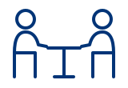{fig-alt="Two students facing each other at a table"}

[2 · Face to face | 面对面]{.bi}
:::

::: {.box .plain}
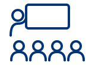{fig-alt="A teacher and the whole class"}

[3 · Whole class | 全班]{.bi}
:::
:::
:::
::: {.column width="54%"}
::: {.box}
[Ask · 提问]{.kicker}

[Where do you see a straight angle at home? | 你在家里哪里能看到平角？]{.bi}


:::

::: {.tiles style="font-size: 0.45em"}
::: {.box .dark style="align-items: center"}
[Think · 思考]{.kicker}


:::

::: {.box .dark style="align-items: center"}
[Share ×2 · 分享 ×2]{.kicker}


:::
:::
:::
::::

::: footer
[7 · Talk and work together · 交流合作]{.phase} · default: Think-Pair-Share
:::

::: notes
**Use it for:** any question everyone should answer · before a whole-class discussion · checking an idea with a partner first.

**Pieces:** the Slide kit's Think-Pair-Share: a `.box` with the steps, `.tiles` of seating drawings, the question with a frame (``, from the language list), and two timers in `.dark` boxes.

**Also see:** The Routines tool (W) does it on top of any slide.
:::

## [Jigsaw: expert groups | 拼图学习：专家组]{.bi} {#interaction-jigsaw data-menu-title="7 · Jigsaw"}

:::: {.columns}
::: {.column width="36%"}
::: {.jigsaw-steps style="font-size: 0.5em; --pic-fit: contain; --pic-height: 4.4em; --pad: 0.3em 0.7em; --gap: 0.25em"}
::: {.box .plain}
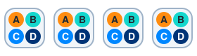{fig-alt="Four home groups, each with one A, B, C and D"}

[1 · Home group | 原小组]{.bi .kicker}

[Get a letter: A, B, C or D. | 每人领一个字母。]{.bi}
:::

::: {.box .plain}
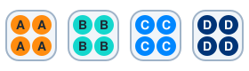{fig-alt="Four expert groups: all A, all B, all C, all D"}

[2 · Expert group | 专家组]{.bi .kicker}

[Do your piece. Agree on 3 key points. | 完成你的任务，总结3个要点。]{.bi}
:::

::: {.box .plain}
[3 · Back home: teach | 回原小组：讲解]{.bi .kicker}

[Teach your 3 points. Take notes. | 讲解3个要点，做笔记。]{.bi}
:::

:::

::: {style="font-size: 0.72em"}

:::
:::
::: {.column width="64%"}
::: puzzle
::: {.box style="--piece: #FFE4C7; --strong: #FF8C0F"}
::: row
[A]{.num}

{.thumb fig-alt="An acute angle"}

[Acute angles | 锐角]{.bi}
:::

[Find three acute angles in the room. Draw them. | 在教室里找三个锐角，画下来。]{.bi}
:::

::: {.box style="--piece: #CDF6F3; --strong: #14D7CD"}
::: row
[B]{.num}

{.thumb fig-alt="An obtuse angle"}

[Obtuse angles | 钝角]{.bi}
:::

[Find three obtuse angles in the room. Draw them. | 在教室里找三个钝角，画下来。]{.bi}
:::

::: {.box style="--piece: #D3E8FF; --strong: #0087FF"}
::: row
[C]{.num}

{.thumb fig-alt="A straight angle"}

[Straight angles | 平角]{.bi}
:::

[When do clock hands make a straight angle? | 钟面上什么时候是平角？]{.bi}
:::

::: {.box style="--piece: #D5DEEB; --strong: #003477"}
::: row
[D]{.num}

{.thumb fig-alt="A full angle"}

[Full angles | 周角]{.bi}
:::

[What turns all the way around? Find three things. | 什么东西会转一整圈？找三个。]{.bi}
:::
:::
:::
::::

::: footer
[7 · Talk and work together · 交流合作]{.phase} · jigsaw
:::

::: notes
**Use it for:** a lot of content that splits into parts: four texts, four regions, four experiments · every student teaches a part.

**Pieces:** the Slide kit's jigsaw: the three steps on the left (the group pictures large), one timer for steps 2 and 3 (press **Reset** between them), and `::: puzzle` with four `.box`es that lock together, each with its tint (`--piece`) and letter colour (`--strong`).

**Also see:** Group roles.
:::

## [Group roles | 小组分工]{.bi} {#interaction-roles data-menu-title="7 · Group roles"}

::: {.tiles .roles style="--cols: 4; text-align: center"}
::: {.box .plain .role-card}
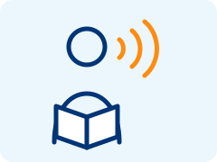{fig-alt="A student reading aloud from a book"}

[**Reader** | **朗读员**]{.bi}

[reads the task card aloud | 大声读任务卡]{.bi .small}

[1]{.num}
:::

::: {.box .plain .role-card}
{fig-alt="A pencil writing on paper"}

[**Writer** | **记录员**]{.bi}

[writes the names on the poster | 把名称写在海报上]{.bi .small}

[2]{.num}
:::

::: {.box .plain .role-card}
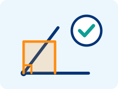{fig-alt="A paper corner held against an angle, and a tick"}

[**Checker** | **检查员**]{.bi}

[checks each angle with a paper corner | 用纸角检查每个角]{.bi .small}

[3]{.num}
:::

::: {.box .plain .role-card}
{fig-alt="A student speaking to the class"}

[**Reporter** | **汇报员**]{.bi}

[presents the poster to the class | 向全班展示海报]{.bi .small}

[4]{.num}
:::
:::

::: {.box .plain style="font-size: 0.85em"}
[Task · 任务]{.kicker}

[Make an angle poster: find five angles in our classroom. Draw each one, name it and check it. | 制作角的海报：在教室里找五个角。画出每个角，写出名称，并检查。]{.bi}
:::

::: footer
[7 · Talk and work together · 交流合作]{.phase} · group roles
:::

::: notes
**Use it for:** any group task: a job for each student · a lab group · a poster · a reading circle.

**Pieces:** `.tiles .roles` with four columns; each role a `.box .plain .role-card` with a line drawing (`images/role-*.svg`, original), the role, what it does, and its `.num` (bottom right, `exemplar.css`); a `.box` for the task. The task needs every role: someone reads it, someone writes, someone checks, someone presents.

**Also see:** Group task (column 6).
:::

## [Think in any language, report in English | 用任何语言思考，用英语汇报]{.bi} {#interaction-languages data-menu-title="7 · Any language, report in English"}

::: steps
1. [**Think** in any language. | 用任何语言**思考**。]{.bi}
2. [**Discuss** with your group in any language. | 用任何语言和小组**讨论**。]{.bi}
3. [**Plan** your answer in English. Use the frame. | 用英语**准备**答案，用句型。]{.bi}
4. [**Report** to the class in English. | 用英语向全班**汇报**。]{.bi}
:::



::: footer
[7 · Talk and work together · 交流合作]{.phase} · any language, report in English
:::

::: notes
**Use it for:** a hard new idea: think and talk in any language, then report in English with a frame · newcomers in a group.

**Pieces:** Chalkline's `.steps`, and a frame (``, from the language list).

**Also see:** Question formats (column 2).
:::

## {#big-question data-menu-title="7 · Big question" .center}

::: cover
[Big question · 大问题]{.bi .kicker}

[Is a straight angle really an angle? | 平角真的是角吗？]{.bi .big}


:::

::: footer
[7 · Talk and work together · 交流合作]{.phase} · big question
:::

::: notes
**Use it for:** a question to argue, with a frame for the reason · an ethics question · a 'would you rather' · a prediction.

**Pieces:** `.cover` with a `.kicker`, `.big` text and a frame (``, from the language list).

**Also see:** Think-Pair-Share.
:::

## [Draw an angle you can find at home | 画一个家里能找到的角]{.bi} {#interaction-board data-menu-title="7 · Live board"}

::: {.live-board rooms="wbo"}
Scan to draw with us. Then write its name.
:::

::: footer
[7 · Talk and work together · 交流合作]{.phase} · live board
:::

::: notes
**Use it for:** everyone draws or writes on one board: ideas, examples, a class drawing · brainstorming · exit ideas.

**Pieces:** `::: {.live-board rooms="wbo"}` (a WBO whiteboard, no login). For a Padlet wall: `::: {.live-board src="…" join="…"}`. Needs the internet. See the Live boards deck in Start here.

**Also see:** Padlet wall.
:::

## Post one idea {#padlet data-menu-title="7 · Padlet wall"}

::: {.live-board}
Post one thing you learned today.
:::

::: footer
[7 · Talk and work together · 交流合作]{.phase} · Padlet wall
:::

::: notes
**Use it for:** students post ideas, photos or questions from their devices · a gallery of homework · questions for a guest.

**Pieces:** `::: {.live-board}`: a Padlet wall that fills the slide, with its link and QR code in the corner (`src=` and `join=` keep it in the file; **Edit link** pastes it for now).

**Also see:** Live board.
:::

# True or false? {#true-false data-menu-title="8 · True or false"}

::::: {style="font-size: 1.2em; margin-top: 0.8em"}
::: {.poll type="truefalse" correct="false"}
A straight angle is just a straight line. It is not an angle.
:::
:::::

::: footer
[8 · Check understanding · 检查理解]{.phase} · default: true or false
:::

::: notes
**Use it for:** a quick check after two or three input slides · a common mistake to vote on · a statement to argue about.

**Pieces:** `::: {.poll type="truefalse" correct="false"}`: two card buttons with badges drawn in SVG (in a `font-size: 1.2em` div to make them bigger). Also `type="choice"` with `options="…"`, and `type="smileys"`. Results collect on the Poll results slide.

**Also see:** Multiple choice; Quiz list.
:::

## Quick check {#choice data-menu-title="8 · Multiple choice"}

::::: {style="font-size: 1.15em; margin-top: 0.6em"}
::: {.poll type="choice" options="2 | 3 | 4" correct="C"}
How many right angles make one full angle?
:::
:::::

::: footer
[8 · Check understanding · 检查理解]{.phase} · multiple choice
:::

::: notes
**Use it for:** one question with three or four answers · a vote (no right answer: leave out `correct`) · a prediction before an experiment.

**Pieces:** `::: {.poll type="choice" options="2 | 3 | 4" correct="C"}`: each answer big on its own tile (long answers get smaller type). The results collect on the Poll results slide (column 10).

**Also see:** Multiple choice with pictures; True or false.
:::

## Quick check: pictures {#choice-pictures data-menu-title="8 · Multiple choice: pictures"}

::: {.poll type="choice" correct="B"}
Which clock shows a right angle?

- 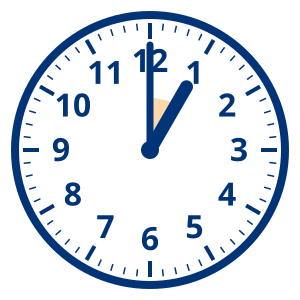 1:00
-  3:00
- 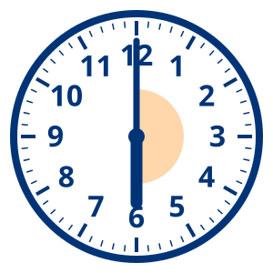 6:00
:::

::: footer
[8 · Check understanding · 检查理解]{.phase} · multiple choice: pictures
:::

::: notes
**Use it for:** which picture shows it? · which graph matches? · which map, flag, shape or animal? · choose a photo to write about.

**Pieces:** `::: {.poll type="choice" correct="B"}` with the question, then a list: one answer per line, a picture and a few words (`-  3:00`). Each card gets its letter, A, B, C, so students can call out an answer too.

**Also see:** Multiple choice (words); Sort it (pictures).
:::

## [Vote! | 投票！]{.bi} {#pie-vote data-menu-title="8 · Pie vote"}

::: {.pie-vote editable="true"}
:::

::: footer
[8 · Check understanding · 检查理解]{.phase} · pie vote
:::

::: notes
**Use it for:** any vote where the class should see the result grow: which topic next? · which answer is right? · predict the experiment · pick the class reward · which character is to blame?

**How it works:** blank to start: **Edit answers**, type the question and two to eight answers, **Done**. Students tap their answer; the pie grows with each vote. **Hide chart** (or R) covers it until everyone has voted. Your answers and votes stay in this browser.

**Pieces:** `::: {.pie-vote editable="true"}` (`mood.html`). Answers written in the slide instead: a list inside, one per line (`- Mars`, `- [Jupiter | 木星]{.bi}`), with the question above it.

**Also see:** Multiple choice; Check-in: feelings pie (column 1).
:::

## True or false? {#quiz-list data-menu-title="8 · Quiz list"}

[Guess first, then click to see each answer.]{.fine}

::: {.tiles style="--cols: 1; --gap: 0.3em; font-size: 0.85em; margin-top: 0.4em"}
::: {.box .plain}
::: row
Göbekli Tepe is older than the Egyptian pyramids.

[True]{.pill .fragment}
:::
:::

::: {.box .plain}
::: row
The pillars were carved with metal tools.

[False: stone tools]{.pill .fragment}
:::
:::

::: {.box .plain}
::: row
Most carvings show farm animals like sheep and cows.

[False: wild animals]{.pill .fragment}
:::
:::

::: {.box .plain}
::: row
Archaeologists have dug up the whole hill.

[False: about 1/10]{.pill .fragment}
:::
:::
:::

::: footer
[8 · Check understanding · 检查理解]{.phase} · quiz list
:::

::: notes
**Use it for:** several statements, answers on click · Athens or Sparta? · fact or opinion? · which planet? · hands up first, then reveal.

**Pieces:** `.tiles` with one column; each statement a `.box .plain` with a `.row` and its answer in a `[…]{.pill .fragment}` (shown on the next click). From the Göbekli Tepe unit (rewritten with the slide kit's pieces, so it follows the colour scheme).

**Also see:** Review set (column 4).
:::

## Sort the clocks {#practice-sort data-menu-title="8 · Sort it (pictures)"}

::::: act-center
::: {.sort}
- **Acute**
  -  | At 1:00 the hands are close together: smaller than a right angle.
  - 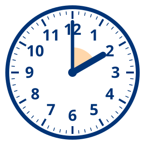 | At 2:00 the opening is smaller than a right angle.
  - 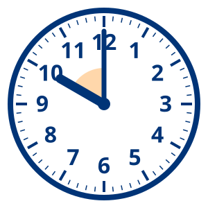 | At 10:00 the hands are two hours apart: smaller than a right angle.
- **Right**
  -  | At 3:00 the hands make a square corner.
  - 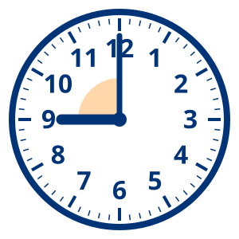 | At 9:00 the hands make a square corner too.
- **Obtuse**
  - 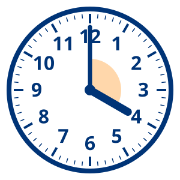 | At 4:00 the opening is bigger than a right angle, smaller than a straight angle.
  - 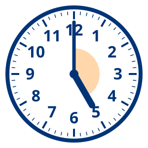 | At 5:00 the hands are almost in a line, but not quite.
  - 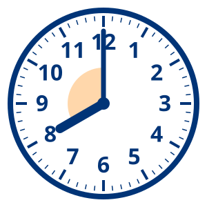 | At 8:00 the hands are four hours apart: bigger than a right angle.
- **Straight**
  -  | At 6:00 the two hands make one straight line.
:::
:::::

::: footer
[8 · Check understanding · 检查理解]{.phase} · sort it (pictures)
:::

::: notes
**Use it for:** sort pictures into groups: clocks by angle, animals by class, shapes by sides · tap a card, then its group.

**Pieces:** `::: {.sort}` with pictures as items: ` | reason`, inside `::::: act-center` (`exemplar.css`): in the middle of the slide.

**Also see:** Sort it (words); Venn sort.
:::

## Greece, Rome, or both? {#venn data-menu-title="8 · Venn sort"}

::: {.sort layout="venn"}
- **Ancient Greece**
  - The first democracy | Athens had the first democracy.
  - The Olympic Games | The first Olympic Games were in Greece.
  - City-states | Greece was many city-states, not one country.
- **Both**
  - Many gods | Greeks and Romans both prayed to many gods.
  - Temples with columns | Both built temples with tall columns.
  - Theaters and plays | Both watched plays in big theaters.
- **Ancient Rome**
  - Emperors | Rome had emperors, like Augustus.
  - Aqueducts | The Romans built aqueducts to carry water.
  - Latin | The Romans spoke Latin. The Greeks spoke Greek.
:::

::: footer
[8 · Check understanding · 检查理解]{.phase} · Venn sort
:::

::: notes
**Use it for:** what's the same and what's different: two cultures, two books, two numbers (prime / even) · three groups, the middle is 'both'.

**Pieces:** `::: {.sort layout="venn"}` with exactly three groups (left, both, right), each item with a reason after a `|`. From the Ancient Rome unit.

**Also see:** Two things side by side (column 3).
:::

## Label the angle {#practice-label data-menu-title="8 · Label it"}

::::: act-center
::: {.label-it image="images/MTH-001.svg"}
- Vertex | 29,78 | The vertex is the point where the two sides meet.
- Side | 75,78 | A side is one of the two lines.
- Angle | 47,62 | The angle is the opening between the sides.
:::
:::::

::: footer
[8 · Check understanding · 检查理解]{.phase} · label it
:::

::: notes
**Use it for:** parts of a diagram, a map, a plant, a machine, an angle · drag each label to its dot.

**Pieces:** `::: {.label-it image="…"}` inside `::::: act-center` (the picture bigger, in the middle of the slide), one line per label: the label, `|`, where its dot goes (`x,y` in percent: press **L** on the slide and tap the picture to find it), `|`, a reason.

**Also see:** Label a photo.
:::

## Label the aqueduct {#label-photo data-menu-title="8 · Label a photo"}

::: {.label-it image="images/units/pont-du-gard.jpg"}
- Water channel | 40,15 | The water flowed in a covered channel along the very top.
- Small arches | 66,22 | The top row has the smallest arches, under the water channel.
- Big arches | 47,38 | The middle row has big arches, to lift the channel high.
- Bottom arches | 48,57 | The bottom row stands in the river valley.
- River | 12,82 | The aqueduct crosses the Gardon River.
:::

::: footer
[8 · Check understanding · 检查理解]{.phase} · label a photo
:::

::: notes
**Use it for:** label a photo: a building, a body, a landscape, a lab setup.

**Pieces:** `::: {.label-it image="…"}`: one line per label (label | x,y | reason); press **L** on the slide and tap the picture to find x,y. From the Ancient Rome unit.

**Also see:** Label it.
:::

## [Draw an angle: put the steps in order | 画角：排一排顺序]{.bi} {#strategies-order data-menu-title="8 · Put it in order"}

::: {.put-in-order first="Start" last="Done"}
- Draw a dot. | This is the vertex.
- Draw a straight line from the dot. | This is the first side.
- Turn, and draw a second line from the dot. | This is the second side.
- Draw a small curve between the sides. | This marks the angle.
:::

::: footer
[8 · Check understanding · 检查理解]{.phase} · put it in order
:::

::: notes
**Use it for:** any process with steps: drawing, a recipe, a lab, the water cycle.

**Pieces:** `::: {.put-in-order first="…" last="…"}`, one step per line, a reason after the `|`.

**Also see:** Put it in order: math steps.
:::

## Solve it, step by step {#order-math data-menu-title="8 · Put it in order: math steps"}

::: {.put-in-order first="Start" last="Answer"}
- 3x + 5 = 20 | The equation to solve.
- 3x + 5 − 5 = 20 − 5 | Take 5 from both sides.
- 3x = 15 | Now only the x part is on the left.
- 3x ÷ 3 = 15 ÷ 3 | Divide both sides by 3.
- x = 5 | The answer. Check: 3 × 5 + 5 = 20 ✓
:::

::: footer
[8 · Check understanding · 检查理解]{.phase} · put it in order: math steps
:::

::: notes
**Use it for:** the steps of solving an equation · a proof · a construction · debugging code.

**Pieces:** `::: {.put-in-order first="Start" last="Answer"}`, the steps in the right order (they're mixed up for you), a reason after each `|`. From the STEM unit.

**Also see:** Line-by-line reading (column 4): to show a proof first.
:::

## Fill in the blanks {#fill-blanks data-menu-title="8 · Fill in the blanks"}

::: {.fill-blanks extra="soldiers, temples"}
The Romans needed lots of clean [water] for their cities. They built [aqueducts] to carry it from the mountains.

The water flowed down a gentle [slope], so they needed no pumps. Many aqueducts went over valleys on tall [arches].
:::

::: footer
[8 · Check understanding · 检查理解]{.phase} · fill in the blanks
:::

::: notes
**Use it for:** a summary with gaps · key words in context · a cloze reading · a lab conclusion.

**Pieces:** `::: {.fill-blanks extra="…"}`: the text with each missing word in `[brackets]`; `extra=` adds wrong words to the bank. From the Ancient Rome unit.

**Also see:** Build the sentence.
:::

## Build the sentence {#sentence data-menu-title="8 · Build the sentence"}

::: {.sentence-builder}
- The Romans / built / long, straight roads. 
- Aqueducts / carried / water / to the city. 
- Augustus / was / the first emperor / of Rome. 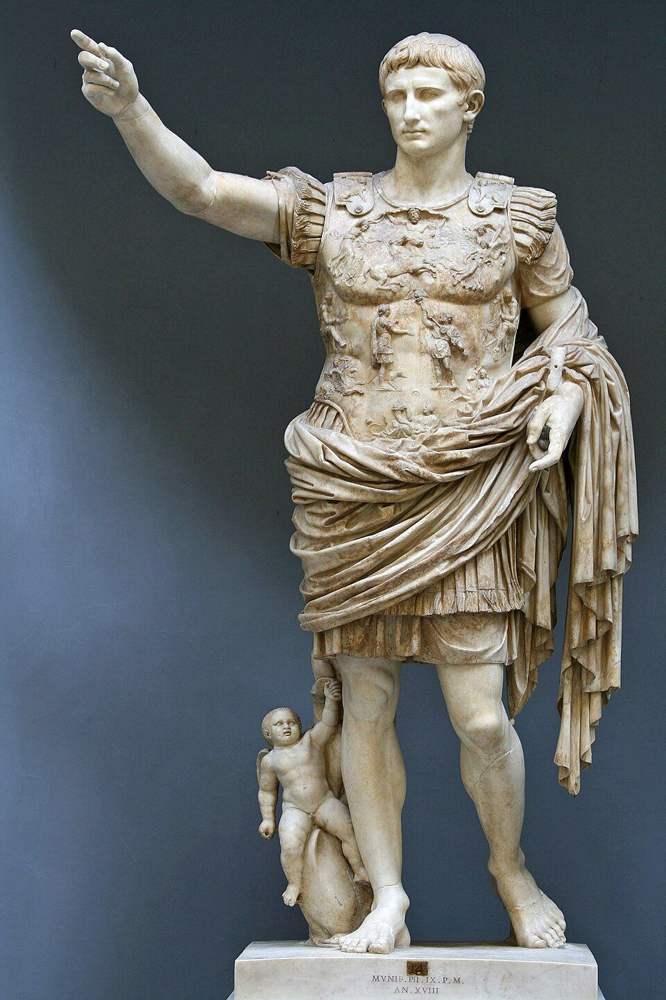
- Gladiators / fought / in the Colosseum. 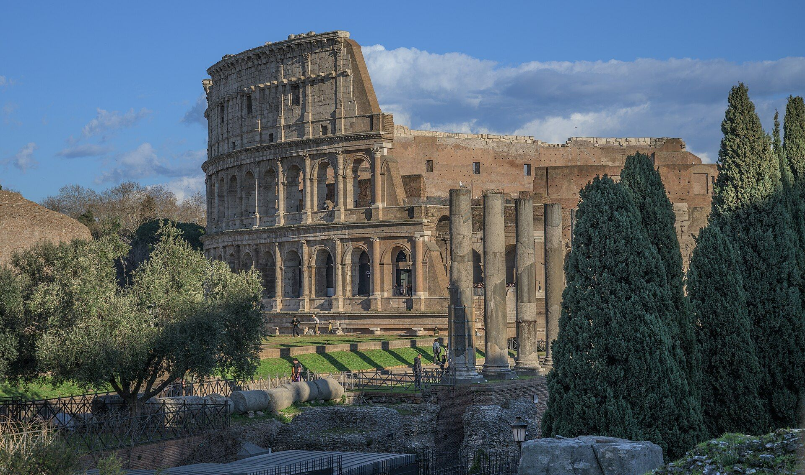
- The Senate / gave / advice / to the consuls. | Who gave advice?
:::

::: footer
[8 · Check understanding · 检查理解]{.phase} · build the sentence
:::

::: notes
**Use it for:** word order in English · a key sentence of the lesson · lines of code (one tile per part).

**Pieces:** `::: {.sentence-builder}`: one sentence per line, `/` between tiles, a picture or a hint after `|`. From the Ancient Rome unit.

**Also see:** Fill in the blanks; Code (column 3).
:::

## Match it {#match data-menu-title="8 · Match it"}

Tap a word, then tap its meaning.

::: {.matching}
- myth | A traditional story about gods and heroes.
- philosopher | A thinker who asks big questions about life and truth.
- temple | A building where people worship a god or goddess.
- column | A tall post that holds up a roof.
- theater | An outdoor place for plays, with seats in a half circle.
- Olympic Games | Sports contests at Olympia every four years, to honor Zeus.
:::

::: footer
[8 · Check understanding · 检查理解]{.phase} · match it
:::

::: notes
**Use it for:** words and meanings · countries and capitals · formulas and names · questions and answers.

**Pieces:** `::: {.matching}`: one pair per line, `word | meaning`. A right pair locks in. English only (it's review). From the Ancient Greece unit.

**Also see:** Matching game (column 9).
:::

## Put Rome on the timeline {#timeline-activity data-menu-title="8 · Put it on the timeline"}

::: {.timeline-activity title="Ancient Rome"}
- 509 BC | Rome becomes a republic 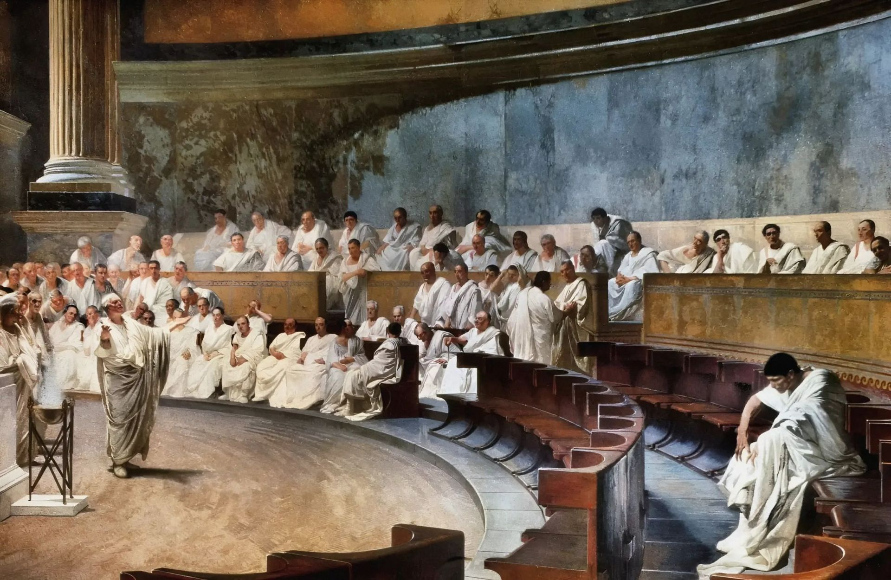
- 312 BC | The Via Appia 
- 27 BC | Augustus, the first emperor 
- AD 50 | The Pont du Gard 
- AD 80 | The Colosseum opens 
- AD 113 | Trajan's Column 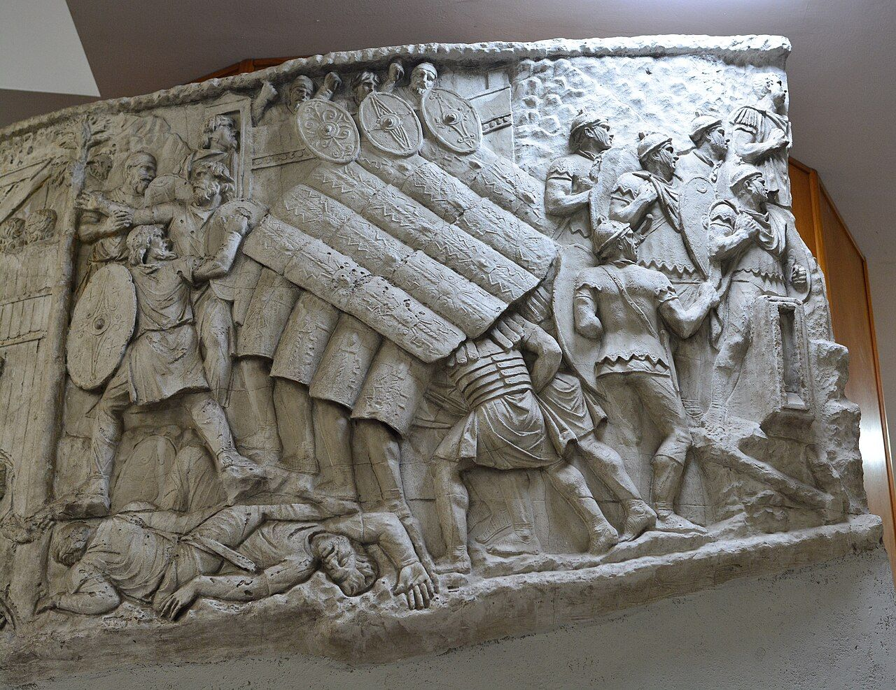
:::

::: footer
[8 · Check understanding · 检查理解]{.phase} · put it on the timeline
:::

::: notes
**Use it for:** place events on a line by their date · inventions · a person's life · geological time.

**Pieces:** `::: {.timeline-activity}`: one line per event (date | event, with a picture if you like); `tolerance=` and `snap=` set how close is right. From the Ancient Rome unit.

**Also see:** Timeline (column 4).
:::

# Angles quick-fire! {#quickfire data-menu-title="9 · Quick-fire"}

::: {.trivia title="Angles quick-fire!" seconds="10"}
- An angle smaller than a right angle | An acute angle
- The two sides make one straight line. What angle is it? | A straight angle
- One side turns all the way around, back to the start | A full angle
- 1 straight angle = how many right angles? | 2
- 1 full angle = how many right angles? | 4
- At 3:00, the clock hands make… | A right angle
- The point where the two sides of an angle meet | The vertex
:::

::: footer
[9 · Review games · 复习游戏]{.phase} · default: quick-fire
:::

::: notes
**Use it for:** five minutes of review at the end · retrieval at the start · times tables · capitals.

**Pieces:** `::: {.trivia title="…" seconds="10"}`, one question per line, the answer after the `|`. From Unit 5. Other games from the vocab list: ``, ``, ``: see the Review games deck in Unit 1.

**Also see:** Jeopardy.
:::

## Angles Jeopardy {#review-jeopardy data-menu-title="9 · Jeopardy (your questions)"}

::: {.jeopardy teams="2"}
- **Names**
  - Smaller than a right angle | acute
  - A square corner | right
  - Bigger than a right angle, smaller than a straight angle | obtuse
  - One side turns all the way around | full
- **Parts**
  - The point where the sides meet | the vertex
  - An angle has two of these | sides
  - We measure angles in these | degrees
  - The curve that marks an angle | an arc
- **Clocks**
  - The angle at 3:00 | a right angle
  - The angle at 6:00 | a straight angle
  - Name a time with an acute angle | 1:00, 2:00, 10:00 or 11:00
  - Name a time with an obtuse angle | 4:00, 5:00, 7:00 or 8:00
- **Compare**
  - 2 right angles = 1 … | straight angle
  - 4 right angles = 1 … | full angle
  - 2 straight angles = 1 … | full angle
  - Which is bigger: acute or obtuse? | obtuse
:::

::: footer
[9 · Review games · 复习游戏]{.phase} · Jeopardy (your questions)
:::

::: notes
**Use it for:** a unit review in teams · four topics, four levels · before a test.

**Pieces:** `::: {.jeopardy teams="2"}`: each category a **bold** line, one clue per line under it, the answer after the `|`. Or from the vocab list: ``.

**Also see:** Jeopardy from a word list.
:::

## Vocab Jeopardy {#jeopardy-words data-menu-title="9 · Jeopardy from words"}



::: footer
[9 · Review games · 复习游戏]{.phase} · Jeopardy from a word list
:::

::: notes
**Use it for:** a quick vocab review with no questions to write.

**Pieces:** `` for a unit's words, or `words="…"` for a lesson's.

**Also see:** Jeopardy (your questions).
:::

## Word 1 {#snowman data-menu-title="9 · Snowman"}



::: footer
[9 · Review games · 复习游戏]{.phase} · snowman
:::

::: notes
**Use it for:** spell a key word · a mystery word to start the lesson · spelling practice.

**Pieces:** `` (its picture and meaning are the hint); `` for a random word.

**Also see:** Word scramble.
:::

## What is it? {#picture-reveal data-menu-title="9 · Picture reveal"}



::: footer
[9 · Review games · 复习游戏]{.phase} · picture reveal
:::

::: notes
**Use it for:** guess a word, a place or a person from a picture, tile by tile · a hook for a new topic.

**Pieces:** ``.

**Also see:** Interest hook (column 1).
:::

## Words and pictures {#matching-pictures data-menu-title="9 · Matching with pictures"}



::: footer
[9 · Review games · 复习游戏]{.phase} · matching with pictures
:::

::: notes
**Use it for:** match words and pictures · newcomers' vocab · science diagrams.

**Pieces:** ``, or `words="…"` for a lesson's words.

**Also see:** Match it (column 8).
:::

## Find the pairs {#memory data-menu-title="9 · Memory"}



::: footer
[9 · Review games · 复习游戏]{.phase} · memory
:::

::: notes
**Use it for:** turn over two cards: a word and its picture · a calm game for a small group.

**Pieces:** `` or `words="…"`; `with="meaning"` pairs words and meanings.

**Also see:** Matching with pictures.
:::

## Unscramble it {#scramble data-menu-title="9 · Word scramble"}



::: footer
[9 · Review games · 复习游戏]{.phase} · word scramble
:::

::: notes
**Use it for:** spell a long word · a warm-up · a hint of the lesson's topic.

**Pieces:** ``, or `unit=1` for a random word.

**Also see:** Snowman.
:::

## Athens or Sparta? {#sort-game data-menu-title="9 · Sort it (words)"}

::: {.sort}
- **Athens**
  - Democracy | Athens let its citizens vote on laws.
  - Plays and theater | Athens built theaters and wrote plays.
  - A strong navy | Athens was a sea power, with many warships.
  - Philosophers | Thinkers like Socrates lived in Athens.
- **Sparta**
  - Two kings | Sparta had two kings, not a democracy.
  - Boys trained as soldiers | In Sparta, boys left home at 7 to train for war.
  - The strongest army on land | Sparta's soldiers were the best in Greece.
  - Life built around the army | Everything in Sparta was about being ready for war.
:::

::: footer
[9 · Review games · 复习游戏]{.phase} · sort it (words)
:::

::: notes
**Use it for:** sort statements into two or three groups, with reasons · fact or opinion · living or non-living.

**Pieces:** `::: {.sort}`: each group in **bold**, its items under it, a reason after `|`. From the Ancient Greece unit.

**Also see:** Sort it (pictures, column 8).
:::

## Bingo {#bingo data-menu-title="9 · Bingo"}



::: footer
[9 · Review games · 复习游戏]{.phase} · bingo
:::

::: notes
**Use it for:** vocab bingo: print cards before class, call the meanings in class.

**Pieces:** `` or `words="…"`: **Make cards** (a PDF) and **Call**.

**Also see:** Word Blitz.
:::

## Word Blitz {#blitz data-menu-title="9 · Word Blitz"}



::: footer
[9 · Review games · 复习游戏]{.phase} · Word Blitz
:::

::: notes
**Use it for:** like Kahoot, for one player at a time: a station, a computer at the back, homework.

**Pieces:** `` or `words="…"`; `mode="survival"`, `seconds=`, `ask="picture"`.

**Also see:** Quick-fire.
:::

## [Review games | 复习游戏]{.bi} {#game-picker data-menu-title="9 · Every game for a unit"}



::: footer
[9 · Review games · 复习游戏]{.phase} · every game for a unit
:::

::: notes
**Use it for:** a review lesson: students choose the game and the unit · a station · the course's games page.

**Pieces:** ``: every game, with your course's vocab (empty until the course has a vocab list).

**Also see:** Word Blitz.
:::

# [Did we do it? | 我们做到了吗？]{.bi} {#did-we data-menu-title="10 · Did we do it?"}

:::: {.columns}
::: {.column width="50%"}
::: {.box .plain}
[Content objective · 内容目标]{.kicker}

[I can name five kinds of angle. | 我能说出五种角的名称。]{.bi}
:::

::: {.box .plain}
[Language objective · 语言目标]{.kicker}

[I can compare two angles with *bigger than* and *smaller than*. | 我能用 *bigger than* 和 *smaller than* 比较两个角。]{.bi}
:::

[Show me: 1 to 5 fingers. | 用1到5根手指表示。]{.bi .small}
:::
::: {.column width="50%"}
::: {.area .donow label="Exit ticket · 出门条"}
1. Draw an obtuse angle. Mark the vertex.
2. Finish the sentence: 

::: {.end style="align-self: center; font-size: 0.48em"}

:::
:::
:::
::::

::: footer
[10 · End a lesson · 结束上课]{.phase} · default: did we do it?
:::

::: notes
**Use it for:** the end of every lesson: the objectives again and an exit ticket · fingers 1 to 5.

**Pieces:** `.columns`, two `.box .plain` with the objectives, and an `.area` for the exit ticket with a timer.

**Also see:** Exit ticket; Rate yourself.
:::

## [Exit ticket | 出门条]{.bi} {#exit-ticket data-menu-title="10 · Exit ticket"}

::: {.box .plain style="font-size: 0.9em"}
1. [Draw an obtuse angle. Mark the vertex. | 画一个钝角，标出顶点。]{.bi}
2. [Finish the sentence. | 完成句子。]{.bi} 
:::



::: footer
[10 · End a lesson · 结束上课]{.phase} · exit ticket
:::

::: notes
**Use it for:** two questions on paper, handed in at the door · one content, one language · sorted into three piles to plan tomorrow.

**Pieces:** a `.box .plain` with a numbered list; ``.

**Also see:** Did we do it?.
:::

## [Rate yourself | 给自己打星]{.bi} {#review-stars data-menu-title="10 · Rate yourself (stars)"}

[Tap the stars for each line. Then the next student. | 每一行点星星，然后换下一位同学。]{.bi .lead}

::::: at-bottom
::: {.star-survey stars="4"}
- [I can name five kinds of angle. | 我能说出五种角的名称。]{.bi}
- [I can find angles around me. | 我能找到身边的角。]{.bi}
- [I can compare angles with *bigger than* and *smaller than*. | 我能用 *bigger than* 和 *smaller than* 比较角。]{.bi}
:::
:::::

::: footer
[10 · End a lesson · 结束上课]{.phase} · rate yourself (stars)
:::

::: notes
**Use it for:** each student taps 1 to 4 stars for each 'I can' as they leave · a confidence check before a test · feedback on a unit.

**Pieces:** `::: {.star-survey stars="4"}` with one line per statement (Chalkline's poll code), inside `::::: at-bottom` (`exemplar.css`): low on the screen, so every student can reach it.

**Also see:** Self-check page (column 5).
:::

## [How did you do? | 你学得怎么样？]{.bi} {#review-poll data-menu-title="10 · Exit poll"}

::::: at-bottom
::: {.poll type="smileys"}
How well can you name a straight angle and a full angle?
:::
:::::

::: footer
[10 · End a lesson · 结束上课]{.phase} · exit poll
:::

::: notes
**Use it for:** how did it go? one tap each · how hard was the homework? · which topic again?.

**Pieces:** `::: {.poll type="smileys"}`: three card buttons with faces drawn in SVG, inside `::::: at-bottom` (`exemplar.css`), low on the screen so every student can reach it.

**Also see:** Poll results.
:::

## Poll results {#poll-results data-menu-title="10 · Poll results" .poll-summary-slide}

::: {.poll-summary}
:::

::: footer
[10 · End a lesson · 结束上课]{.phase} · poll results
:::

::: notes
**Use it for:** every poll of the lesson on one slide, ready to screenshot for your records.

**Pieces:** `::: {.poll-summary}` on a slide of its own (`.poll-summary-slide`).

**Also see:** Multiple choice (column 8).
:::

## [Lesson summary | 课堂小结]{.bi} [made in draw.io]{.drawio-label} {#summary data-menu-title="10 · Lesson summary"}

<link rel="stylesheet" href="drawio/drawio-live.css">
<div class="drawio-live" data-mode="recall" data-src="drawio/summary.svg"></div>
<script src="drawio/drawio-live.js"></script>

::: footer
[10 · End a lesson · 结束上课]{.phase} · lesson summary
:::

::: notes
**Recall mode:** the details start blank with a "?". Students say (or write) what goes there, then tap the box to check. **Show all** at the bottom right. Leave out `data-mode="recall"` for the plain diagram.

**Use it for:** a summary students rebuild from memory · the same diagram as next lesson's Do now · a mind map of what the lesson covered · the links between ideas · a unit summary.

**Pieces:** a draw.io SVG in `<div class="drawio-live" data-mode="recall" data-src="…">` (`drawio/drawio-live.js`). It blanks the end boxes (the ones only one line touches); to choose others, add `data-hide="id1, id2"` with draw.io's cell ids.

**Also see:** Diagram from draw.io (column 3).
:::

## [Homework and next time | 作业和下节课]{.bi} {#review-homework data-menu-title="10 · Homework and next time"}

:::: {.columns}
::: {.column width="55%"}
::: {.box .plain .homework}
[Homework · 作业]{.kicker}

[Angle hunt at home: find and draw 5 angles. Name each one. | 在家找角：找出并画下5个角，写出名称。]{.bi}

[Due: next lesson · Packet page: *Angle Hunt* | 下节课交 · 学习包：*找角*]{.bi .small}


:::
:::
::: {.column width="45%"}
::: {.box .plain .homework}
[Next time · 下节课]{.kicker}

[Measuring angles with a protractor | 用量角器量角]{.bi}

{.next-photo fig-alt="A student measures an angle with a protractor tool"}
:::
:::
::::

::: footer
[10 · End a lesson · 结束上课]{.phase} · homework and next time
:::

::: notes
**Use it for:** homework with its packet page · what's next, with a picture · a project's next step.

**Pieces:** `.columns` with two `.box .plain .homework`: the top of the packet page, ``: page 1 of the printable, drawn from its PDF; tap it to open the page large (the same window as the packet gallery's), and a photo for next time (`{.next-photo}`).

**Also see:** Packet page (column 5).
:::

# [Colour schemes | 配色方案]{.bi} {#schemes data-menu-title="11 · Colour schemes"}

::: {.tiles style="--cols: 4; --gap: 0.45em; font-size: 0.7em"}
::: {.box .scheme-default}
[Default]{.kicker}

[A pill]{.pill} The brand colours, on white.
:::

::: {.box .scheme-sky}
[Sky]{.kicker}

[A pill]{.pill} Calm, for long reading.
:::

::: {.box .scheme-lagoon}
[Lagoon]{.kicker}

[A pill]{.pill} Loud: openers and games.
:::

::: {.box .scheme-sunrise}
[Sunrise]{.kicker}

[A pill]{.pill} Warm paper.
:::

::: {.box .scheme-night}
[Night]{.kicker}

[A pill]{.pill} Dark, for a dim room.
:::

::: {.box .scheme-trail}
[Trail]{.kicker}

[A pill]{.pill} Leather and stitching.
:::

::: {.box .scheme-glass style="background: url(images/abstract-glow.jpg) center / cover"}
[Glass]{.kicker}

[A pill]{.pill} Flat and modern.
:::

::: {.box .scheme-official}
[Official]{.kicker}

[A pill]{.pill} The school's own (My themes).
:::
:::

::: {.strip style="font-size: 0.6em; margin-top: 0.7em"}
[Use one]{.pill}

A deck: `slide-scheme: night` in its labels · one slide: `## Title {.scheme-night}` · try them: the palette, top right
:::

::: footer
[11 · Looks and settings · 外观与设置]{.phase} · colour schemes
:::

::: notes
**Use it for:** choosing a scheme for a deck · showing students the class's look · checking a new theme.

**Pieces:** each box carries a scheme's class, so it takes that scheme's colours. Chalkline's schemes are in `styles/schemes.scss`; a course's own go in `brand/themes/` (My themes), and the palette lists them all.

**Also see:** Looks.
:::

## [Warring States thinkers · five schools | 战国诸子 · 五大学派]{.bi} {#look-game data-menu-title="11 · Look: game" .look-game}

::: tiles
::: box
{fig-alt="Mencius" style="--pic-position: 50% 60%"}

### [Confucianism | 儒家]{.bi}
[Mencius | 孟子]{.bi .muted}

**[Kind government | 仁政]{.bi}**

[《孟子》]{.bi .fine .end}
:::

::: box
{fig-alt="The book Mozi" style="--pic-position: 50% 30%"}

### [Mohism | 墨家]{.bi}
[Mozi | 墨子]{.bi .muted}

**[Love everyone, no wars of attack | 兼爱非攻]{.bi}**

[《墨子》]{.bi .fine .end}
:::

::: box
{fig-alt="Zhuangzi" style="--pic-position: 50% 20%"}

### [Daoism | 道家]{.bi}
[Zhuangzi | 庄子]{.bi .muted}

**[Follow nature | 顺应自然]{.bi}**

[《庄子》]{.bi .fine .end}
:::

::: {.box .spot}
{fig-alt="A statue of Han Fei" style="--pic-position: 50% 25%"}

### [Legalism | 法家]{.bi}
[Han Fei | 韩非]{.bi .muted}

**[Rule by law, a strong ruler | 以法治国]{.bi}**

[《韩非子》]{.bi .fine .end}
:::

::: box
{fig-alt="Sun Bin" style="--pic-position: 50% 60%"}

### [Military thinkers | 兵家]{.bi}
[Wu Qi, Sun Bin | 吴起 孙膑]{.bi .muted}

**[Military strategy | 军事战略]{.bi}**

[《孙膑兵法》]{.bi .fine .end}
:::
:::

::: strip
[Think · 思考]{.pill}

[Which school's ideas did Warring States rulers like best? | 哪一个学派的主张最受战国统治者欢迎？]{.bi}
:::

::: footer
[11 · Looks and settings · 外观与设置]{.phase} · look: game
:::

::: notes
**Use it for:** a review day · games · a fun recap.

**Pieces:** the profile cards with `.look-game` on the slide: the same Markdown, another shape. Looks: game, brutal, scroll, dusk (`slide-kit-looks.css`).

**Also see:** Profile cards (column 3).
:::

## [Warring States thinkers · five schools | 战国诸子 · 五大学派]{.bi} {#look-scroll data-menu-title="11 · Look: scroll" .look-scroll}

::: tiles
::: box
{fig-alt="Mencius" style="--pic-position: 50% 60%"}

### [Confucianism | 儒家]{.bi}
[Mencius | 孟子]{.bi .muted}

**[Kind government | 仁政]{.bi}**

[《孟子》]{.bi .fine .end}
:::

::: box
{fig-alt="The book Mozi" style="--pic-position: 50% 30%"}

### [Mohism | 墨家]{.bi}
[Mozi | 墨子]{.bi .muted}

**[Love everyone, no wars of attack | 兼爱非攻]{.bi}**

[《墨子》]{.bi .fine .end}
:::

::: box
{fig-alt="Zhuangzi" style="--pic-position: 50% 20%"}

### [Daoism | 道家]{.bi}
[Zhuangzi | 庄子]{.bi .muted}

**[Follow nature | 顺应自然]{.bi}**

[《庄子》]{.bi .fine .end}
:::

::: {.box .spot}
{fig-alt="A statue of Han Fei" style="--pic-position: 50% 25%"}

### [Legalism | 法家]{.bi}
[Han Fei | 韩非]{.bi .muted}

**[Rule by law, a strong ruler | 以法治国]{.bi}**

[《韩非子》]{.bi .fine .end}
:::

::: box
{fig-alt="Sun Bin" style="--pic-position: 50% 60%"}

### [Military thinkers | 兵家]{.bi}
[Wu Qi, Sun Bin | 吴起 孙膑]{.bi .muted}

**[Military strategy | 军事战略]{.bi}**

[《孙膑兵法》]{.bi .fine .end}
:::
:::

::: strip
[Think · 思考]{.pill}

[Which school's ideas did Warring States rulers like best? | 哪一个学派的主张最受战国统治者欢迎？]{.bi}
:::

::: footer
[11 · Looks and settings · 外观与设置]{.phase} · look: scroll
:::

::: notes
**Use it for:** history and stories · a treasure map · old documents.

**Pieces:** `.look-scroll` on the slide: its own paper and colours.

**Also see:** Look: game.
:::

## [Warring States thinkers · five schools | 战国诸子 · 五大学派]{.bi} {#look-brutal data-menu-title="11 · Look: brutal" .look-brutal}

::: tiles
::: box
{fig-alt="Mencius" style="--pic-position: 50% 60%"}

### [Confucianism | 儒家]{.bi}
[Mencius | 孟子]{.bi .muted}

**[Kind government | 仁政]{.bi}**

[《孟子》]{.bi .fine .end}
:::

::: box
{fig-alt="The book Mozi" style="--pic-position: 50% 30%"}

### [Mohism | 墨家]{.bi}
[Mozi | 墨子]{.bi .muted}

**[Love everyone, no wars of attack | 兼爱非攻]{.bi}**

[《墨子》]{.bi .fine .end}
:::

::: box
{fig-alt="Zhuangzi" style="--pic-position: 50% 20%"}

### [Daoism | 道家]{.bi}
[Zhuangzi | 庄子]{.bi .muted}

**[Follow nature | 顺应自然]{.bi}**

[《庄子》]{.bi .fine .end}
:::

::: {.box .spot}
{fig-alt="A statue of Han Fei" style="--pic-position: 50% 25%"}

### [Legalism | 法家]{.bi}
[Han Fei | 韩非]{.bi .muted}

**[Rule by law, a strong ruler | 以法治国]{.bi}**

[《韩非子》]{.bi .fine .end}
:::

::: box
{fig-alt="Sun Bin" style="--pic-position: 50% 60%"}

### [Military thinkers | 兵家]{.bi}
[Wu Qi, Sun Bin | 吴起 孙膑]{.bi .muted}

**[Military strategy | 军事战略]{.bi}**

[《孙膑兵法》]{.bi .fine .end}
:::
:::

::: strip
[Think · 思考]{.pill}

[Which school's ideas did Warring States rulers like best? | 哪一个学派的主张最受战国统治者欢迎？]{.bi}
:::

::: footer
[11 · Looks and settings · 外观与设置]{.phase} · look: brutal
:::

::: notes
**Use it for:** a bold poster look · art and design · a slide everyone should see.

**Pieces:** `.look-brutal` on the slide.

**Also see:** Look: game.
:::

## [This slide is bilingual | 这张幻灯片是双语的]{.bi} {#bilingual data-menu-title="11 · Bilingual slides"}

:::: {.columns}
::: {.column width="52%"}
::: {.box .plain}
[Optional · 可选]{.kicker}

[Any slide can have two languages. On English-only slides, the controls hide. | 任何幻灯片都可以使用两种语言。只有英文的幻灯片上，按钮会隐藏。]{.bi}
:::

::: box
[How to write it · 写法]{.kicker}

`[Schools | 诸子]{.bi}`

[English, a bar, then 中文. | 先写英文，再写竖线，然后写中文。]{.bi}
:::
:::
::: {.column width="48%"}
::: {.box .dark}
[The controls ↗ · 切换按钮]{.kicker}

- **EN** · [English only | 只显示英文]{.bi}
- **文A** · [both languages | 两种语言]{.bi}
- **中** · [中文 only | 只显示中文]{.bi}
- **⇅** · [swap the large one | 交换大小]{.bi}

[Your choice is kept for every deck in this browser. | 你的选择会保存在这个浏览器里，所有幻灯片都适用。]{.bi .fine style="color: inherit; opacity: 0.8"}
:::
:::
::::

::: footer
[11 · Looks and settings · 外观与设置]{.phase} · bilingual slides
:::

::: notes
**Use it for:** how to write two languages once · the controls: English, both, 中文, swap.

**Also see:** Words and language (column 2).
:::

## [Timers | 计时器]{.bi} {#timers data-menu-title="11 · Timers"}

::::: {.columns}
::: {.column width="40%"}
::: {.box .dark style="align-items: center"}
[In a dark box · 深色框]{.kicker}


:::
:::
::: {.column width="60%"}
[A row: what to do, the time, the buttons · 一行：任务、时间、按钮]{.fine}



[Radial: no numbers. Tap it to start. · 圆形：没有数字，点一下开始。]{.fine}

::: {.row style="justify-content: flex-start; gap: 1.5em"}



:::
:::
:::::

::: footer
[11 · Looks and settings · 外观与设置]{.phase} · timers
:::

::: notes
**Use it for:** any timed task · Do now (5 min) · stations · tests.

**Pieces:** `` (big, alone or in a `.box .dark`); `` (one row); `` (a disc that empties, no numbers: for quiet work, younger students, or when watching the clock makes it worse; `shape="square"`, `size="8em"`). Press **T** on a timer slide to start or pause; a running timer follows you to other slides (bottom centre), except a radial one. Point at a radial timer to set its minutes. The Routines tool (W) times a whole routine, step by step.

**Also see:** A task with a timer (column 6).
:::

## [Credits | 来源]{.bi} {#credits .credits data-menu-title="Credits"}

:::: columns
::: column
### Pictures

- **Tower clock, open scissors, Ferris wheel, wall clock, measuring angles, sundial, Salisbury clock, Huygens' clock, quartz watch, atomic clock:** see the Exemplar lesson's Credits slide (CC BY and CC BY-SA, Flickr).
- **Göbekli Tepe pillar with arm and fox:** Guérin Nicolas, [CC BY-SA 3.0](https://creativecommons.org/licenses/by-sa/3.0), [Wikimedia Commons](https://commons.wikimedia.org/wiki/File:G%C3%B6bekli_Tepe_Pilar_Arm_and_Fox.JPG)
- **Theatre of Epidaurus:** Olecorre, [CC BY-SA 3.0](https://creativecommons.org/licenses/by-sa/3.0), [Wikimedia Commons](https://commons.wikimedia.org/wiki/File:Theatre_of_Epidaurus_OLC.jpg)
- **Pont du Gard:** Benh LIEU SONG, [CC BY-SA 3.0](https://creativecommons.org/licenses/by-sa/3.0), [Wikimedia Commons](https://commons.wikimedia.org/wiki/File:Pont_du_Gard_BLS.jpg)
- **Colosseum and forum:** Wilfredor, CC0, [Wikimedia Commons](https://commons.wikimedia.org/wiki/File:Colosseum_of_Rome_and_Roman_forum.jpg)
- **Children's Games:** Pieter Bruegel the Elder, 1560, public domain, [Wikimedia Commons](https://commons.wikimedia.org/wiki/File:Pieter_Bruegel_the_Elder_-_Children%E2%80%99s_Games_-_Google_Art_Project.jpg)
- **Parthenon; Via Appia; Augustus; the Senate (Maccari); Trajan's Column:** public domain, Wikimedia Commons (details: `images/units/CREDITS.md`)
- **Original drawings for Chalkline:** angles, clocks, roles, the classroom map, the drum kit, the vocab drawings.
:::

::: column
### Sources

- **Slides:** from Chalkline's Exemplar lesson and Slide kit, and the sample course's units (Ancient Greece, Ancient Rome, Göbekli Tepe, STEM, Angles).
- **Video:** TED-Ed, *Everything you need to know to read Homer's "Odyssey"* (YouTube).
- **Interactive pages:** Blockly (Google, Apache 2.0), JSXGraph (MIT/LGPL), GeoGebra (geogebra.org); see `embeds/stem/CREDITS.md`.
- **Discussion roles and stems:** after Voice 21 / School 21.
:::
::::

::: notes
Credits. Every deck that uses outside pictures or sources ends with a slide like this one (see `CLAUDE.md`).
:::
