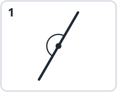
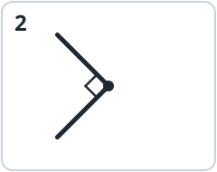
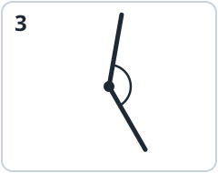
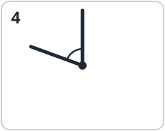

Today you learned two new angles: the  and the . Show a family member your turning angle and teach them the names!

## 1. Sort the angles

Write the number of each angle in the right box.

::: {layout-ncol=4}
{fig-alt="Angle 1" width="1.5in"}

{fig-alt="Angle 2" width="1.5in"}

{fig-alt="Angle 3" width="1.5in"}

{fig-alt="Angle 4" width="1.5in"}
:::

::: {layout-ncol=4}
**Acute:** ________

**Right:** ________

**Obtuse:** ________

**Straight:** ________
:::

## 2. True or false?

Write **T** (true) or **F** (false).

**a.** ______ A straight angle is just a line. It is not an angle.

**b.** ______ Longer sides make an angle bigger.

**c.** ______ An obtuse angle is smaller than a straight angle.

**d.** ______ 1 full angle = 4 right angles.

**e.** ______ At 6:00, the clock hands make a straight angle.

## 3. How far does it turn?

The  starts at 12. What angle has it turned? Write **right angle**, **straight angle** or **full angle**.

**a.** after 15 minutes: _______________________

**b.** after 30 minutes: _______________________

**c.** after 60 minutes: _______________________



## 4. Angle hunt at home

Find **two** straight angles and **one** full angle at home. Draw or write what you found.

::: {layout-ncol=3}





:::

## 5. Challenge

::: {.keep}
**a.** How many right angles make 3 straight angles? ______

**b.** Turn one side of a right angle until it makes a straight angle. How many more right angles did it turn? ______

**c.** Tom says: "At 12:00 the clock hands make no angle." Lily says: "From 12:00 to 1:00, the minute hand turns a full angle." Who is right? Explain.


:::

## 6. Get ready for the next lesson

Next time, we measure angles with a . We measure in  (°). A right angle is **90°**. Can you guess?

**a.** A straight angle = 2 right angles = ______ °

**b.** A full angle = 4 right angles = ______ °

::: {.content-visible when-profile="teacher"}


::: {.callout-note title="Answer key"}
**1.** Acute: 4 (70°). Right: 2. Obtuse: 3 (140°). Straight: 1.

**2.** a F (it has a vertex and two sides); b F (the opening decides the size, not the length of the sides); c T; d T; e T.

**3.** a right angle; b straight angle; c full angle.

**4.** Any sensible answers, for example: a book or a laptop opened flat, a ruler's edge with a dot in the middle, arms stretched out to the sides (straight); a wheel, a fan or a door handle turning once, spinning around once (full).

**5.** a 6. b 1. c Both are right: at 12:00 the hands are together (no opening), and in one hour the minute hand turns all the way around, a full angle.

**6.** a 180°. b 360°.
:::
:::
