Use the slides *Turning and Angles* and your turning angle to help you.



## 1. Name the angle

Write the name of each angle: , , ,  or .

::: {layout-ncol=3}
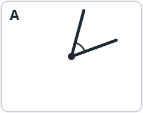{fig-alt="Angle A" width="1.45in"}

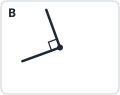{fig-alt="Angle B" width="1.45in"}

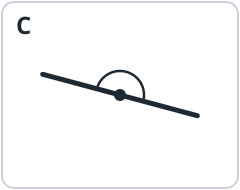{fig-alt="Angle C" width="1.45in"}
:::

::: {layout-ncol=3}
**A.** ______________________

**B.** ______________________

**C.** ______________________
:::

::: {layout-ncol=3}
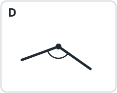{fig-alt="Angle D" width="1.45in"}

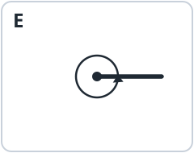{fig-alt="Angle E" width="1.45in"}

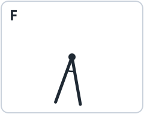{fig-alt="Angle F" width="1.45in"}
:::

::: {layout-ncol=3}
**D.** ______________________

**E.** ______________________

**F.** ______________________
:::

## 2. Fill in the blanks

**a.** 1 straight angle = ______ right angles.

**b.** 1 full angle = ______ straight angles = ______ right angles.

**c.** Write **<**, **>** or **=**.

acute angle ◯ right angle  ·  obtuse angle ◯ straight angle  ·  2 right angles ◯ 1 straight angle

## 3. Angles on a clock

What angle do the  and the  make? Write **acute**, **right**, **obtuse** or **straight**.

::: {layout-ncol=6}
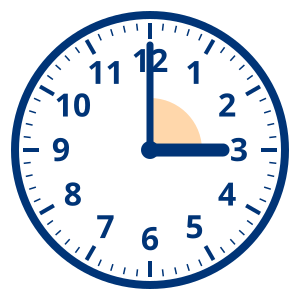{fig-alt="A clock showing 3:00" width="1in"}

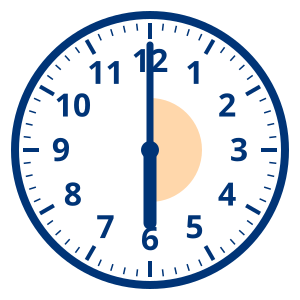{fig-alt="A clock showing 6:00" width="1in"}

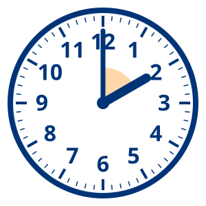{fig-alt="A clock showing 2:00" width="1in"}

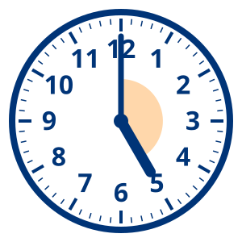{fig-alt="A clock showing 5:00" width="1in"}

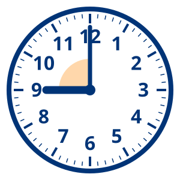{fig-alt="A clock showing 9:00" width="1in"}

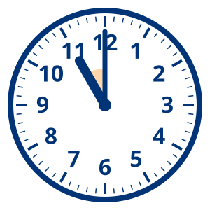{fig-alt="A clock showing 11:00" width="1in"}
:::

::: {layout-ncol=6}
**3:00** ________

**6:00** ________

**2:00** ________

**5:00** ________

**9:00** ________

**11:00** _______
:::

## 4. Draw it

Draw each angle. Mark the  with a dot.

::: {layout-ncol=2}



:::

::: {layout-ncol=2}



:::

## 5. In daily life

::: {.keep}
**a.** I see a straight angle when …



**b.** I see a full angle when …


:::

::: {.content-visible when-profile="teacher"}


::: {.callout-note title="Answer key"}
**1.** A acute (55°); B right (90°, see the square mark); C straight (180°: the sides make one line, and the vertex is in the middle); D obtuse (125°); E full (360°: one side has turned all the way around); F acute (30°). *Look for:* students who call C "a line" or E "no angle": ask them to find the vertex and the two sides.

**2.** a. 2. b. 2; 4. c. acute angle **<** right angle; obtuse angle **<** straight angle; 2 right angles **=** 1 straight angle.

**3.** 3:00 right; 6:00 straight; 2:00 acute; 5:00 obtuse; 9:00 right; 11:00 acute.

**4.** Each angle has a dot for the vertex and two straight sides. The straight angle needs a dot *on* the line, with a side going each way (and ideally a half-circle arc).

**5.** Any sensible answers. Straight angle: a book or a fan opened flat, the clock hands at 6:00, arms stretched out to the sides. Full angle: the minute hand in one hour, a wheel or a fan blade turning once, spinning around once.
:::
:::
