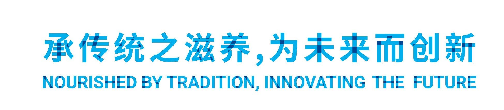
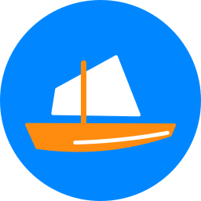
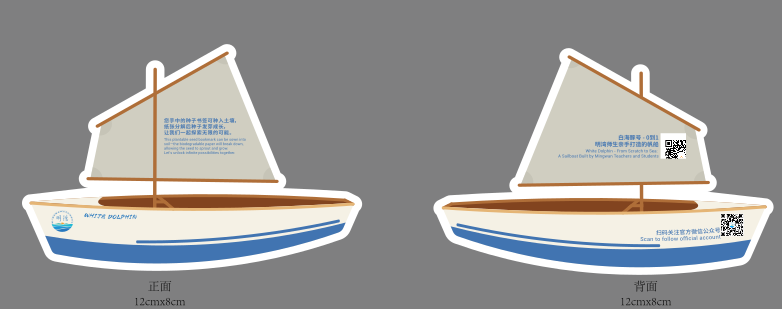
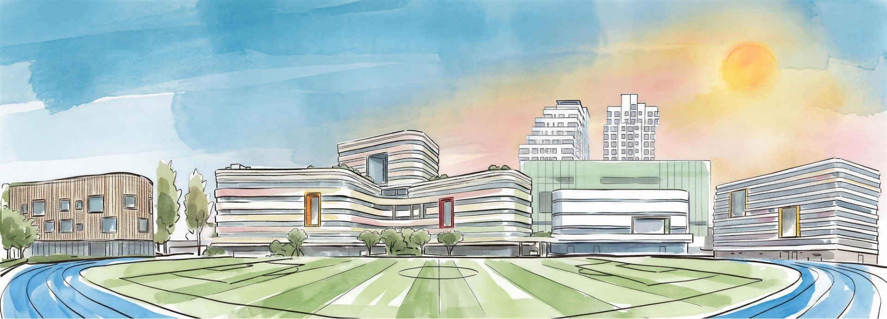
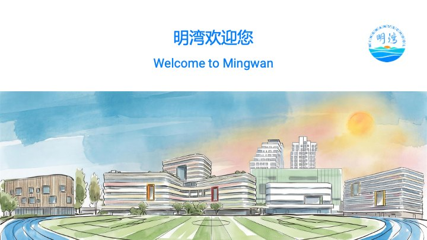
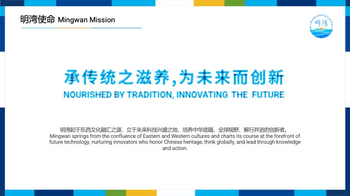
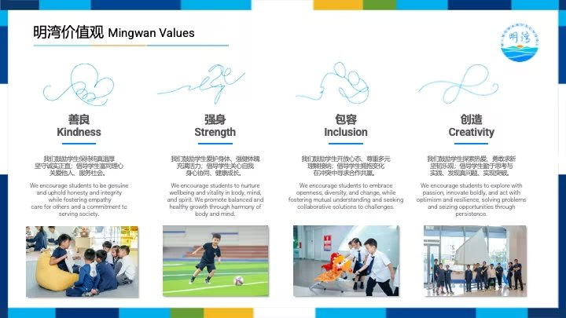
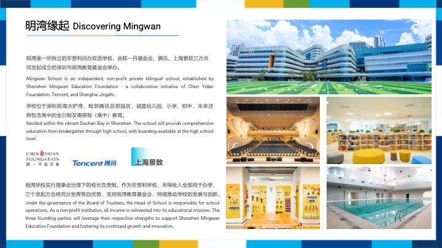
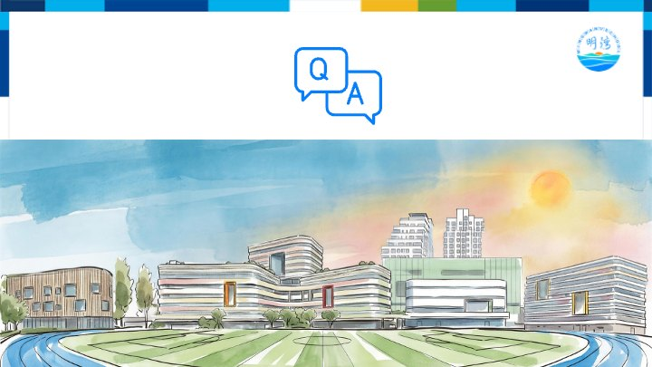

## [Mingwan Mission | 明湾使命]{.bi} {#mission}

{.tagline fig-alt="承传统之滋养，为未来而创新 · Nourished by tradition, innovating the future"}

::: {.mission style="font-size: 0.6em; text-align: center"}
[Mingwan springs from the confluence of Eastern and Western cultures and charts its course at the forefront of future technology, nurturing innovators who honor Chinese heritage, think globally, and lead through knowledge and action. | 明湾起于东西文化融汇之源，立于未来科技兴盛之地，培养中华底蕴、全球视野、知行并进的创新者。]{.bi}
:::

::: notes
The mission slide, in the official style. The tagline is marketing's picture (`images/tagline.jpg`); the mission text is from marketing's *Mingwan Mission* slide.
:::

## [Brand resources | 品牌资源]{.bi} {#resources}

::: {.resource-grid}
::: {.res .res-emblem}
{fig-alt="The Mingwan emblem"}

[**Emblem** · `logo-emblem.png`]{.fine}
:::

::: {.res}
{fig-alt="The sailboat icon: a white sail and an orange hull on a blue circle"}

[**Icon** · `icon-sailboat.svg`]{.fine}
:::

::: {.res}
{fig-alt="The sailboat icon in navy only"}

[**One colour** · `icon-sailboat-navy.svg`]{.fine}
:::

::: {.res .res-colours}
```{=html}
<div class="swatches">
  <span style="--c:#00aeef">#00aeef<br>cyan</span><span style="--c:#004694">#004694<br>blue</span><span style="--c:#003477">#003477<br>navy</span>
  <span style="--c:#0f3668">#0f3668<br>dark navy</span><span style="--c:#f2b726">#f2b726<br>yellow</span><span style="--c:#7c9f2b">#7c9f2b<br>green</span>
</div>
```

[**Band colours** · from marketing's slides]{.fine}
:::

::: {.res .res-wide}
{fig-alt="The White Dolphin boat illustration, front and back of the bookmark"}

[**White Dolphin boat** · `boat-illustration.svg` (the bookmark, front and back)]{.fine}
:::

::: {.res .res-wide}
{fig-alt="The tagline"}

[**Tagline** · `images/tagline.jpg`]{.fine}
:::

::: {.res .res-wide}
{fig-alt="A watercolour of the campus and its sports field"}

[**Campus watercolour** · `images/campus-watercolor.jpg`]{.fine}
:::

:::

::: notes
Everything the official style uses, in one place. The logo files are in `brand/logos/` (see `brand/README.md`); the tagline and the campus watercolour are in this folder's `images/`. The band colours are sampled from marketing's PowerPoint; they're drawn by `.scheme-official` in `brand/revealjs.scss`.
:::

## [Reference: marketing's slides | 参考：市场部的幻灯片]{.bi} {#reference}

::: {.ref-grid}
{fig-alt="Marketing's welcome slide"}

{fig-alt="Marketing's mission slide"}

{fig-alt="Marketing's values slide"}

{fig-alt="Marketing's Discovering Mingwan slide"}

{fig-alt="Marketing's Q and A slide"}
:::

::: notes
The PowerPoint slides from the marketing department that this style follows: the colour bands, the emblem top right, the title with its three-colour line, and the campus watercolour on the welcome and Q&A slides.
:::

## [Questions? | 有问题吗？]{.bi} {#qa .qa}

```{=html}
<svg class="qa-icon" viewBox="0 0 120 84" aria-hidden="true">
  <g fill="#fff" stroke="#1a7fe0" stroke-width="3.5" stroke-linejoin="round">
    <path d="M6 6h50a6 6 0 0 1 6 6v26a6 6 0 0 1-6 6H26l-12 10v-10H6a6 6 0 0 1-6-6V12a6 6 0 0 1 6-6z" transform="translate(2 0)"/>
    <path d="M58 30h50a6 6 0 0 1 6 6v26a6 6 0 0 1-6 6h-8v10L88 68H58a6 6 0 0 1-6-6V36a6 6 0 0 1 6-6z"/>
  </g>
  <g fill="#1a7fe0" font-family="Source Sans 3, Arial, sans-serif" font-weight="700" text-anchor="middle">
    <text x="33" y="33" font-size="24">Q</text><text x="83" y="57" font-size="24">A</text>
  </g>
</svg>
```

{.qa-campus .nostretch fig-alt="A watercolour of the campus and its sports field"}

::: notes
The closing slide, like marketing's Q&A slide: the bands at the top and sides, the Q&A icon as the title, and the campus watercolour across the bottom (`{.qa-campus}`).
:::

## [Credits | 来源]{.bi} {#credits .credits}

:::: columns
::: column
### Pictures

- **Campus watercolour, tagline and the reference slides:** Mingwan School marketing department, 2026. The school's own material.
- **Emblem, sailboat icon and White Dolphin boat:** Mingwan School (`brand/logos/`).
:::
::::
