## [Today we will… | 今天我们要…]{.bi} {#goals}

```{=html}
<style>
  /* The interactive angle page, in a frame filling the slide under its title */
  .reveal .angle-frame { display: block; width: 100%; height: 540px; border: 1px solid var(--ui-line, #d6dee8); border-radius: 12px; background: #fff; }
  .reveal .daily-life img.photo { height: 290px; width: 100%; object-fit: cover; }
  .reveal #review .vocab-gallery { --vg-min: 3.6em; }   /* six words in one row */
  .reveal .equation { font-size: 1.25em; font-weight: 700; text-align: center; margin: 0.4em 0; }
</style>
```

::: {.goal}
- [Turn an angle and watch it change. | 旋转一个角，观察它的变化。]{.bi}
- [Meet two new angles: the straight angle and the full angle. | 认识两种新的角：平角和周角。]{.bi}
- [Find straight angles and full angles in daily life. | 找一找生活中的平角和周角。]{.bi}
:::

::: notes
This lesson follows the Grade 4 lesson plan *旋转与角* (Turning and angles): Activity 1, turn an angle; Activity 2, practice (clock angles, drawing angles); Activity 3, share what we learned.

Students already know acute, right and obtuse angles, and they have seen turning (rotation). Today we start from turning.
:::

## [Angles we know | 我们认识的角]{.bi} {#review}



::: strip
[Think]{.pill}

[What makes an angle bigger: longer sides, or a wider opening? | 角的大小和什么有关：边的长短，还是两边张开的大小？]{.bi}
:::

::: notes
Quick review. Tap a picture for the word's full card. The answer to the question: the opening. Longer sides do **not** make an angle bigger. This matters later, when the sides of a straight angle look like "just a line".
:::

## [Activity 1: Make a turning angle | 活动一：做一个活动角]{.bi} {#activity-1}

:::: {.columns}
::: {.column width="58%"}
1. [Join two paper strips at one end with a split pin. | 用一个两脚钉把两张纸条的一端钉在一起。]{.bi}
2. [Hold one strip still. | 按住一张纸条不动。]{.bi}
3. [ the other strip slowly. | 慢慢旋转另一张纸条。]{.bi}
4. [Stop and name each angle you make. | 停下来，说出你摆出的每一个角。]{.bi}
:::
::: {.column width="42%"}
::: {.box .plain}
[With a partner · 和同桌一起]{.kicker}

[Show an acute angle, a right angle and an obtuse angle. Then keep turning. What happens? | 摆出锐角、直角和钝角，然后继续旋转。会发生什么？]{.bi}
:::
:::
::::

::: notes
**Materials:** two card strips and one split pin (两脚钉) per student, or two pencils held at one end. Students who finish early: keep turning until the moving strip comes back to the start.

Walk around and listen for the words acute, right, obtuse. Ask: *Which strip is the vertex? Which part stays still?* (The pin is the vertex.)
:::

## [Turn it and watch | 旋转，仔细看]{.bi} {#turn-it}

<iframe class="angle-frame" data-src="embeds/turning-angle.html" title="Turn an angle"></iframe>

::: notes
Press **▶ Turn**: one side turns all the way round, stopping at the right angle, the straight angle and the full angle. Or drag the orange dot. Ask students to call out the name before it shows.

Ask: *What changes? What stays the same?* (The opening changes; the vertex and the still side stay.)

The buttons on the right jump to each kind of angle. **° Degrees** and **◠ Protractor** are for the next lesson; **🕒 Clock** is for Activity 2. The page is `embeds/turning-angle.html` (no internet needed); add `?mode=clock` to its address to start on the clock.
:::

## [Straight angle | 平角]{.bi} {#straight-angle}

:::: {.columns}
::: {.column width="45%"}
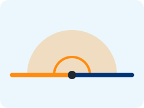{width="100%" fig-alt="A straight angle: the two sides make one straight line through the vertex, with a half circle shaded"}
:::
::: {.column width="55%"}
- [Turn one side until the two sides make a straight line. | 旋转一条边，直到两条边成一条直线。]{.bi}
- [This is a . | 这就是平角。]{.bi}
- [It still has a  and two sides. It is an angle, not just a line! | 它仍然有一个顶点和两条边。它是角，不只是一条直线！]{.bi}
:::
::::

::: {.equation}
[1 straight angle = 2 right angles | 1 平角 = 2 直角]{.bi}
:::

::: notes
The key idea: a straight angle *looks* like a line, but it is an angle: it has a vertex and two sides, and it was made by turning. Have students point to the vertex and the two sides on their strips.

Put two right angles (two book corners) side by side: they make a straight angle.
:::

## [Full angle | 周角]{.bi} {#full-angle}

:::: {.columns}
::: {.column width="45%"}
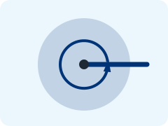{width="100%" fig-alt="A full angle: one side has turned all the way around, so the whole circle is shaded"}
:::
::: {.column width="55%"}
- [Keep turning, all the way around. | 继续旋转，转一整圈。]{.bi}
- [The side comes back to the start. | 这条边回到了起点。]{.bi}
- [This is a . | 这就是周角。]{.bi}
- [The two sides are together again, but the angle is the whole circle. | 两条边又重合了，但这个角是整个圆。]{.bi}
:::
::::

::: {.equation}
[1 full angle = 2 straight angles = 4 right angles | 1 周角 = 2 平角 = 4 直角]{.bi}
:::

::: notes
A full angle looks like "one line" because the two sides are on top of each other. The difference from "no angle": the side has turned all the way round. Show it on the interactive page, or with the strips.
:::

## [From small to big | 从小到大]{.bi} {#compare}

::: chain
::: {.box .plain style="text-align: center"}
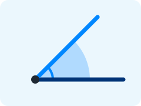{fig-alt="An acute angle" width="100%"}

### [acute | 锐角]{.bi}
:::

::: {.box .plain style="text-align: center"}
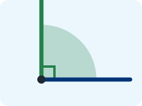{fig-alt="A right angle" width="100%"}

### [right | 直角]{.bi}
:::

::: {.box .plain style="text-align: center"}
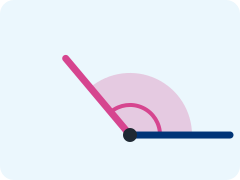{fig-alt="An obtuse angle" width="100%"}

### [obtuse | 钝角]{.bi}
:::

::: {.box .plain style="text-align: center"}
{fig-alt="A straight angle" width="100%"}

### [straight | 平角]{.bi}
:::

::: {.box .plain style="text-align: center"}
{fig-alt="A full angle" width="100%"}

### [full | 周角]{.bi}
:::
:::

::: strip
[Say it]{.pill}

[An acute angle is smaller than a right angle. An obtuse angle is bigger than a right angle and smaller than a straight angle. | 锐角比直角小。钝角比直角大，比平角小。]{.bi}
:::

::: notes
Read the sentences together, then cover them and ask students to say them from the pictures. Ask: *Is every angle bigger than an obtuse angle a straight angle?* (No: you can keep turning past a straight angle. The ones between straight and full have no special name in Grade 4.)
:::

## [Straight and full angles in daily life | 生活中的平角和周角]{.bi} {#daily-life .daily-life}

:::: {.columns}
::: {.column width="50%"}
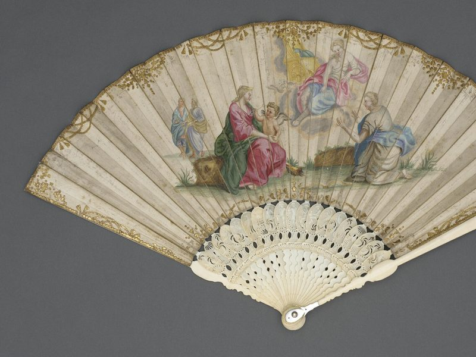{.photo fig-alt="An old folding fan, open wide"}

[Open a fan wider and wider: the angle grows. | 扇子越打开，角越大。]{.bi .photo-caption}
:::
::: {.column width="50%"}
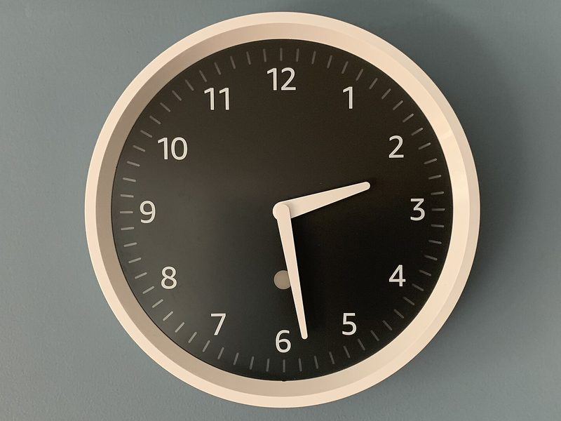{.photo fig-alt="A round wall clock with a black face"}

[In one hour, the minute hand turns all the way around. | 一小时里，分针转了一整圈。]{.bi .photo-caption}
:::
::::

::: strip
[Pair talk]{.pill}

[Where else do you see a straight angle or a full angle? | 你还在哪里见过平角或周角？]{.bi}
:::

::: notes
Activity 1, step 4 of the lesson plan: angles students have seen themselves. Ideas: a fan opened flat (straight angle); the minute hand in one hour, a turning wheel, a fan or windmill blade going around once (full angle); a book opened flat on the desk (straight angle); a door opened all the way to the wall.

Push for full sentences: *I see a straight angle when … / I see a full angle when …*
:::

## [Activity 2: Angles on a clock | 活动二：钟面上的角]{.bi} {#clock-angles}

<iframe class="angle-frame" data-src="embeds/turning-angle.html?mode=clock" title="Angles on a clock"></iframe>

::: notes
Textbook page 24: what angle do the  and the  make? The minute hand stays on 12; drag the hour hand, or tap a time. Ask students to show the angle with their arms first, then check.

3:00 and 9:00: right angles. 6:00: a straight angle. 1:00, 2:00, 10:00, 11:00: acute. 4:00, 5:00, 7:00, 8:00: obtuse. At 12:00 the hands are together.
:::

## Sort the clocks {#sort-clocks}

::: {.sort}
- **Acute**
  - 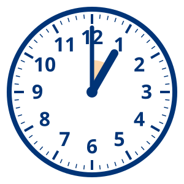 | At 1:00 the hands are close together: smaller than a right angle.
  - 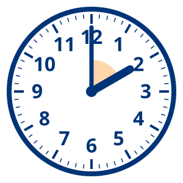 | At 2:00 the opening is smaller than a right angle.
  - 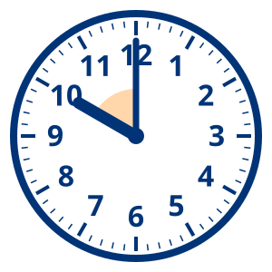 | At 10:00 the hands are two hours apart: smaller than a right angle.
- **Right**
  - 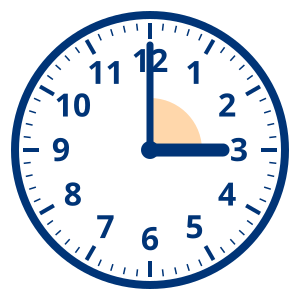 | At 3:00 the hands make a square corner.
  - 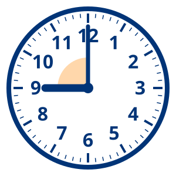 | At 9:00 the hands make a square corner too.
- **Obtuse**
  - 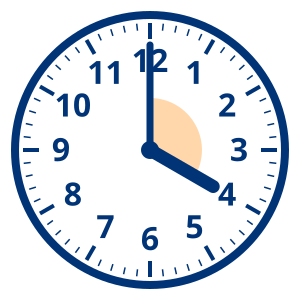 | At 4:00 the opening is bigger than a right angle, smaller than a straight angle.
  - 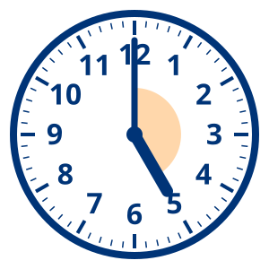 | At 5:00 the hands are almost in a line, but not quite.
  - 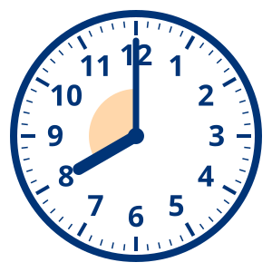 | At 8:00 the hands are four hours apart: bigger than a right angle.
- **Straight**
  - 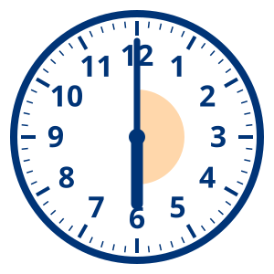 | At 6:00 the two hands make one straight line.
:::

::: notes
Review, so English only. Students come up and tap a clock, then its group. A wrong answer shows the reason.
:::

## [Draw it | 画一画]{.bi} {#draw}

:::: {.columns}
::: {.column width="55%"}
[Draw these angles. Mark the vertex. | 画出下面的角，标出顶点。]{.bi}

1. [an acute angle | 一个锐角]{.bi}
2. [a right angle | 一个直角]{.bi}
3. [an obtuse angle | 一个钝角]{.bi}
4. [a straight angle | 一个平角]{.bi}
:::
::: {.column width="45%"}
::: {.box .plain}
[On the board · 在黑板上]{.kicker}

[Press **B** for a blank chalkboard, **C** to draw on this slide. | 按 **B** 打开空白黑板，按 **C** 在这张幻灯片上画。]{.bi}
:::


:::
::::

::: notes
Activity 2, part 2 of the lesson plan. Students draw in their books or on the class worksheet (question 3). Then invite four students to draw one angle each on the board. Look for: a dot for the vertex; a straight angle drawn with a dot in the middle of the line (not just a line).
:::

## True or false? {#true-false}

::: {.poll type="truefalse" correct="false"}
A straight angle is just a straight line. It is not an angle.
:::

::: notes
False. A straight angle has a vertex and two sides, made by turning. Ask a student who voted "false" to explain.
:::

## Quick check {#quick-check}

::: {.poll type="choice" options="2 | 3 | 4" correct="C"}
How many right angles make one full angle?
:::

::: notes
4 right angles = 2 straight angles = 1 full angle. Show it with four book corners meeting at one point.
:::

## [Activity 3: Share | 活动三：说一说]{.bi} {#share}

::: {.box .plain}
[Sentence frames · 句型]{.kicker}

- [Today I learned … | 今天我学到了……]{.bi}
- [A straight angle is … | 平角是……]{.bi}
- [A full angle is … | 周角是……]{.bi}
- [I saw a straight angle / a full angle when … | 我在……的时候看到了平角／周角。]{.bi}
:::

::: notes
Activity 3 of the lesson plan: share what you learned and how you feel. Partners take turns with two frames each; then a few students share with the class.
:::

## [Next time: measuring angles | 下节课：角的度量]{.bi} {#next-time}

:::: {.columns}
::: {.column width="45%"}
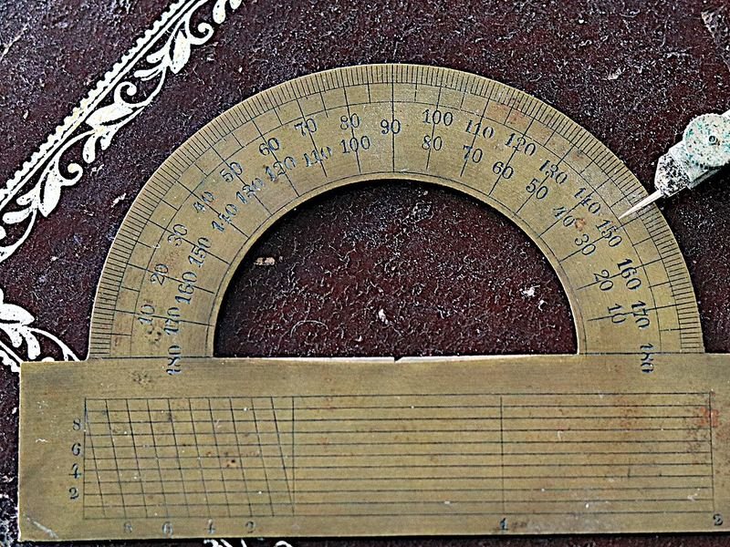{.photo fig-alt="A brass protractor, a half circle with numbers from 0 to 180"}
:::
::: {.column width="55%"}
- [We measure angles with a . | 我们用量角器量角。]{.bi}
- [The unit is the  (°). | 单位是度（°）。]{.bi}
- [A right angle is 90°. A straight angle is 180°. A full angle is 360°. | 直角是 90°，平角是 180°，周角是 360°。]{.bi}
:::
::::

::: notes
A preview of lesson 5 (*角的度量*): why we need a protractor, and how to use it. On the interactive page, turn on **° Degrees** and **◠ Protractor**: the inner scale starts at 0 on the still side.
:::

## Quick-fire review {#quick-fire}

::: {.trivia title="Angles quick-fire!" seconds="10"}
- An angle smaller than a right angle | An acute angle
- The two sides make one straight line. What angle is it? | A straight angle
- One side turns all the way around, back to the start | A full angle
- 1 straight angle = how many right angles? | 2
- 1 full angle = how many straight angles? | 2
- 1 full angle = how many right angles? | 4
- At 3:00, the clock hands make… | A right angle
- At 6:00, the clock hands make… | A straight angle
- At 5:00, the clock hands make… | An obtuse angle
- The point where the two sides of an angle meet | The vertex
:::

::: notes
**Quick-fire**: 10 seconds a question. Point to a student, who answers out loud; press **Show the answer**, then **✓ Right** or **✗ Wrong**. Review, so English only. Change `seconds="10"` to make it easier or harder.
:::

## Exit ticket {#exit-ticket}

::: {.poll type="smileys"}
How well can you name a straight angle and a full angle?
:::

## Poll results {.poll-summary-slide}

::: {.poll-summary}
:::

## [Credits | 来源]{.bi} {#credits .credits}

:::: columns
::: column
### Pictures

- **Folding fan:** France, about 1720, Los Angeles County Museum of Art. Public domain, via [Wikimedia Commons](https://commons.wikimedia.org/wiki/File:Folding_Fan_LACMA_M.76.8.2.jpg).
- **Wall clock:** photo by bfishadow, [CC BY 2.0](https://creativecommons.org/licenses/by/2.0), via [Wikimedia Commons](https://commons.wikimedia.org/wiki/File:Echo_Wall_Clock_(49383378912).jpg).
- **Brass protractor:** photo by Compo, [CC BY-SA 4.0](https://creativecommons.org/licenses/by-sa/4.0), via [Wikimedia Commons](https://commons.wikimedia.org/wiki/File:Brass_Protractor.jpg).
- **Original, made for this course:** the angle and clock drawings, the title background and the interactive angle page. Full list: `images/CREDITS.md`.
:::

::: column
### Sources

- **Lesson plan:** Grade 4 math, *旋转与角* (Turning and angles) and *角的度量* (Measuring angles), unit 线与角 (Lines and angles). The clock exercise is from the textbook, page 24.
- **Background:** [Angle](https://simple.wikipedia.org/wiki/Angle), Simple English Wikipedia, [CC BY-SA 4.0](https://creativecommons.org/licenses/by-sa/4.0/).
:::
::::
